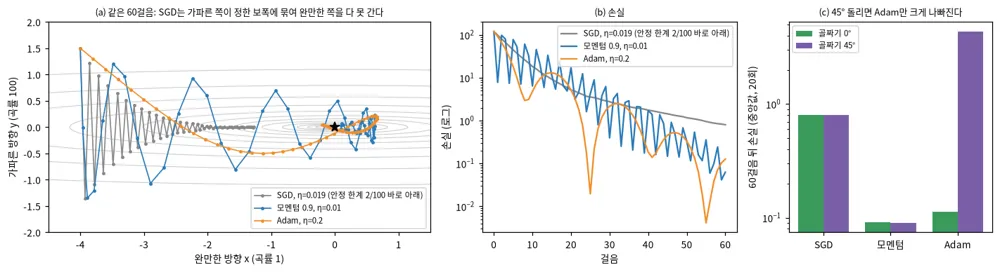
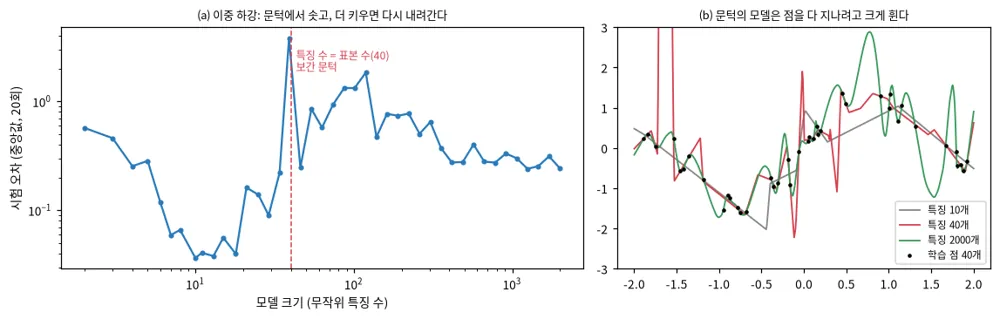
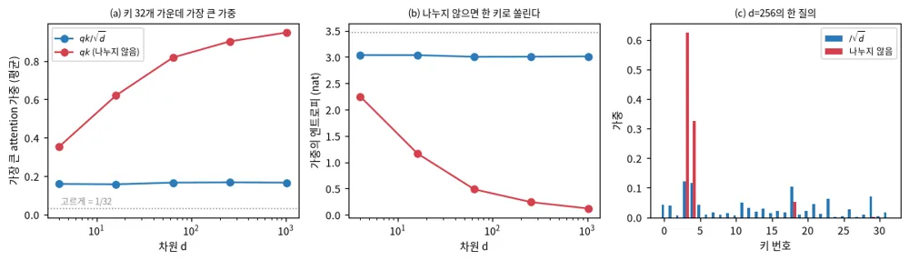
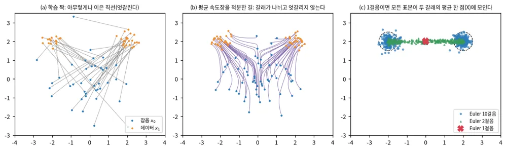

<!-- doc: 딥러닝 | 5 -->
# 딥러닝 (§L) — 기초에서 기반 모델까지, travplan의 망을 읽는 데 필요한 개념

**결론 먼저.** ==이 문서는 강화학습 문서(§R)가 전제로 두는 딥러닝 자체를 정리한다. 기초(손실·최적화·일반화), 구조(합성곱·transformer·상태공간 모델), 생성 모델(diffusion·flow matching), 자기지도와 규모, 멀티모달·로봇 기반 모델 순서로 간다.==
절마다 "travplan에서"를 붙여, 그 개념이 저장소의 어느 망에 들어 있는지 잇는다. travplan의 망은 넷이다. Planner D(flow matching, 파라미터 1,486,488개), Joint Planner(DiT식 transformer, 1,791,274개), TravNet(팽창 합성곱, 19,746개), 학습 Controller `TinyPolicy`(MLP, 1,675개)다.

**자료.** 뼈대는 교재 한 권이고, 교재가 나온 뒤의 주제는 강의 셋과 원 논문으로 채웠다.

| 자료 | 무엇 | 이 문서에서 쓰는 곳 |
|---|---|---|
| [Understanding Deep Learning](https://udlbook.github.io/udlbook/) (Simon J. D. Prince, MIT Press 2023) | 무료 PDF 교재 21장과 파이썬 노트북([GitHub](https://github.com/udlbook/udlbook)). 기초부터 diffusion까지 한 표기로 쓴다 | L.1–L.10의 순서와 표기 |
| [MIT 6.S184 Flow Matching and Diffusion Models](https://diffusion.csail.mit.edu/) | 생성 모델 강의. 강의 노트는 [arXiv:2506.02070](https://arxiv.org/abs/2506.02070)(Holderrieth·Erives 2025) | L.10–L.12 |
| [Stanford CS336 Language Modeling from Scratch](https://stanford-cs336.github.io/spring2025/) (2025 봄) | 토크나이저부터 transformer 학습, 규모의 법칙, 정렬까지 직접 구현하는 강의 | L.5–L.8, L.13, L.16–L.18 |
| [MIT 6.S191 Introduction to Deep Learning](https://introtodeeplearning.com/) | 매년 갱신하는 짧은 입문 강의와 실습 | 처음 보는 사람의 첫 주 |
| [Stanford CS231n](https://cs231n.stanford.edu/) | 시각 인식 강의. 합성곱, ViT, 자기지도 시각 표현 | L.4, L.14 |
| [Dive into Deep Learning](https://d2l.ai/) | 코드가 붙은 무료 교재 | 구현을 따라 할 때 |

**절과 교재 장.** 교재가 없는 절은 원 논문을 따라 썼다. 강화학습은 교재 19장 대신 §R에서 다룬다.

| 이 문서 | 주제 | 교재(UDL) 장 | travplan에서 |
|---|---|---|---|
| L.0 | 딥러닝이 바꾼 것 | 1 | 네 망의 자리 |
| L.1 | 신경망·손실·역전파 | 2–5, 7 | `TinyPolicy`, 모든 망 |
| L.2 | 최적화기 | 6 | Planner D 학습 |
| L.3 | 일반화·정규화·불확실성·실험 위생 | 8, 9, 20 | DAgger, σ 채널, 짝 비교 |
| L.4 | 합성곱·잔차·U-Net·점군 | 10, 11 | TravNet, Planner D 인코더 |
| L.5 | attention과 transformer | 12 | Joint Planner의 CDiT |
| L.6 | 위치 부호화와 효율 | 12 | 시간 임베딩 |
| L.7 | transformer 밖의 시퀀스 모델 | 교재 밖 | — |
| L.8 | 전문가 혼합(MoE) | 교재 밖 | — |
| L.9 | 잠재 변수 모델: VAE·VQ-VAE·GAN | 14, 15, 17 | 배경 0.14 |
| L.10 | diffusion | 18 | 배경 0.5 |
| L.11 | flow matching | 16, 교재 밖 | Planner D |
| L.12 | 적은 걸음 생성 | 교재 밖 | Planner D 10걸음 |
| L.13 | 자기회귀와 토큰 | 12 | 행동 토큰(FAST) |
| L.14 | 대조·마스크·자기 증류 | 교재 밖 | 인식 A.11(DINOv2) |
| L.15 | 예측 표현(JEPA) | 교재 밖 | 인식 A.6 |
| L.16 | 규모의 법칙과 추론 시간 계산 | 교재 밖 | 표본 수·Euler 걸음 |
| L.17 | 적응·압축: LoRA, 증류, 양자화 | 교재 밖 | Playground float16 |
| L.18 | 정렬 | 교재 밖 | §R.12 |
| L.19 | 시각-언어 모델 | 교재 밖 | Planner B.6 |
| L.20 | 시각-언어-행동 모델 | 교재 밖 | Planner B.6b |
| L.21 | world model | 교재 밖 | 인식 A.6, Controller E |
| L.22 | travplan의 네 망과 실습 | — | 전부 |

**보는 순서.** 처음이면 6.S191 첫 주 강의를 본 뒤 교재 1–9장을 읽는다(L.1–L.3). 그다음 교재 10–12장(L.4–L.6)을 읽고, Planner D를 읽으려면 6.S184 노트의 앞부분(flow와 diffusion의 정의, flow matching 학습)으로 바로 간다(L.10–L.11).
교재 13장(그래프 신경망)과 21장(윤리)은 이 문서에서 다루지 않는다.
travplan의 코드부터 읽고 싶으면 L.22의 표에서 망 하나를 골라 거꾸로 따라간다.

**표기.** 입력 $x$, 출력 $y$, 파라미터 $\theta$, 망 $f_\theta$, 손실 $\mathcal{L}(\theta)$, 학습률 $\eta$를 쓴다.
생성 모델에서는 잡음 $x_0 \sim \mathcal{N}(0, I)$, 데이터 $x_1$, 시간 $t \in [0, 1]$로 쓴다. 배경 문서 0.6과 같은 방향이다(diffusion 논문의 다수는 시간 방향이 반대다).

**처음 읽는 사람의 순서.** L.0, L.1, L.2, L.5, L.11, L.22 순서로 읽으면 Planner D가 무엇을 배우고 왜 그렇게 생겼는지 따라갈 수 있다.

### L.0 딥러닝이 바꾼 것: 특징을 사람이 아니라 자료가 정한다

**한 줄로.** ==딥러닝은 특징을 손으로 설계하던 자리를, 손실을 줄이도록 자료로 배우는 여러 층의 함수로 바꿨다.==

**흐름.**

**1. 표현 학습.** 고전 기계학습은 사람이 특징(경사, 단차, 거칠기)을 만들고 그 위에 작은 모델을 얹었다. 딥러닝은 원자료(높이 지도, 영상, 점군)에서 특징까지 함께 배운다.
층마다 앞 층의 출력을 조금씩 다시 쓰고, 끝의 표현은 과제에 맞게 정해진다.

**2. 세 재료.** 2012년 이후의 성공은 세 가지가 함께 커진 결과다. 큰 자료, GPU 병렬 계산, 그리고 역전파로 학습되는 미분 가능한 구조다.
Sutton의 "쓴 교훈(The Bitter Lesson)"은 계산과 함께 커지는 일반 방법이 결국 사람의 지식을 넣은 방법을 이긴다고 정리한다(§R.0에서도 다룬다).

**3. 2020년대의 이동.** 과제마다 망을 따로 학습하던 방식에서, 큰 자료로 한 번 사전학습한 기반 모델을 고쳐 쓰는 방식으로 옮겨 갔다(L.14–L.20).
출력도 "정답 하나"에서 "분포에서 뽑은 표본"으로 바뀌었다(L.9–L.13). 로봇에서는 이 둘이 VLA(L.20)와 생성형 궤적 Planner(Planner 문서 B.8)로 나타났다.

**travplan에서.** travplan은 두 쪽을 함께 둔다. cost는 손으로 만든 기하 추정기(`GeometricTraversability`)가 기준이고, 같은 특징을 자료로 배우는 TravNet이 그 자리를 바꿔 끼울 수 있다(`TraversabilityEstimator` 프로토콜).
Planner는 학습 쪽(Planner D)이 주인공이고, 손으로 만든 Dijkstra(`GuidancePlanner`)가 기준선과 폴백이다. 그래서 이 문서의 개념은 늘 "손으로 만든 기준선을 넘는가"로 잰다.

<!-- tab: 기초 -->

### L.1 신경망·손실·역전파: 미분 가능한 함수를 쌓고 기울기로 고친다 (교재 2–5, 7장)

**한 줄로.** ==신경망은 선형 변환과 비선형 함수를 번갈아 쌓은 함수이고, 손실의 기울기를 역전파로 한 번에 구해 파라미터를 고친다.==

**흐름.**

**1. 층.** 한 층은 $h = \phi(Wx + b)$다. $\phi$는 ReLU($\max(0, z)$), GELU, tanh 같은 비선형 함수다. 비선형이 없으면 층을 아무리 쌓아도 선형 함수 하나와 같다.
얕은 망도 폭을 넓히면 어떤 연속 함수든 근사할 수 있다(보편 근사). 깊게 쌓는 이유는 같은 파라미터 수로 선형 조각(ReLU가 만드는 영역)을 층 수에 대해 지수적으로 많이 만들 수 있기 때문이다(교재 4장).

**2. 손실은 확률 모형에서 나온다.** 교재 5장의 요지는 손실을 고르는 일이 출력 분포를 고르는 일이라는 것이다.
출력을 평균으로 보는 정규분포면 음의 로그 우도가 제곱 오차가 되고, 베르누이면 이진 교차 엔트로피가 된다. 분산까지 출력하면 이분산(heteroscedastic) 손실이 된다.

$$\mathcal{L}(\theta) = -\sum_i \log p(y_i \mid f_\theta(x_i)), \qquad \mathcal{N}:\ \tfrac{1}{2}\sigma^{-2}(y - \mu)^2 + \tfrac{1}{2}\log \sigma^2$$

**3. 역전파.** 연쇄 법칙을 출력에서 입력 쪽으로 한 번 훑으면 모든 파라미터의 기울기가 나온다. 계산은 순전파 한 번과 같은 차수다. 대신 순전파의 중간 활성을 모두 저장해야 하므로, 학습의 메모리는 대개 파라미터보다 활성이 정한다.
PyTorch 같은 자동 미분은 순전파의 계산 그래프를 기록했다가 거꾸로 돈다.

**4. 초기화.** 층을 지날 때 활성의 분산이 커지거나 줄면 기울기가 폭발하거나 사라진다. He 초기화는 ReLU에서 분산을 유지하도록 가중의 분산을 $2/n_{in}$으로 둔다(교재 7장).

자세히: 이분산 손실이 TravNet에서 하는 일

TravNet은 칸마다 cost 로짓과 로그 분산 두 값을 낸다. 손실은 위 정규분포 음의 로그 우도를 시그모이드 cost에 건 꼴이다(`travplan/representation/traversability.py`의 `heteroscedastic_loss`).
라벨이 시끄러운 칸에서는 분산을 키우면 첫 항이 작아지고, 둘째 항 $\tfrac{1}{2}\log\sigma^2$가 분산을 무한정 키우지 못하게 막는다. 그래서 망이 "여기는 라벨을 믿기 어렵다"를 스스로 배운다.
이 분산이 TravMap의 σ 채널로 들어간다. 자세한 유도와 evidential 학습은 배경 문서 0.8이다.

**travplan에서.** 학습 Controller `TinyPolicy`는 이 절의 가장 작은 예다. 관측 50개 → tanh 은닉층 24·16 → tanh 머리 3개(차체 twist)이고 파라미터는 1,675개다(TP-0128).
기울기가 아니라 진화 전략(ES)으로 학습했다. 망이 작고 보상이 미분되지 않는 시뮬레이터에서 나오기 때문이다(§R.3).

### L.2 최적화기: 같은 기울기로 어디까지 가나 (교재 6장)

**한 줄로.** ==손실 지형은 방향마다 곡률이 다르다. SGD는 가장 가파른 방향이 허락하는 보폭에 묶인다. 모멘텀은 완만한 방향의 걸음을 쌓아 늘리고, Adam은 성분마다 걸음의 크기를 다시 맞춘다.==

*그림 — 곡률이 1과 100인 2차 손실에서 잡음 섞인 기울기로 60걸음. (a, b) SGD는 안정 한계(η < 2/100) 바로 아래 학습률에서도 완만한 쪽을 다 가지 못한다. (c) 같은 골짜기를 45° 돌리면 SGD(0.80 → 0.81)와 모멘텀(0.092 → 0.091)은 그대로이고 Adam만 0.11 → 4.3으로 나빠진다(20회 중앙값). 출처: scripts/make_dl_figures.py*

**흐름.**

**1. SGD.** 미니배치로 기울기를 어림해 $\theta \leftarrow \theta - \eta \nabla \mathcal{L}$로 간다. 곡률 $\lambda$인 방향은 $\eta < 2/\lambda$여야 발산하지 않는다.
그래서 가장 가파른 방향이 학습률을 정하고, 완만한 방향은 아주 느리게 줄어든다. 그림 (a)의 회색 선이 이것이다.

**2. 모멘텀.** 지난 기울기를 지수 평균한 속도 $m$으로 간다. 진동하는 방향은 서로 지워지고, 한결같은 방향은 쌓인다.
2차 손실에서 계수 $\beta$의 모멘텀은 안정 한계를 $\eta < 2(1+\beta)/\lambda$로 넓히는 데 그치지만, 완만한 방향의 실효 걸음은 $\eta/(1-\beta)$로 키운다. $\beta = 0.9$면 10배다.

**3. Adam과 AdamW.** Adam([arXiv:1412.6980](https://arxiv.org/abs/1412.6980))은 성분마다 기울기 제곱의 지수 평균으로 나눈다. 성분마다 다른 학습률을 쓰는 셈이다(대각 전처리).
==이 보정은 좌표축 방향으로만 한다.== 그림 (a)의 골짜기는 축에 나란해 Adam에 유리하다. 같은 골짜기를 45° 돌리면 두 성분이 비슷한 크기의 기울기를 받아 보정이 쓸모없어지고, 그림 (c)에서 Adam만 크게 나빠진다.
SGD와 모멘텀은 회전에 따라 바뀌지 않는다. 실제 망의 손실 지형에서 Adam이 잘 되는 것은, 층과 성분마다 기울기 크기가 크게 다르기 때문으로 본다.

$$m_t = \beta_1 m_{t-1} + (1-\beta_1) g_t,\quad v_t = \beta_2 v_{t-1} + (1-\beta_2) g_t^2,\quad \theta_t = \theta_{t-1} - \eta\,\frac{\hat m_t}{\sqrt{\hat v_t} + \epsilon}$$

AdamW([arXiv:1711.05101](https://arxiv.org/abs/1711.05101))는 가중 감쇠를 이 나눗셈 밖으로 꺼냈다. Adam 안에 L2 항을 넣으면 감쇠도 성분마다 다르게 나뉘어 의도와 달라진다. 지금 transformer 학습의 기본값이 AdamW다.

**4. 학습률 일정.** 처음 몇백~몇천 걸음은 학습률을 0에서 올리고(warmup), 그 뒤 코사인이나 선형으로 내린다. 흔한 설명은 Adam의 $v$ 어림이 처음에는 표본이 적어 부정확하고, 초기 망의 기울기가 커서 큰 걸음이 학습을 망가뜨린다는 것이다.

**5. 최근: 행렬 단위 최적화.** Muon은 가중 행렬의 모멘텀을 Newton–Schulz 반복으로 직교화한 방향으로 간다. 행렬의 특이값을 고르게 해, 몇 방향만 크게 움직이는 일을 막는다.
Moonshot AI는 가중 감쇠와 갱신 크기 조정을 더해 큰 언어 모델 학습에 쓸 수 있음을 보였다([Muon is Scalable for LLM Training, arXiv:2502.16982](https://arxiv.org/abs/2502.16982)).
Muon은 은닉층의 2차원 가중 행렬에만 쓰고, 임베딩·출력층·편향은 AdamW로 둔다.

**travplan에서.** Planner D와 TravNet은 Adam 계열로 학습한다. 그림의 교훈은 학습률을 손실의 가장 가파른 방향이 정한다는 것이다.
Planner D 입력의 채널을 물리 단위로 나눠 $O(1)$로 맞추는 것(`obs.py`의 `_OBS_SCALE`)도 같은 이유다. 채널마다 크기가 다르면 곡률도 달라진다.

### L.3 일반화·정규화·불확실성: 외우는데도 왜 새 자료에서 맞나 (교재 8, 9, 20장)

**한 줄로.** ==큰 망은 학습 자료를 다 외울 수 있는데도(무작위 라벨까지 외운다, [Zhang 외, arXiv:1611.03530](https://arxiv.org/abs/1611.03530)) 새 자료에서 잘 맞는다. 고전적 편향–분산 그림은 보간 문턱까지만 맞고, 그 너머에서는 오차가 다시 내려간다(이중 하강).==

*그림 — 무작위 ReLU 특징과 최소 노름 최소제곱으로 학습 점 40개를 맞췄다. 특징 수가 표본 수와 같을 때 시험 오차가 솟고, 더 키우면 다시 내려간다. 출처: scripts/make_dl_figures.py*

**흐름.**

**1. 이중 하강.** 모델을 키우면 시험 오차가 내려갔다가, 학습 자료를 겨우 다 맞추는 문턱에서 솟고, 그 너머에서 다시 내려간다([Deep Double Descent, arXiv:1912.02292](https://arxiv.org/abs/1912.02292)).
문턱에서는 특징 행렬이 정사각에 가까워 가장 작은 특이값이 0 근처로 내려간다. 그래서 점을 다 지나는 해의 노름이 커지고 크게 휜다(그림 b의 빨강).
더 큰 모델은 점을 지나는 해가 많고, 최적화가 그 가운데 노름이 작은 해를 고른다. 선형 최소제곱에서는 0에서 시작한 경사 하강이 정확히 최소 노름 해로 간다(암묵적 정규화). 깊은 망에서 이 그림이 얼마나 그대로 맞는지는 아직 연구 중이다.
봉우리는 라벨 잡음이 있을 때 두드러진다. 그림의 학습 점에도 표준편차 0.3의 잡음을 넣었다.

**2. 명시적 정규화.** 가중 감쇠, dropout, 자료 증강, 조기 종료가 있다. 자료 증강은 "이 변환에는 답이 바뀌지 않는다"는 지식을 넣는 가장 값싼 길이다.

**3. 정규화 층.** BatchNorm([arXiv:1502.03167](https://arxiv.org/abs/1502.03167))은 배치 안에서, LayerNorm([arXiv:1607.06450](https://arxiv.org/abs/1607.06450))은 표본 하나의 특징 안에서 평균과 분산을 맞춘다.
transformer는 배치 크기와 무관한 LayerNorm(또는 평균을 빼지 않는 RMSNorm)을 쓴다. 정규화가 왜 학습을 돕는지는 여러 설명이 있고, 널리 받아들여지는 것은 손실 지형을 고르게 해 큰 학습률을 쓰게 한다는 것이다.

**4. 분포 이동.** 일반화 이론은 학습과 시험이 같은 분포라고 둔다. 로봇에서는 이 가정이 먼저 깨진다. 정책이 바뀌면 만나는 상태가 바뀌기 때문이다(§R.2의 공변량 이동).

**5. 불확실성.** 망이 "모른다"를 내게 하는 방법은 둘로 나뉜다. 자료 자체의 잡음(우연 불확실성)은 이분산 출력(L.1)이 잡는다.
자료가 없던 곳의 무지(인식 불확실성)는 출력 하나로는 잡히지 않는다. 초기값만 다른 망 몇 개를 학습해 의견 차이를 보는 앙상블([Deep Ensembles, arXiv:1612.01474](https://arxiv.org/abs/1612.01474))이 간단하고 강한 기준선이다.

**6. 실험 위생.** 학습·검증·시험을 나누고, 시험 자료로 설정을 고르지 않는다. 난수 seed를 바꿔 같은 설정을 여러 번 돌려 잡음의 크기부터 잰다.
디버깅은 작은 배치 하나를 완전히 외우게 해 보는 것에서 시작한다. 그것도 못 하면 자료가 아니라 코드가 틀렸다.

**travplan에서.** Planner D의 실패는 대개 넷째 항목이다. 시연은 참값 지도로 만들었고, 배포 때는 L1 belief 지도를 본다(Planner B.16.7의 1번, TP-0055).
DAgger(TP-0073)가 시연 분포를 배포 분포 쪽으로 옮기는 장치다. 모델을 키우는 것보다 이 이동을 줄이는 쪽이 먼저다.
TravMap의 σ 채널은 지금 우연 불확실성(TravNet 분산)과 미관측 칸뿐이다. 학습 분포 밖의 지형을 알리려면 5번의 인식 불확실성이 필요하다.
6번은 travplan의 판정 규칙과 같다. 같은 설정 재실행으로 잡음 바닥을 먼저 재고, 그보다 큰 짝 차이만 근거로 쓴다(CLAUDE.md 2층 게이트).

<!-- tab: 구조 -->

### L.4 합성곱·잔차·U-Net·점군: 구조에 공간의 성질을 넣는다 (교재 10, 11장)

**한 줄로.** ==합성곱은 "같은 무늬는 어디에 있어도 같다"는 가정을 구조에 넣어 파라미터를 아끼고, 잔차 연결은 층을 깊게 쌓아도 기울기가 흐르게 한다.==

**흐름.**

**1. 합성곱.** 작은 커널을 지도 전체에 같은 가중으로 민다. 이동 등변성(입력을 밀면 출력도 민다)이 생기고, 파라미터 수가 지도 크기와 무관해진다.
stride로 해상도를 줄이면 한 칸이 보는 범위(수용장)가 넓어진다. 팽창(dilated) 합성곱은 해상도를 줄이지 않고 수용장을 넓힌다.

**2. 잔차 연결.** ResNet([arXiv:1512.03385](https://arxiv.org/abs/1512.03385))은 층이 $h + F(h)$를 내게 했다. 층이 할 일이 "고칠 만큼만 더하기"가 되고, 기울기가 더하기 경로로 곧장 흐른다.
지금의 transformer도 모든 블록이 잔차 블록이다.

**3. U-Net.** U-Net([arXiv:1505.04597](https://arxiv.org/abs/1505.04597))은 해상도를 줄였다 늘리면서 같은 해상도끼리 건너뛰기 연결을 둔다. 칸마다 출력을 내는 분할과, 이미지 diffusion의 잡음 예측망이 이 모양을 썼다.

**4. 점군.** PointNet([arXiv:1612.00593](https://arxiv.org/abs/1612.00593))은 점마다 같은 MLP를 걸고 최댓값으로 모은다. 점의 순서와 무관한 함수가 된다. LiDAR 점을 격자로 바꾸지 않고 바로 받는 망의 출발점이다.

자세히: TravNet의 수용장 계산

TravNet은 3×3 합성곱 세 층을 팽창 1, 2, 4로 쌓고 1×1로 끝낸다. 수용장은 $1 + 2(1 + 2 + 4) = 15$칸이다.
운동학 시뮬의 지도 해상도가 0.05 m이므로 한 칸의 cost는 둘레 0.75 m를 보고 정해진다. 해상도를 줄이지 않으니 출력이 입력과 같은 격자에 그대로 맞는다.
같은 수용장을 팽창 없이 얻으려면 3×3 층이 일곱 개 필요하다. 팽창은 Orin 예산 안에서 층 수를 줄이는 선택이다(코드 주석).

**travplan에서.** Planner D의 인코더는 로봇 중심 64×64 칸(0.1 m, 6.4 m 사방) 4채널 지도를 stride 2 합성곱 넷으로 4×4까지 줄인 뒤 256차원으로 편다(`flow_model.py`).
TravNet은 해상도를 지키는 팽창 합성곱이라 출력 전체가 이동 등변이다(위 토글).
Planner D는 마지막에 4×4 특징을 펴서 선형층에 넣으므로 이동 등변성을 일부러 버린다. 로봇 중심 지도에서는 "장애물이 로봇 앞 어디에 있나"가 답을 바꿔야 하기 때문이다. 대신 지도를 로봇 기준으로 돌려 잘라 회전을 맞춘다(`obs.py`의 `egocentric_crop`).

### L.5 attention과 transformer: 무엇을 볼지를 입력이 정한다 (교재 12장)

**한 줄로.** ==attention은 각 토큰이 다른 모든 토큰을 보고, 얼마나 볼지를 내용의 유사도로 정하는 가중 평균이다. transformer는 이것과 MLP를 잔차로 번갈아 쌓은 구조다.==

*그림 — 성분 분산이 1인 무작위 질의와 키 32개. 내적을 $\sqrt{d}$로 나누지 않으면 차원이 커질수록 가중이 한 키에 몰린다(엔트로피가 0으로 간다). 출처: scripts/make_dl_figures.py*

**흐름.**

**1. 식.** 토큰마다 질의 $q$, 키 $k$, 값 $v$를 선형으로 만든다. 출력은 값들의 가중 평균이고 가중은 질의와 키의 내적의 softmax다([Attention Is All You Need, arXiv:1706.03762](https://arxiv.org/abs/1706.03762)).

$$\mathrm{Attention}(Q, K, V) = \mathrm{softmax}\!\left(\frac{QK^\top}{\sqrt{d}}\right) V$$

**2. 왜 $\sqrt{d}$로 나누나.** 성분이 독립이고 분산이 1이면 내적의 분산은 $d$다. 나누지 않으면 차원이 클수록 softmax가 한 키에 쏠리고, 그 자리의 기울기가 거의 0이 된다(그림 a, b).

**3. 여러 머리.** 차원을 나눠 attention을 여러 벌 따로 돌리고 이어 붙인다. 머리마다 다른 관계(가까운 것, 같은 종류, 앞의 것)를 볼 수 있다.

**4. 블록.** 한 블록은 정규화 → attention → 더하기, 정규화 → MLP → 더하기다. attention이 토큰 사이를 섞고 MLP가 토큰 안을 다시 쓴다.
이것은 정규화를 잔차 가지 안에 두는 Pre-LN이다. 원 논문은 더한 뒤 정규화하는 Post-LN이었고, 깊어지면 warmup 없이 학습이 불안정해 지금은 Pre-LN이 기본이다.

**5. 마스크.** 인과 마스크는 앞 토큰만 보게 한다(다음 토큰 예측, L.13). 마스크를 바꾸면 같은 블록이 "시간 축은 인과, 행위자 축은 전부" 같은 구조가 된다.

**6. 조건 넣기.** DiT([Scalable Diffusion Models with Transformers, arXiv:2212.09748](https://arxiv.org/abs/2212.09748))는 diffusion 시간과 조건을 LayerNorm의 이동·배율로 넣는다(adaLN). U-Net 없이 transformer만으로 diffusion을 키울 수 있음을 보였다.

자세히: 비용과 ViT

attention은 토큰 수 $n$에 대해 $O(n^2)$ 계산과 메모리가 든다. 긴 시퀀스에서 이것이 병목이다(L.6, L.7).
ViT([arXiv:2010.11929](https://arxiv.org/abs/2010.11929))는 이미지를 16×16 패치로 잘라 토큰으로 썼다. 합성곱의 이동 등변성 가정이 없어 자료가 적으면 불리하고, 자료가 많으면 앞선다.
그래서 시각 기반 모델(L.14)은 대개 ViT이고, 작은 로봇 망은 여전히 합성곱을 많이 쓴다.

**travplan에서.** Joint Planner(TP-0049)의 CDiT가 이 절 그대로다(`travplan/planners/learned/cdit.py`). 토큰은 (행위자, 시각) 한 쌍이고, 로봇 1과 보행자 최대 8의 미래를 함께 생성한다(`joint_encoder.py`).
마스크는 시간 축으로 인과, 같은 시각의 행위자끼리는 전부 본다. flow 시간과 환경 조건은 adaLN으로 넣는다. 계획 시간 180 ms가 남은 문제다(TP-0052). TODO에 적힌 계산은 토큰 360개 × 표본 8개 × 4걸음이고, 비용의 출처가 위 토글의 $O(n^2)$와 생성 걸음 수(L.12)다.

### L.6 위치 부호화와 효율: 순서를 알려 주고, 같은 계산을 빨리 한다

**한 줄로.** ==attention은 순서를 모르므로 위치를 따로 넣어야 한다. 그리고 같은 계산이라도 메모리 왕복을 줄이면 눈에 띄게 빨라진다.==

**흐름.**

**1. 사인 부호화.** 위치나 시간을 여러 주파수의 사인·코사인으로 편다. 망이 작은 차이와 큰 차이를 함께 구분할 수 있다. diffusion과 flow의 시간 $t$도 같은 방식으로 넣는다.

**2. 회전 위치 부호화(RoPE).** RoFormer([arXiv:2104.09864](https://arxiv.org/abs/2104.09864))는 질의와 키를 위치만큼 회전시킨다. 내적이 두 위치의 차이에만 의존하게 되어 상대 위치가 자연스럽게 들어간다. LLaMA 계열 등 많은 공개 언어 모델이 쓴다.

**3. FlashAttention.** [arXiv:2205.14135](https://arxiv.org/abs/2205.14135)는 $n \times n$ 가중 행렬을 GPU 주 메모리에 쓰지 않고, 작은 조각으로 나눠 칩 위의 빠른 메모리(SRAM) 안에서 softmax까지 끝낸다. 결과는 같고(근사가 아니다), 메모리는 $O(n)$으로 준다. 계산량은 그대로 $O(n^2)$이다.

**4. KV 캐시.** 자기회귀 생성에서는 앞 토큰의 키와 값을 저장해 두고 새 토큰 하나의 질의만 계산한다. 생성 한 걸음의 비용이 $O(n)$이 된다.

**travplan에서.** Planner D와 Joint Planner의 flow 시간 임베딩이 1번이다(`flow_model.py`의 `_time_embedding`, `joint_encoder.py`의 `sinusoidal_embedding`). Joint Planner의 계획 시간을 줄이는 후보(TP-0052)에 3번과 토큰 요약이 들어간다.

### L.7 transformer 밖의 시퀀스 모델: 상태를 들고 간다

**한 줄로.** ==상태공간 모델과 새 순환망은 과거를 고정 크기 상태에 접어 들고 가므로, 시퀀스 길이에 선형인 비용으로 긴 이력을 본다.==

**흐름.**

**1. Mamba.** [arXiv:2312.00752](https://arxiv.org/abs/2312.00752)는 선형 상태공간 모델 $h_t = \bar A h_{t-1} + \bar B x_t$에서 이산화 간격 $\Delta$와 $B$, 출력 행렬 $C$가 입력에 따라 바뀌게 했다(선택적 SSM). $\bar A = \exp(\Delta A)$이므로 상태가 잊히는 속도도 입력이 정한다. 무엇을 기억하고 무엇을 잊을지 입력이 고른다.
학습은 병렬 스캔으로 하고, 추론은 순환처럼 한 걸음에 상수 비용이다.

**2. xLSTM과 TTT.** xLSTM([arXiv:2405.04517](https://arxiv.org/abs/2405.04517))은 LSTM의 게이트를 지수형으로 바꾸고 행렬 기억을 더했다.
TTT([arXiv:2407.04620](https://arxiv.org/abs/2407.04620))는 숨은 상태를 작은 모델로 두고, 시퀀스를 읽으며 그 모델을 경사 하강으로 학습한다.

**3. 섞어 쓰기.** 일부 큰 모델은 attention 층과 SSM 층을 섞는다(예: [Jamba, arXiv:2403.19887](https://arxiv.org/abs/2403.19887)). attention은 정확한 조회에, SSM은 긴 문맥 요약에 강하다.

**travplan에서.** 고유감각 이력을 보는 보행 정책들이 이 자리에 있다. Digit의 HT는 이력 16쌍을 transformer로 봤다(Planner B.16.6). travplan의 Planner D는 이력을 보지 않고 현재 twist만 본다.
plant 지연(TP-0150)을 망이 스스로 추정하게 하려면 이력이 필요하고, 그때 이 절의 선형 비용 모델이 Orin 예산의 후보가 된다.

### L.8 전문가 혼합(MoE): 파라미터는 늘리고 계산은 그대로

**한 줄로.** ==MoE는 MLP를 여러 전문가로 나누고 토큰마다 몇 개만 골라 쓴다. 전체 파라미터는 커지지만 토큰 하나가 쓰는 계산은 켠 전문가 수만큼이다.==

**흐름.**

**1. 게이트.** 작은 라우터가 토큰마다 전문가 점수를 내고 상위 $k$개만 켠다([Shazeer 외, arXiv:1701.06538](https://arxiv.org/abs/1701.06538)). Switch Transformer([arXiv:2101.03961](https://arxiv.org/abs/2101.03961))는 $k = 1$로 단순화했다.

**2. 부하 균형.** 라우터가 몇 전문가에만 몰리면 나머지는 배우지 못한다. 그래서 고르게 쓰도록 보조 손실을 더한다.

**3. 로봇에서.** 보행·조작 정책에서도 동작군마다 전문가를 두는 MoE가 쓰인다. 휴머노이드 범용 추종기 GMT와 저수준 제어기 PILOT이 그 예다(Planner B.16.6, B.16.8).

**travplan에서.** 지금 망들은 작아서 MoE가 필요 없다. 계산은 아껴도 모든 전문가를 메모리에 올려야 하므로, Orin 같은 탑재 장치에서는 메모리가 먼저 걸린다. 지형 종류(경사로, 포트홀, 보도)마다 다른 행동이 필요하다는 가설이 서면 Planner D 속도장 MLP의 후보가 된다.

<!-- tab: 생성 모델 -->

### L.9 잠재 변수 모델: VAE, VQ-VAE, GAN (교재 14, 15, 17장)

**한 줄로.** ==생성 모델은 정답 하나가 아니라 분포를 배운다. VAE는 잠재 공간과 우도의 하한을, GAN은 판별자와의 게임을, VQ-VAE는 이산 토큰을 쓴다.==

**흐름.**

**1. 왜 분포인가.** 장애물 앞에서 왼쪽으로 돌기와 오른쪽으로 돌기가 둘 다 옳으면, 제곱 오차로 배운 망은 두 답의 평균(가운데로 돌진)을 낸다. 분포를 배우면 둘 중 하나를 뽑는다.
이 "평균으로 뭉개짐"은 L.11 그림 (c)에서 직접 보인다.

**2. VAE.** [Auto-Encoding Variational Bayes, arXiv:1312.6114](https://arxiv.org/abs/1312.6114)는 인코더 $q(z \mid x)$와 디코더 $p(x \mid z)$를 함께 학습한다. 로그 우도 대신 하한(ELBO)을 올린다.

$$\log p(x) \ge \mathbb{E}_{q(z \mid x)}[\log p(x \mid z)] - \mathrm{KL}(q(z \mid x)\,\|\,p(z))$$

재매개변수화($z = \mu + \sigma \epsilon$)로 표본을 뽑는 과정을 미분한다. 이 하한은 §R.7의 변분 추론과 같은 식이다.

**3. GAN.** [arXiv:1406.2661](https://arxiv.org/abs/1406.2661)은 생성자가 판별자를 속이도록 학습한다. 표본이 선명하지만 학습이 불안정하고 모드 일부를 놓치기 쉽다. 이미지 생성의 주류는 diffusion으로 넘어갔다.
적대적 모방(GAIL, AMP)은 이 구조를 행동에 쓴 것이다(§R.17).

**4. VQ-VAE.** [Neural Discrete Representation Learning, arXiv:1711.00937](https://arxiv.org/abs/1711.00937)은 잠재를 코드북의 가장 가까운 벡터로 바꾼다. 연속 신호가 이산 토큰이 되어, 그 위에 언어 모델식 자기회귀를 얹을 수 있다(L.13). 자세한 식은 배경 문서 0.14다.

**travplan에서.** travplan의 생성 모델은 VAE나 GAN이 아니라 flow matching이다(L.11). VQ 토큰은 장면을 토큰으로 바꾸는 world model 연구를 읽을 때 필요하다(인식 A.6).

### L.10 diffusion: 잡음을 조금씩 걷어 내는 법을 배운다 (교재 18장)

**한 줄로.** ==diffusion은 데이터에 잡음을 단계적으로 더하는 과정을 정하고, 그 반대 방향(잡음 제거)을 망이 배우게 한다. 생성은 순수 잡음에서 시작해 수십 걸음 걷어 낸다.==

**흐름.**

**1. DDPM.** [arXiv:2006.11239](https://arxiv.org/abs/2006.11239)는 망이 더해진 잡음 $\epsilon$을 맞히게 했다. 손실은 단순한 제곱 오차이고, 그 뒤 모든 diffusion 학습의 기본이 됐다.

**2. 점수와 SDE.** [Score-Based Generative Modeling through SDEs, arXiv:2011.13456](https://arxiv.org/abs/2011.13456)은 잡음 더하기를 연속 시간 확률미분방정식으로 보고, 잡음 예측이 로그 밀도의 기울기(점수)와 같은 정보임을 보였다. 잡음 수준 $\sigma_t$에서 $\nabla_x \log p_t(x) = -\epsilon_\theta(x, t)/\sigma_t$다.
같은 주변 분포를 지나는 결정적 ODE(확률 흐름 ODE)도 있다. 그래서 확률적으로도 결정적으로도 뽑을 수 있다.

**3. DDIM.** [arXiv:2010.02502](https://arxiv.org/abs/2010.02502)는 학습은 그대로 두고 결정적 샘플러로 걸음을 크게 줄였다.

**4. guidance.** 분류기 없는 guidance([arXiv:2207.12598](https://arxiv.org/abs/2207.12598))는 조건 있는 예측과 없는 예측을 섞는다. $\hat\epsilon = (1 + w)\,\epsilon(x, c) - w\,\epsilon(x)$. $w$를 키우면 조건을 더 따르고 다양성은 준다.
비용의 기울기로 끌어당기는 guidance는 Planner 쪽 연구(B.8)가 장애물 회피에 쓴다.

**5. diffusion 정책.** [Diffusion Policy, arXiv:2303.04137](https://arxiv.org/abs/2303.04137)은 로봇 행동 묶음(action chunk)을 diffusion으로 생성했다. 여러 모드가 있는 시연에서 회귀보다 안정적이었다.

**travplan에서.** diffusion의 식과 guidance의 자세한 유도는 배경 문서 0.5에 있다. 여기서는 개념의 위치만 잡고, travplan이 실제로 쓰는 flow matching(L.11)으로 넘어간다.
Playground에는 Planner D와 같은 망을 DDPM 조상 샘플러로 돌리는 비교가 있다(TP-0137).

### L.11 flow matching: 잡음에서 데이터까지의 속도장을 회귀한다

**한 줄로.** ==flow matching은 잡음 표본과 데이터 표본을 직선으로 잇고, 그 직선의 속도를 망이 회귀하게 한다. 학습은 제곱 오차 하나이고, 생성은 배운 속도장을 몇 걸음 적분하는 것이다.==

*그림 — 2차원 장난감(목표 분포는 왼쪽·오른쪽 두 덩어리). (a) 학습 짝은 아무렇게나 이어 엇갈린다. (b) 망이 배우는 평균 속도장을 적분한 길은 엇갈리지 않고 갈래가 나뉜다. (c) Euler 1걸음이면 모든 표본이 두 갈래의 평균 한 점에 모인다. 속도장은 닫힌 꼴로 구했다. 출처: scripts/make_dl_figures.py*

**흐름.**

**1. 학습.** 잡음 $x_0 \sim \mathcal{N}(0, I)$와 데이터 $x_1$을 뽑고, 시간 $t$를 뽑아 $x_t = (1 - t)x_0 + t x_1$을 만든다. 망 $v_\theta(x_t, t, c)$가 $x_1 - x_0$를 맞히게 한다.

$$\mathcal{L}(\theta) = \mathbb{E}_{t, x_0, x_1}\big\|\,v_\theta(x_t, t, c) - (x_1 - x_0)\,\big\|^2$$

이 손실의 최소해는 $v^*(x, t) = \mathbb{E}[x_1 - x_0 \mid x_t = x]$, 곧 그 점을 지나는 모든 짝의 평균 속도다([Flow Matching, arXiv:2210.02747](https://arxiv.org/abs/2210.02747); [Rectified Flow, arXiv:2209.03003](https://arxiv.org/abs/2209.03003)).
짝 하나의 속도를 표적으로 쓰는 이 손실(조건부 flow matching)은 알 수 없는 주변 속도장 $v^*$를 표적으로 쓰는 손실과 기울기가 같다. 그래서 $v^*$를 몰라도 학습할 수 있다. Lipman 외의 핵심 정리다.

**2. 왜 엇갈리지 않나.** 학습 짝(그림 a)은 서로 엇갈리지만, 한 점에서는 평균 속도 하나만 있으므로 적분한 길(그림 b)은 엇갈리지 않는다. 속도장이 매끈하면(립시츠) ODE의 해가 하나로 정해지므로 결정적으로 뽑을 수 있다.

**3. 생성.** $x_0$를 뽑아 $x \leftarrow x + v_\theta(x, t)\,\Delta t$를 $t = 0$에서 1까지 반복한다. 걸음이 적으면 빠르지만 오차가 생긴다.
그림 (c)의 1걸음은 $t = 0$의 평균 속도로 한 번에 가므로 모든 표본이 두 덩어리의 평균에 모인다. 회귀로 배운 망의 "평균으로 뭉개짐"과 같다. 이것은 속도장이 정확할 때의 이야기다. 학습된 Planner D에서는 1걸음 결과가 조건부 평균과 맞는 경우가 83%였다(TP-0137, Planner B.15.1).

**4. diffusion과의 관계.** 가우시안 경로에서는 속도장, 잡음 예측, 점수가 서로 선형 변환이다. 두 방법은 같은 것을 다른 좌표로 쓴 것이다(배경 문서 0.6b, [Flow Matching Guide and Code, arXiv:2412.06264](https://arxiv.org/abs/2412.06264)).

자세히: 그림의 속도장을 닫힌 꼴로 구하는 법

목표 분포가 정규분포의 혼합 $\sum_k \pi_k \mathcal{N}(\mu_k, s^2 I)$이면, 성분 $k$에서 $x_t$와 $x_1 - x_0$는 함께 정규분포다.
$\mathrm{Var}(x_t) = (1-t)^2 + t^2 s^2$이고 $\mathrm{Cov}(x_1 - x_0, x_t) = t s^2 - (1 - t)$이므로 조건부 평균은 다음과 같다.

$$\mathbb{E}[x_1 - x_0 \mid x_t = x, k] = \mu_k + \frac{t s^2 - (1-t)}{(1-t)^2 + t^2 s^2}\,(x - t\mu_k)$$

여기에 사후 확률 $p(k \mid x_t = x) \propto \pi_k \mathcal{N}(x; t\mu_k, \mathrm{Var}(x_t) I)$를 곱해 더하면 $v^*$다. 망을 학습하지 않고도 "학습이 수렴하면 망이 낼 속도장"을 그릴 수 있다.
$t = 0$이면 사후 확률이 두 성분에 반반이고 속도가 $\bar\mu - x$가 된다. 그래서 1걸음 Euler는 모든 점을 $\bar\mu$로 보낸다.

**travplan에서.** Planner D가 이 절 그대로다(`travplan/planners/learned/flow_model.py`). 생성하는 것은 4 s 동안(40걸음 × 0.1 s) 차체 twist의 변화율 120개이고, 조건은 지도 조각 인코딩, 하위 목표, 현재 twist, 시간 임베딩이다.
추론은 Euler 10걸음이다. 변화율을 생성하므로 적분한 궤적이 현재 속도에서 끊기지 않는다(Planner B.8.3). 그림의 두 갈래는 비유하자면 장애물을 왼쪽·오른쪽으로 도는 두 모드다.

### L.12 적은 걸음 생성: 10걸음을 1–2걸음으로

**한 줄로.** ==생성 걸음 수만큼 속도망을 다시 부른다(지도 인코더는 한 번만 돈다). 걸음을 줄이는 방법은 길을 곧게 펴기, 한 번에 끝점으로 가는 사상 배우기, 큰 교사를 증류하기 셋이다.==

**흐름.**

**1. 곧게 펴기(reflow).** 학습한 흐름으로 짝 $(x_0, \hat x_1)$을 새로 만들어 다시 학습하면 길이 더 곧아진다(Rectified Flow). 곧은 길은 적은 걸음의 Euler로도 오차가 작다.

**2. consistency model.** [arXiv:2303.01469](https://arxiv.org/abs/2303.01469)는 확률 흐름 ODE 위의 어느 점에서도 같은 끝점을 내는 사상을 배운다. 한 걸음 생성이 가능하고, 걸음을 더하면 품질이 오른다.

**3. 증류.** 큰 걸음 수의 교사가 낸 결과를 학생이 적은 걸음으로 흉내 내게 한다. 일반 지식 증류(L.17)의 생성 모델판이다.

**4. 대가.** 걸음을 줄이면 모드 사이의 표본(그림 L.11 c의 녹색 2걸음)이 늘 수 있다. 플래너에서 모드 사이는 대개 장애물 정면이다.

**travplan에서.** 계획 시간과 품질의 맞교환은 배경 문서 0.7b에 정리돼 있다. Planner D의 계획 시간은 4.1 ms로 1층 기준(10 ms)을 이미 지키므로 지금 걸음을 줄일 이유는 작다.
Joint Planner(180 ms, TP-0052)는 사정이 다르고, 이 절의 셋이 그 후보다. 판정은 치명 수를 늘리지 않는 짝 비교다.

### L.13 자기회귀와 토큰: 다음 토큰을 맞히는 하나의 틀

**한 줄로.** ==모든 것을 토큰 열로 바꾸면, "앞 토큰을 보고 다음 토큰의 분포를 맞힌다"는 학습 하나로 글, 영상, 행동을 함께 다룰 수 있다.==

**흐름.**

**1. 자기회귀.** $p(x) = \prod_i p(x_i \mid x_{<i})$로 나누고 인과 마스크 transformer로 각 항을 맞힌다. GPT-3([arXiv:2005.14165](https://arxiv.org/abs/2005.14165))는 모델을 키우자 프롬프트 안의 몇 예시만으로 새 과제를 푸는 능력(맥락 안 학습)이 나타남을 보였다.
양방향 마스크 예측(BERT, [arXiv:1810.04805](https://arxiv.org/abs/1810.04805))은 생성 대신 표현 학습에 쓴다(L.14).

**2. 토크나이저.** 글은 바이트쌍 부호화(BPE)로 자주 나오는 조각을 토큰으로 만든다. 영상은 VQ(L.9)나 패치로 만든다.

**3. 행동 토큰.** RT-2(L.20)는 각 행동 차원을 256칸으로 나눠 글자 토큰처럼 썼다. 주기가 높고 매끈한 행동에서는 이웃 토큰이 거의 같아 학습이 어렵다.
FAST([arXiv:2501.09747](https://arxiv.org/abs/2501.09747))는 행동 묶음에 이산 코사인 변환(DCT)을 걸고 BPE로 압축해 이 문제를 풀었다.

**travplan에서.** Planner D는 토큰이 아니라 연속 변화율 120개를 한 번에 생성한다. 자기회귀 토큰 방식은 언어와 함께 쓰는 VLA를 Planner에 붙일 때 다시 나온다(Planner B.6b).

<!-- tab: 자기지도·규모 -->

### L.14 대조·마스크·자기 증류: 라벨 없이 표현을 배운다 (교재 14장)

**한 줄로.** ==자기지도 학습은 자료 안에서 맞힐 문제를 스스로 만든다. 같은 것의 두 보기를 가깝게(대조), 가린 부분을 채우게(마스크), 교사의 출력을 흉내 내게(자기 증류) 한다.==

**흐름.**

**1. 대조.** SimCLR([arXiv:2002.05709](https://arxiv.org/abs/2002.05709))은 한 영상의 두 증강을 가깝게, 다른 영상은 멀게 한다. CLIP([arXiv:2103.00020](https://arxiv.org/abs/2103.00020))은 영상과 그 설명 글을 짝으로 써서 4억 쌍으로 학습했다.
CLIP의 표현 공간에서는 글로 적은 범주로 영상을 분류할 수 있다(영점 분류).

**2. 마스크.** MAE([arXiv:2111.06377](https://arxiv.org/abs/2111.06377))는 영상 패치의 75%를 가리고 나머지로 복원하게 한다. 가린 비율이 높아야 쉬운 보간으로 풀 수 없다.

**3. 자기 증류.** DINO([arXiv:2104.14294](https://arxiv.org/abs/2104.14294))는 학생이 교사(학생 가중의 지수 이동 평균)의 출력을 맞히게 한다. 라벨 없이 학습한 ViT의 attention이 물체 경계를 따라갔다.
DINOv2([arXiv:2304.07193](https://arxiv.org/abs/2304.07193))는 자료를 골라 모으고 학습을 키워, 미세 조정 없이 깊이·분할에 쓰는 특징을 냈다. DINOv3([arXiv:2508.10104](https://arxiv.org/abs/2508.10104))는 모델과 자료를 더 키우고 조밀한 특징이 긴 학습에서 무너지는 문제를 다뤘다.

**travplan에서.** 인식 문서 A.11은 시각 기반 모델을 traversability 라벨의 교사로 쓰는 연구를 다룬다. DINOv2 특징 위에 작은 머리를 얹는 방식이 많다.
travplan의 TravNet은 아직 카메라를 보지 않는다. 입력을 영상으로 넓힐 때 이 절의 사전학습 백본이 인코더 자리에 들어간다(`TravNet` 주석).

### L.15 예측 표현(JEPA): 픽셀이 아니라 표현을 예측한다

**한 줄로.** ==JEPA는 가린 부분의 픽셀을 복원하지 않고, 그 부분의 표현을 예측한다. 예측할 수 없는 세부(나뭇잎의 흔들림)에 용량을 쓰지 않는다.==

**흐름.**

**1. I-JEPA.** [arXiv:2301.08243](https://arxiv.org/abs/2301.08243)은 영상의 한 부분 표현에서 다른 부분의 표현을 예측한다. 표적 표현은 지수 이동 평균 인코더가 만든다.

**2. V-JEPA 2.** [arXiv:2506.09985](https://arxiv.org/abs/2506.09985)는 인터넷 영상으로 사전학습한 뒤, 적은 양의 로봇 영상으로 행동 조건 예측기를 붙였다. 그 예측기로 목표 영상에 가까워지는 행동을 찾아 조작 계획에 썼다.

**3. 생성 world model과의 차이.** 생성 world model(L.21)은 다음 장면을 그린다. JEPA는 그리지 않고 표현 공간에서 비용을 잰다. 계획에 필요한 것이 그림이 아니라 비용이라면 JEPA 쪽이 값싸다.

**travplan에서.** TravMap 자체가 손으로 정한 "표현"이다. 높이·경사·단차·σ를 예측하는 것은 픽셀이 아니라 표현을 예측하는 셈이다. 미관측 칸을 채우는 학습(인식 A.5, A.6)이 JEPA식 목적을 쓸 수 있다.

### L.16 규모의 법칙과 추론 시간 계산: 무엇을 키울지 미리 잰다

**한 줄로.** ==손실은 모델 크기, 자료 양, 계산에 대해 거듭제곱 법칙으로 준다. 그래서 작은 실험으로 큰 실험의 결과를 미리 어림하고, 정해진 계산을 크기와 자료에 어떻게 나눌지 정한다.==

**흐름.**

**1. Kaplan 외 2020.** [arXiv:2001.08361](https://arxiv.org/abs/2001.08361)은 언어 모델의 손실이 크기·자료·계산 각각에 대해 매끈한 거듭제곱 법칙을 따름을 보였다.

**2. Chinchilla.** [arXiv:2203.15556](https://arxiv.org/abs/2203.15556)은 계산을 고정했을 때 모델 크기와 학습 토큰을 같은 비율로 키우는 것이 최적이라고 다시 쟀다. 파라미터당 약 20 토큰이 기준으로 널리 쓰인다. 이전 큰 모델들은 크기에 비해 자료가 모자랐다.

**3. 추론 시간 계산.** [arXiv:2408.03314](https://arxiv.org/abs/2408.03314)는 같은 모델로 추론 때 계산을 더 쓰면(여러 답 뽑아 검증기로 고르기, 고쳐 쓰기) 더 큰 모델보다 나을 수 있음을 보였다. 문제의 난이도에 따라 최적 배분이 다르다.

**travplan에서.** 추론 시간 계산은 travplan에 이미 있다. Planner D는 여러 표본을 뽑아 선택기로 고르고(`flow_planner.py`의 `SelectorConfig`), MPPI는 표본 768개를 굴려 가중한다.
"표본 수와 Euler 걸음을 늘리는 것"과 "망을 키우는 것" 가운데 어디에 계산을 쓸지는 이 절의 질문이다. 판정은 2층 짝 비교로 한다.
주의할 점이 있다. 규모의 법칙은 언어 모델 사전학습 손실에서 잰 것이다. 로봇 정책의 성공률처럼 끝에서 한 번 나오는 지표에 같은 법칙이 맞는다는 근거는 아직 약하다.

### L.17 적응·압축: LoRA, 증류, 양자화

**한 줄로.** ==큰 사전학습 모델을 그대로 쓰기에는 무겁다. 적은 파라미터만 고쳐 맞추고(LoRA), 작은 학생에게 옮기고(증류), 숫자를 줄여 담는다(양자화).==

**흐름.**

**1. LoRA.** [arXiv:2106.09685](https://arxiv.org/abs/2106.09685)는 가중 $W$를 얼려 두고 저랭크 갱신 $BA$만 학습한다($W' = W + BA$, 랭크 $r \ll d$). 과제마다 작은 어댑터만 저장하면 된다.
QLoRA([arXiv:2305.14314](https://arxiv.org/abs/2305.14314))는 얼린 가중을 4비트로 담아 메모리를 더 줄였다.

**2. 지식 증류.** [Hinton 외, arXiv:1503.02531](https://arxiv.org/abs/1503.02531)은 학생이 교사의 부드러운 확률(온도를 올린 softmax)을 맞히게 했다. 정답 하나보다 "무엇과 헷갈리는지"까지 옮겨진다.
특권 교사–학생(§R.2, 배경 0.12)은 증류를 행동에 쓴 것이다.

**3. 양자화와 가지치기.** 학습 뒤 가중을 float16·int8로 줄이거나, 작은 가중을 지운다. 복권 가설([arXiv:1803.03635](https://arxiv.org/abs/1803.03635))은 큰 망 안에 처음부터 잘 학습되는 작은 부분망이 있다고 본다.

**travplan에서.** Planner D는 float16으로 내보내 브라우저 Playground에서 돈다(TP-0137, Planner 문서 작업 기록). 황금 벡터로 파이썬과 같은 출력을 내는지 고정했다.
특권 교사(Guidance + MPPI)의 행동을 학생(Planner D)이 따라 하는 DAgger 학습이 증류다(TP-0073).

### L.18 정렬: 사전학습 모델을 원하는 쪽으로

**한 줄로.** ==사전학습 모델은 자료를 흉내 낼 뿐이다. 사람의 선호나 과제 보상으로 다시 다듬는 단계가 정렬이고, 주된 도구는 강화학습과 그 변형이다.==

**흐름.**

**1. RLHF.** InstructGPT([arXiv:2203.02155](https://arxiv.org/abs/2203.02155))는 지시 따르기 시연으로 미세 조정한 뒤, 선호 비교로 보상 모델을 학습하고 PPO로 최적화했다.

**2. DPO.** [arXiv:2305.18290](https://arxiv.org/abs/2305.18290)은 보상 모델 없이 선호 쌍에서 바로 정책을 학습하는 손실을 유도했다.

**3. 로봇에서.** 같은 순서(시연으로 사전학습 → 보상으로 후학습)가 로봇 정책에도 쓰인다. 식과 변형(GRPO 포함)은 강화학습 문서 R.12, 생성 정책의 RL은 R.13이다.

**travplan에서.** Planner D의 RL 후학습(TP-0066)이 이 순서다. 시연으로 사전학습한 flow 정책을, 굴려 본 점수로 가중한 flow matching으로 다시 학습했다(§R.16).

<!-- tab: 멀티모달·로봇 -->

### L.19 시각-언어 모델(VLM): 영상 특징을 언어 모델에 넣는다

**한 줄로.** ==VLM은 시각 인코더의 특징을 언어 모델의 토큰 공간으로 옮겨, 영상에 대해 글로 묻고 답하게 한다.==

**흐름.**

**1. 이어 붙이기.** LLaVA([Visual Instruction Tuning, arXiv:2304.08485](https://arxiv.org/abs/2304.08485))는 CLIP 시각 인코더의 출력을 작은 사영층으로 언어 모델 입력에 넣고, 영상 지시 따르기 자료로 학습했다.

**2. 쓰임.** 장면 설명, 물체 찾기, 상식 판단(이 길은 공사 중이다)을 준다. 대신 느리고, 기하(몇 cm 단차인가)에 약하다.

**travplan에서.** 인식 문서 A.10은 VLM을 traversability의 폴백 판단자로 쓰는 연구(PIVOT, CATNAV)를 다룬다. Planner 문서 B.6은 언어 조건 내비를 다룬다.
travplan에서 VLM의 자리는 TravMap을 대신하는 것이 아니라, 기하가 판단하지 못하는 의미(사유지, 공사 구간)를 cost에 더하는 것이다.

### L.20 시각-언어-행동 모델(VLA): 행동을 출력하는 VLM

**한 줄로.** ==VLA는 VLM을 로봇 시연으로 이어 학습해 행동을 내게 한다. 행동을 내는 방식은 토큰(자기회귀)과 연속 생성(flow·diffusion 행동 전문가) 둘로 갈렸다.==

**흐름.**

**1. 토큰 행동.** RT-2([arXiv:2307.15818](https://arxiv.org/abs/2307.15818))는 행동을 글자 토큰으로 바꿔 VLM이 웹 지식과 함께 배우게 했다. OpenVLA([arXiv:2406.09246](https://arxiv.org/abs/2406.09246))는 이를 70억 파라미터 공개 모델로 냈다.

**2. 연속 행동 전문가.** π0([arXiv:2410.24164](https://arxiv.org/abs/2410.24164))는 VLM 옆에 flow matching으로 행동 묶음을 생성하는 작은 전문가를 붙였다. 높은 주기의 매끈한 행동에 토큰보다 맞는다.

**3. 토큰을 다시 살리기.** FAST(L.13)는 토큰 방식을 압축으로 고쳐, 자기회귀 VLA의 학습을 크게 빠르게 했다.

**4. 내비게이션과 다리 로봇.** VLA가 저수준 관절까지 내기는 어렵다. 다리 로봇에서는 VLA가 속도·방향 명령을 내고 학습한 보행 정책이 관절을 맡는 두 층 구성이 많다(Planner B.16.8).

**travplan에서.** π0의 행동 전문가는 Planner D와 같은 flow matching 생성기다. 다른 점은 조건이다. Planner D는 TravMap과 하위 목표를, π0은 VLM 특징과 언어 지시를 받는다.
Planner B.6b는 VLA 계열을 정리하고, travplan에서는 VLA가 하위 목표를 내고 Planner D가 지형을 보는 두 층이 후보다.

### L.21 world model: 다음을 상상하고 그 안에서 계획·학습한다

**한 줄로.** ==world model은 행동을 받아 다음 상태(또는 장면)를 예측하는 학습 모델이다. 그 안에서 상상으로 굴려 정책을 학습하거나 계획한다.==

**흐름.**

**1. 잠재 world model.** DreamerV3([arXiv:2301.04104](https://arxiv.org/abs/2301.04104))는 순환 잠재 상태 모델을 학습하고, 그 안의 상상 rollout으로 actor-critic을 학습했다. 같은 설정 하나로 여러 영역을 풀었다.

**2. 생성형 world model.** Genie([arXiv:2402.15391](https://arxiv.org/abs/2402.15391))는 행동 라벨 없는 인터넷 영상에서 잠재 행동을 배워, 조작할 수 있는 장면을 생성했다. NVIDIA Cosmos([arXiv:2501.03575](https://arxiv.org/abs/2501.03575))는 물리 AI용 world model을 diffusion과 자기회귀 두 갈래로 공개했다.

**3. 표현 world model.** V-JEPA 2(L.15)는 장면을 그리지 않고 표현을 예측해 계획에 썼다.

**4. 모델 기반 RL과의 관계.** 강화학습 문서 R.9의 모델 기반 RL이 같은 생각이다. 다른 점은 규모다. world model은 영상 규모 자료로 사전학습한다.

**travplan에서.** MPPI는 손으로 쓴 world model(운동학 + 1차 지연, TP-0150) 안에서 768개를 굴리는 계획기다. 학습 동역학(Controller E, TP-0126)이 그 모델의 오차를 줄이는 자리다.
인식 문서 A.6은 다음 지도와 보행자를 예측하는 world model을 다룬다.

<!-- tab: travplan에서 -->

### L.22 travplan의 네 망과 실습

**한 줄로.** ==travplan의 망 넷은 이 문서의 개념을 작은 크기로 다 쓴다. 망마다 어떤 개념이 어디 있는지 알면, 개념을 코드로 바로 시험할 수 있다.==

| 망 | 파일 | 파라미터 | 구조(L.4–L.8) | 학습(L.1–L.3, L.9–L.18) | 문서 |
|---|---|---|---|---|---|
| Planner D | `travplan/planners/learned/flow_model.py` | 1,486,488 | stride 합성곱 인코더 + MLP 속도장, 사인 시간 임베딩 | flow matching(L.11), DAgger 증류(L.17), RL 후학습(L.18) | Planner B.8, §R.16 |
| Joint Planner | `travplan/planners/learned/cdit.py`, `joint_encoder.py`, `joint_flow_model.py` | 1,791,274 | 인과 DiT 블록, adaLN, (행위자, 시각) 토큰 | flow matching(L.11) | Planner B.8, TP-0049 |
| TravNet | `travplan/representation/traversability.py` | 19,746 | 팽창 합성곱(수용장 15칸 = 0.75 m) | 이분산 손실(L.1), 기하 추정기 라벨의 자기지도 | 인식 A.10, 배경 0.8, TP-0022 |
| TinyPolicy | `travplan/control/tiny_policy.py` | 1,675 | tanh MLP 24·16 | 진화 전략(기울기 없음) | Controller E.12, TP-0128 |

파라미터 수는 기본 설정의 값을 이 브랜치에서 세었다(`sum(p.numel() for p in model.parameters())`). Planner D의 값은 Planner 문서 작업 기록의 체크포인트 값과 같다.

**실습.** 셋 다 저장소만으로 할 수 있다. 1·2는 몇 초, 3은 1층 스모크(12 에피소드) 한 판이다.

1. **그림 다시 만들기.** `python -m scripts.make_dl_figures --only flow`. 그다음 `fig_flow`의 `S`(덩어리 폭)를 키우거나 Euler 걸음을 3·5로 바꿔, 걸음이 적을 때 표본이 어디로 가는지 본다(L.11, L.12).
2. **수용장 재기.** TravNet에 한 칸만 1인 입력을 넣고 출력이 바뀌는 칸을 센다. 15 × 15가 나와야 한다(L.4 토글). 팽창을 1·1·1로 바꾸면 7 × 7이 된다.
3. **Euler 걸음과 계획 품질.** Euler 걸음을 10에서 2·1로 바꿔 1층 스모크를 돌린다. `FlowPolicyConfig`의 기본값을 바꾸면 안 된다. `FlowPlanner.load`가 체크포인트의 `policy_cfg`로 설정을 덮어쓰기 때문이다.
   `scripts/run_benchmark.py`에서 `FlowPlanner.load(ckpt_d, seed=seed)`로 만든 planner에 `planner.policy.cfg = dataclasses.replace(planner.policy.cfg, sample_steps=2)`를 한 줄 더해 돌리고, 그 변경은 커밋하지 않는다.
   L.11 그림 (c)대로라면 1걸음에서는 장애물 정면으로 가는 표본이 는다. 이것은 가설이고, 결과는 치명 수와 함께 적는다.

**스스로 확인.** 각 탭을 읽은 뒤 답해 본다. 답은 토글에 있다.

1. 장애물 앞 시연에 왼쪽 돌기와 오른쪽 돌기가 반반이다. 제곱 오차로 회귀한 망은 무엇을 내고, flow matching은 무엇을 내나?
2. 곡률이 1과 100인 골짜기에서 SGD의 학습률 상한은 얼마이고, 완만한 방향은 60걸음에 얼마나 줄어드나?
3. attention에서 $\sqrt{d}$로 나누지 않으면 $d$가 클 때 무슨 일이 생기나?
4. TravNet의 출력 칸 하나는 입력 몇 칸을 보나? 팽창을 모두 1로 바꾸면?
5. Planner D의 Euler 걸음을 10에서 1로 줄이면 표본은 어디로 가나? 학습된 망에서도 꼭 그런가?
6. 이분산 손실이 잡는 불확실성과 못 잡는 불확실성은 각각 무엇이고, 못 잡는 쪽은 무엇으로 재나?
7. MoE가 탑재 장치에서 먼저 부딪히는 한계는 계산인가 메모리인가?

답

1. 회귀한 망은 조건부 평균, 곧 두 길의 가운데(장애물 정면)를 낸다. flow matching은 분포에서 뽑으므로 표본마다 왼쪽이나 오른쪽 하나를 낸다(L.9, L.11 그림 b).
2. 상한은 $2/100 = 0.02$다. 0.019로 가면 완만한 방향은 걸음마다 $1 - 0.019$배가 되어 60걸음 뒤 $0.981^{60} \approx 0.32$배로, 그림 (a)처럼 $x = -4$에서 약 $-1.3$까지만 간다(L.2).
3. 내적의 분산이 $d$로 커져 softmax가 한 키에 몰린다. 가중의 엔트로피가 0으로 가고 기울기가 거의 사라진다(L.5 그림).
4. $1 + 2(1 + 2 + 4) = 15$칸, 0.05 m 격자에서 0.75 m다. 팽창이 모두 1이면 7칸이다(L.4 토글).
5. 속도장이 정확하면 $t = 0$의 평균 속도로 한 번에 가므로 모든 표본이 모드들의 평균에 모인다. 학습된 Planner D에서는 이 관계가 83%에서만 맞았다(L.11, TP-0137).
6. 자료 자체의 잡음(우연 불확실성)은 잡고, 학습 자료가 없던 곳의 무지(인식 불확실성)는 못 잡는다. 후자는 앙상블의 의견 차이 같은 방법으로 잰다(L.3).
7. 메모리다. 토큰마다 켜는 전문가는 몇 개뿐이지만 모든 전문가를 메모리에 올려야 한다(L.8).

**다음 후보.** 이 문서의 개념이 travplan의 열린 TODO와 만나는 곳이다. 모두 아직 시험하지 않았다.

| 개념 | 후보 | 열린 항목 |
|---|---|---|
| 분포 이동(L.3) | Planner D를 L1 belief로 다시 학습 | TP-0055 |
| 적은 걸음 생성(L.12), FlashAttention·토큰 요약(L.6) | Joint Planner 계획 시간 180 ms → 20 ms | TP-0052 |
| 사전학습 시각 백본(L.14) | TravNet 입력을 카메라로 넓힘 | TP-0022 후속 |
| 이력 시퀀스 모델(L.7) | plant 지연을 망이 추정 | TP-0150 후속 |
| 추론 시간 계산(L.16) | 표본 수·걸음과 망 크기의 계산 배분 | 없음(새 항목 후보) |
