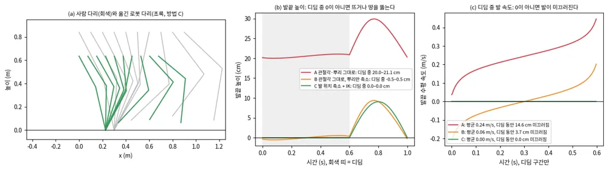
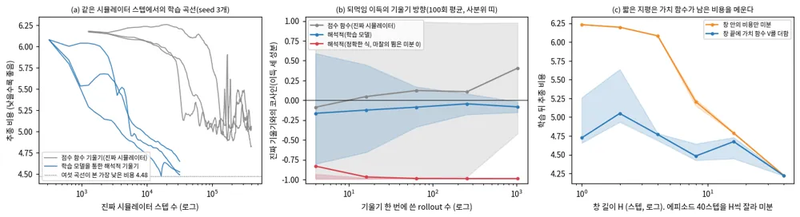

<!-- doc: 모방 | 5 -->
# 모방 (§I) — 사람 동작을 휴머노이드가 따라 하게 한다: 데이터, 리타기팅, 동작 추종, 범용 추종기

**결론 먼저.** ==휴머노이드 전신 제어의 표준 경로는 "사람 동작 데이터를 모으고, 로봇 몸에 맞게 옮기고(리타기팅), 그 동작을 RL(reinforcement learning, 강화학습)로 따라 하는 추종기를 학습하고, 추종기 위에 원격조종·Planner·VLA(vision-language-action) 모델을 얹는 것"이다.==
2025–2026년의 쟁점은 셋이다. 첫째, 리타기팅 품질이 추종 성공률을 바꾼다(GMR, OmniRetarget). 둘째, 추종기 하나를 데이터·모델·계산으로 키우면 처음 보는 동작까지 따른다(SONIC, Humanoid-GPT).
셋째, 같은 추종기를 훨씬 적은 계산으로 만들 수 있다. SuperMimic은 학습 world model을 통한 해석적 정책 기울기로, 자기 벤치마크(학습 동작 129,514개, 자기 실패 판정)에서 GPU 128장 7일짜리 SONIC 공개 체크포인트의 정규화 수익을 H100 한 장 3시간에 넘었다.

**이 문서와 다른 문서.** 이 계열의 일부는 이미 다른 문서에 카드로 있다. 이 문서는 그 카드들을 한 흐름으로 잇고, 리타기팅과 2026년의 새 연구를 더한다.

| 문서 | 이미 있는 것 | 이 문서에서 |
|---|---|---|
| Planner B.16.1 | ASE에서 MaskedMimic까지, HOVER, SONIC 카드, GRAIL | I.7, I.10에서 더 자세히 |
| Planner B.16.6 | H2O, OmniH2O, HumanPlus, ExBody·ExBody2, ASAP, VideoMimic, BeyondMimic 카드 | I.8의 표에 한 줄씩, BeyondMimic 설정은 I.8 토글 |
| Controller F.8, E.13 | GR00T 분리형 WBC, Playground 휴머노이드 | I.0, I.14 |
| 인식 A.8 | TANGO(SONIC을 system-0으로 쓴 예) | I.13 |
| 강화학습 R.2, R.3, R.9, R.17 | 행동 복제, REINFORCE, 모델 기반 RL, 적대적 모방 | I.7, I.11 |
| 딥러닝 L.21 | world model | I.11 |

**파이프라인.** 이 문서는 아래 네 단계 순서로 간다.

```
 사람 동작                 리타기팅                  동작 추종(RL)               위 층
┌───────────────┐      ┌───────────────────┐     ┌──────────────────────┐    ┌──────────────────────┐
│ 모션 캡처 (I.1) │ ───▶ │ 로봇 관절 궤적      │ ──▶ │ 범용 추종기           │ ◀─ │ 원격조종 (VR·RGB)      │
│ 영상 복원 (I.2) │      │ IK·상호작용 보존    │     │ 미래 참조 → 관절 목표   │    │ 운동학 Planner         │
└───────────────┘      │ 물리 거르기 (I.3–6) │     │ 50 Hz (I.7–I.12)     │    │ VLA·생성 모델 (I.13)    │
                       └───────────────────┘     └──────────────────────┘    └──────────────────────┘
```

**절.**

| 탭 | 절 | 주제 |
|---|---|---|
| 개요 | I.0 | 왜 동작 추종인가, travplan의 자리 |
| 데이터·리타기팅 | I.1–I.6 | 모션 데이터, 영상 복원, 리타기팅의 고전 해법, GMR, 상호작용 보존(OmniRetarget), 물리 기반·학습 리타기팅과 거르기 |
| 동작 추종 | I.7–I.9 | 캐릭터 애니메이션의 뿌리(DeepMimic·AMP·PHC), 실물 휴머노이드 추종기(2024–2025), 공통 설계와 평가 지표 |
| 범용 추종기 | I.10–I.12 | SONIC, SuperMimic, 2026년의 후속 |
| 위 층 | I.13 | 원격조종·운동학 Planner·VLA가 추종기를 부르는 방식 |
| travplan에서 | I.14 | 대응표, 실습, 스스로 확인할 질문 |

**연표.** 리타기팅과 추종이 함께 발전했다. 2025년부터는 같은 로봇(Unitree G1)과 같은 추종 설정(BeyondMimic)을 공유해 방법끼리 비교하기 쉬워졌다.

| 연도 | 데이터·리타기팅 | 동작 추종 | 범용 추종기·위 층 |
|---|---|---|---|
| 1998–2020 | Gleicher 시공간 제약(1998), Pollard 상체 로봇(2002), Nakaoka 춤 재현(HRP-1S 2003, HRP-2 2007), 상호작용 메시(2010), NKN(2018), Skeleton-Aware Networks(2020), 동물 동작 IK(2020) | SAMCON(2010), DeepMimic·SFV(2018), DReCon·NPMP(2019), CoMic·ScaDiver(2020) | — |
| 2021–2023 | AMASS(2019), LAFAN1(2020), AIST++(2021) | UHC(2021), AMP(2021), ASE(2022), MoCapAct(2022), PHC(2023) | PULSE(2023) |
| 2024 | H2O의 SMPL 체형 맞춤, sim-to-data 거르기 | H2O, OmniH2O, HumanPlus, ExBody, ExBody2 | MaskedMimic, HOVER |
| 2025 | GMR, OmniRetarget, PHUMA, SPIDER, VideoMimic | ASAP, HuB, KungfuBot, BumbleBee, GMT, TWIST, BeyondMimic, Any2Track, KungfuBot2, AMS, GentleHumanoid. 캐릭터: InterMimic, ADD, SMP | SONIC, TWIST2, Meta Motivo, BFM-Zero |
| 2026 상반기 | BONES-SEED 공개(03), NMR, ReActor | ZEST, OmniXtreme, Deep Whole-body Parkour, PHP, HoloMotion-1, Humanoid-GPT, LIMMT. 캐릭터: GPC | GRAIL, SceneBot, TextOp, OmniClone |
| 2026 하반기 | DSMS, UMR, HOI-Retarget, PriMoRetarget, 빠른 SQP 리타기팅 | YAHMP, PGMT, ViBe, NEXUS, P-BFM, C-GMT | Scaling BFM, TRACE, SuperMimic, HuMiT |

**공개 코드와 데이터.** 별 수와 마지막 push는 2026-10-22에 GitHub API로 확인했다.

| 저장소 | 무엇 | 별 · 마지막 push · 라이선스 |
|---|---|---|
| [NVlabs/GR00T-WholeBodyControl](https://github.com/NVlabs/GR00T-WholeBodyControl) | SONIC 학습 코드와 배포 스택(학습 코드 2026-04, v1.1 체크포인트 2026-07) | 3,799 · 2026-10-13 · README에 Apache-2.0, 가중치는 NVIDIA Open Model License |
| [HybridRobotics/whole_body_tracking](https://github.com/HybridRobotics/whole_body_tracking) | BeyondMimic 동작 추종. 많은 2025–2026 연구가 이 설정을 그대로 쓴다 | 2,443 · 2026-10-16 · MIT |
| [mujocolab/mjlab](https://github.com/mujocolab/mjlab) | MuJoCo Warp 위의 Isaac Lab식 학습 틀. BeyondMimic과 SuperMimic 재현이 쓴다 | 3,240 · — · Apache-2.0 |
| [NVlabs/ProtoMotions](https://github.com/NVlabs/ProtoMotions) | PHC·MaskedMimic 계열의 GPU 학습 틀. v3부터 PyRoki로 리타기팅 | 2,424 · 2026-10-16 · Apache-2.0 |
| [YanjieZe/GMR](https://github.com/YanjieZe/GMR) | 실시간 리타기팅(로봇 17종 이상) | 2,788 · 2026-04-02 · MIT |
| [amazon-far/holosoma](https://github.com/amazon-far/holosoma) | 학습 틀과 상호작용 보존 리타기팅(`holosoma_retargeting`) | 1,704 · 2026-10-22 · Apache-2.0 |
| [chungmin99/pyroki](https://github.com/chungmin99/pyroki), [kevinzakka/mink](https://github.com/kevinzakka/mink) | JAX 기구학 최적화, MuJoCo 미분 IK. 리타기팅의 풀이기 | 1,808 · MIT / 1,582 · Apache-2.0 |
| [xbpeng/MimicKit](https://github.com/xbpeng/MimicKit) | DeepMimic·AMP·ASE·ADD·SMP 등 Peng 계열을 Isaac Gym·Isaac Lab·Newton 위에 다시 구현. G1·Go2 설정과 GMR 출력 변환기 포함 | 2,395 · 2026-10-17 · Apache-2.0 |
| [robfiras/loco-mujoco](https://github.com/robfiras/loco-mujoco) | 모방 학습 벤치마크. 휴머노이드 12종에 LAFAN1·기본 동작을 옮겨 두었고, JAX PPO·GAIL·AMP·DeepMimic 기준선이 있다. AMASS는 라이선스 때문에 각자 받아 옮긴다 | 1,474 · 2026-08-22 · MIT(데이터 CC BY-NC-ND 4.0) |
| [unitreerobotics/unitree_rl_lab](https://github.com/unitreerobotics/unitree_rl_lab) | 제조사가 Isaac Lab으로 옮긴 BeyondMimic식 한 동작 추종(G1 춤 두 개)과 실물 배포용 C++ 제어기 | 1,420 · 2026-05-25 · Apache-2.0 |
| [ZhengyiLuo/PHC](https://github.com/ZhengyiLuo/PHC), [SMPLSim](https://github.com/ZhengyiLuo/SMPLSim) | PHC·PHC+ 학습과 평가, SMPL 체형 맞춤 리타기팅(`docs/retargeting.md`, G1 예). H2O 저장소는 이 패키지 사본을 H1용으로 고쳐 담아 쓴다 | 1,305 · 2025-08-21 · BSD 3-Clause Clear / 353 · 2025-11-03 · BSD-3-Clause |
| [LeCAR-Lab/BFM-Zero](https://github.com/LeCAR-Lab/BFM-Zero) | 비지도 RL 행동 기반 모델의 학습·평가·체크포인트와 G1 배포 가지 | 823 · 2026-10-21 · CC BY-NC 4.0 |
| [microsoft/MoCapAct](https://github.com/microsoft/MoCapAct) | CMU 휴머노이드 조각 전문가 2,589개와 롤아웃 데이터, 증류 정책(I.7) | 225 · 2026-09-30 · MIT(데이터 CDLA-Permissive-2.0) |
| [bones-studio/seed](https://huggingface.co/datasets/bones-studio/seed) (Hugging Face) | BONES-SEED 동작 142,220개, G1 리타기팅 포함 | 신청형 라이선스(I.1) |

SuperMimic은 2026-10-22 현재 공식 코드가 없다. 공개 이틀 안에 비공식 재현 둘이 올라왔다(`zita-ch/supermimic_vibed`, `CuboiLeo/SuperMimic-Reproduced`, 둘 다 MIT).
처음 재현하는 사람에게는 MimicKit(DeepMimic·AMP·ASE·ADD·SMP. PHC·MaskedMimic 계열은 ProtoMotions)과 whole_body_tracking 또는 mjlab(G1 추종)이 가장 짧은 길이다. Isaac Lab 본체에는 캐릭터 AMP 예제만 있고 로봇 동작 추종 과제는 없다(v3.0.0 기준).

**보는 순서.** 처음이면 I.0, I.3, I.7, I.8의 표, I.9, I.10, I.11 순서로 읽는다. I.11 앞에는 강화학습 문서 R.3(REINFORCE)과 R.9(모델 기반 RL)를 먼저 본다.
리타기팅을 직접 해 볼 사람은 I.3의 그림을 만든 스크립트(`scripts/make_mimic_figures.py`)와 GMR 저장소부터 본다. travplan과의 연결만 보려면 I.14로 바로 간다.

**표기.** 관절 위치 $q$, 몸체(링크) 위치 $p$, 자세(회전) $R$, 기준(참조) 동작은 모자 $\hat{\cdot}$를 붙인다. 정책 $\pi_\theta$, 보상 $r$, 할인율 $\gamma$, 가치 함수 $V$를 쓴다.
예외가 하나 있다. I.11에서는 원문 표기를 따라 모자가 world model의 예측을 뜻한다. I.11 장난감 문제의 한 스텝 비용은 $\ell$이다.
MPJPE(mean per-joint position error)는 논문마다 단위가 다르다. 캐릭터 애니메이션과 CMU 계열은 관절 위치 오차(mm)이고, 2025–2026년 로봇 논문 다수는 관절각 오차(rad)를 MPJPE로, 위치 오차를 MPKPE(mean per-keypoint position error)로 쓴다. 이 문서는 표마다 단위를 적는다.

**약어.** IK(inverse kinematics, 역기구학), SMPL(skinned multi-person linear model, 사람 몸 매개변수 모델), PPO(proximal policy optimization), DAgger(dataset aggregation, 학생이 방문한 상태에서 교사 행동을 모아 따라 하는 증류),
MoE(mixture of experts), BPTT(backpropagation through time)를 처음부터 쓴다.

### I.0 왜 동작 추종인가: 프레임마다 정답이 있으면 키울 수 있다

**한 줄로.** ==사람 동작을 프레임마다 따라 하게 하는 동작 추종이, 보상을 손으로 짜는 방식과 판별기 보상을 밀어내고 휴머노이드 전신 제어의 표준 재료가 됐다.==

**흐름.**

**1. 보상 설계의 부담.** 보행 RL은 속도 추종에 발 들기, 자세, 에너지, 접촉 같은 벌점 항을 수십 개 얹는다. 동작이 하나 늘 때마다 항과 가중치를 다시 맞춘다.
동작 추종은 "기준 자세와 얼마나 가까운가" 한 꼴의 보상을 모든 동작에 쓴다(I.7의 DeepMimic 식). BeyondMimic은 한 설정으로 여러 동작을 학습해 이 점을 실물에서 보였다(I.8).

**2. 촘촘한 감독.** 판별기 기반 방법(AMP, ASE, CALM)은 "사람 같은가"를 채점한다. SONIC 서론은 이 방법이 데이터가 커질수록 모드 붕괴에 빠지기 쉽다고 정리한다.
추종은 매 프레임 목표 자세가 있어 데이터와 모델을 함께 키울 수 있다. SONIC은 모델을 1.2M에서 42M 파라미터로, 데이터를 400만에서 1억 프레임으로 키우며 처음 보는 동작의 성공률을 올렸다(I.10).

**3. 추종기가 아래 층이 된다.** 원격조종, 운동학 Planner, VLA가 같은 추종기를 부른다(I.13). 위 층은 "다음 1–2초의 몸 동작"만 내면 되고, 균형과 접촉은 추종기가 맡는다.
travplan의 Planner와 Controller 분리와 같은 모양이다. 다른 점은 휴머노이드에서는 아래 층이 학습 정책이고 위 층이 몸 전체 동작을 낸다는 것이다.

**4. 남은 비용.** 이 경로의 비용은 세 곳에 있다. 데이터(모션 캡처는 비싸다, I.1–I.2), 리타기팅(사람과 로봇의 몸이 다르다, I.3–I.6), 계산(SONIC은 약 2만 1천 GPU 시간, I.10–I.11)이다.
2026년 하반기 연구는 대부분 이 셋 가운데 하나를 줄이거나, 추종기가 못 하는 것(지형·접촉·순응)을 더한다(I.12).

**travplan에서.** travplan의 로봇은 스워브 바퀴라 사람 동작 데이터에 해당하는 것이 없다. 그래도 이 문서를 둔 이유는 셋이다.
첫째, 운동학 Planner와 학습 추종기를 나누는 구조가 휴머노이드에서 표준이 됐고, 그 인터페이스 선택이 travplan의 `PlanResult` 선택과 같은 질문이다.
둘째, 학습 기법(어려운 구간 적응 표집, 교사–학생, world model을 통한 정책 기울기)은 Planner D와 학습 Controller `TinyPolicy`의 학습에 옮길 수 있다.
셋째, Playground에는 휴머노이드가 있고(Controller E.13), 다리 로봇을 쓰게 되면 travplan Controller는 이런 추종기 위에 앉는다(Controller F.8).

<!-- tab: 데이터·리타기팅 -->

### I.1 모션 데이터: 무엇이 공개돼 있고, 무엇에 쓸 수 있나

**한 줄로.** ==공개 모션 데이터는 수십에서 수백 시간이고, 2026-03의 BONES-SEED(약 288시간, G1 리타기팅 포함)가 스튜디오 모션 캡처로는 가장 큰 공개분이다. 라이선스가 대부분 비상업이라 쓰기 전에 확인한다.==

| 데이터 | 규모 | 형식·라이선스 | 쓰는 곳 |
|---|---|---|---|
| [AMASS](https://amass.is.tue.mpg.de) (ICCV 2019) | 광학 모션 캡처 15개 묶음, 346명, 동작 11,451개, 2,488분(약 41시간, 2019 논문 기준. 그 뒤 데이터가 더해졌다) | SMPL-H(2022부터 SMPL-X판). 비상업 연구, 재배포 금지 | PHC·H2O·HOVER·GMT 학습, 평가 분할 |
| [LAFAN1](https://github.com/ubisoft/ubisoft-laforge-animation-dataset) (Ubisoft, SIGGRAPH 2020) | 5명, 시퀀스 77개, 30 fps 496,672프레임(약 4.6시간) | BVH, CC BY-NC-ND 4.0 | GMR 평가 21개, SuperMimic 통제 비교 40개 |
| [Motion-X](https://github.com/IDEA-Research/Motion-X) / Motion-X++ | 81,084 / 120,462 클립, 144.2 / 180.9시간, 글 설명 | SMPL-X, 비상업 | 글-동작, 영상 기반 동작 |
| [OMOMO](https://github.com/lijiaman/omomo_release) (SIGGRAPH Asia 2023) | 약 10시간, 물체 15개, 17명, 120 fps | SMPL-X | 물체 상호작용 리타기팅(I.5) |
| [BONES-SEED](https://huggingface.co/datasets/bones-studio/seed) (2026-03) | 동작 142,220개(원본 71,132 + 좌우 반전 71,088), 120 fps 약 288시간, 배우 522명 | SOMA 체형 두 가지와 G1 MuJoCo CSV(NVIDIA 리타기팅). 신청형 라이선스(아래) | SONIC(일부), SuperMimic(걸러 264.56시간), ProtoMotions |
| Humanoid-X ([arXiv:2412.14172](https://arxiv.org/abs/2412.14172)) | 인터넷 영상에서 약 163,800쌍, 약 240시간 | 영상 복원 SMPL | PHUMA의 원천(I.6) |
| [PHUMA](https://github.com/DAVIAN-Robotics/PHUMA) (CoRL 2026) | Humanoid-X를 물리 기준으로 거르고 LAFAN1·LocoMuJoCo·자체 영상을 더해 73.0시간(클립 7.6만 개) | G1 등, Apache-2.0(코드) | 보행 위주 추종 학습(I.6) |
| HumanML3D (CVPR 2022) | 동작 14,616개, 문장 44,970개, 28.59시간 | AMASS·HumanAct12에서 다시 만들어야 한다 | 글로 동작 생성 |
| [CMU MoCap](http://mocap.cs.cmu.edu/) (CMU Graphics Lab) | 시행 2,605개, 6개 대분류·23개 소분류, 120 Hz 광학 캡처 | ASF/AMC·C3D. "모든 용도에 무료", 단 데이터를 직접 되파는 것은 변환한 형태라도 금지 | NPMP·CoMic·MoCapAct(I.7), ExBody 780클립, AMASS의 한 묶음 |
| AIST++ ([arXiv:2101.08779](https://arxiv.org/abs/2101.08779), ICCV 2021) | 춤 5.2시간, 시퀀스 1,408개, 10개 장르, 30명 | SMPL 자세. 주석은 CC BY 4.0, 원 영상은 학술 전용 | 춤 동작 추종 |
| [100STYLE](https://www.ianxmason.com/100style/) (I3D 2022) | 보행 스타일 100가지, 60 fps 400만 프레임 이상(한 명) | BVH, CC BY 4.0 | 스타일 보행. GMR의 Xsens BVH 경로로 옮길 수 있다 |

**라이선스 함정.** LAFAN1은 CC BY-NC-ND(변경 금지)다. Unitree 조직 계정의 G1·H1 리타기팅본은 2026-10-22에 401을 돌려줬다. BeyondMimic README가 "Unitree 리타기팅 LAFAN1"로 가리키는 사본은 개인 계정(`lvhaidong`)에 있다. 라이선스 필드는 비어 있고, 카드 본문에 원 LAFAN1 라이선스(CC BY-NC-ND 4.0)만 적혀 있다.
AMASS를 G1로 옮긴 Hugging Face 사본 가운데 CC BY 4.0을 단 것이 있지만(`fleaven/Retargeted_AMASS_for_robotics`와 그 재업로드), AMASS 라이선스는 제3자 제공과 상업 이용을 금지하므로 CC BY로 쓸 수 없다. 미러를 쓸 때는 미러에 적힌 라이선스가 아니라 원 데이터의 라이선스를 따른다.
조건 없이 상업 이용까지 열린 큰 원천은 CMU MoCap 원본과 100STYLE이다(BONES-SEED는 연매출 100만 달러 이하일 때만). AMASS 안의 CMU 묶음은 AMASS 라이선스(비상업)를 따른다. SMPL 몸 모델 자체도 비상업 연구 라이선스라, SMPL을 거치는 리타기팅(H2O·PHC식)은 이 조건을 함께 진다.
BONES-SEED는 신청형이다([라이선스](https://bones.studio/info/seed-license)). 원 데이터 재배포는 금지다(6절). 학습한 모델은 사용자 소유이지만, 모델에서 원 데이터를 다시 뽑아낼 수 없어야 한다(5.2절). 연매출이 100만 달러를 넘으면 알리고 상용 라이선스로 바꿔야 한다(4절).

**travplan에서.** 바퀴 로봇에 해당하는 데이터는 원격조종 주행 로그다. Planner B.6d의 MIMIC(Coco 배달로봇 50시간)이 그 예이고, I.3의 리타기팅 문제가 "사람이 조종한 궤적을 다른 몸의 로봇 궤적으로 옮기기"로 다시 나타난다.

### I.2 영상에서 동작을 복원한다: 모션 캡처 없이 데이터를 늘리는 길

**한 줄로.** ==단안 영상에서 세계 좌표의 사람 동작을 복원하는 모델(WHAM, GVHMR, TRAM)이 모션 캡처의 대안이 됐지만, 발 미끄러짐과 높이 오차가 남아 리타기팅 뒤에 물리 거르기를 꼭 붙인다.==

| 모델 | 무엇 | EMDB-2 세계 좌표 오차 | 쓰는 곳 |
|---|---|---|---|
| WHAM ([arXiv:2312.07531](https://arxiv.org/abs/2312.07531), CVPR 2024) | 영상 특징과 2D 관절 운동으로 세계 좌표 동작 | W-MPJPE 354.8 mm, RTE 6.0 % | — |
| GVHMR ([arXiv:2409.06662](https://arxiv.org/abs/2409.06662), SIGGRAPH Asia 2024) | 중력 방향 좌표계(gravity-view)에서 회귀 | 276.5 mm, 2.0 % | KungfuBot, GMR의 영상 입력 |
| TRAM ([arXiv:2403.17346](https://arxiv.org/abs/2403.17346), ECCV 2024) | 축척을 아는 SLAM으로 카메라를 풀고 VIMO로 몸을 푼다 | 222.4 mm, 1.4 % | ASAP |

W-MPJPE는 세계 좌표 관절 위치 오차이고, RTE(root translation error)는 뿌리 이동 오차를 이동 거리로 나눈 백분율이다. 세 숫자는 각 논문의 EMDB-2 표에서 옮겼고(WHAM 표 3, GVHMR 표 1, TRAM 표 3), WHAM·GVHMR은 카메라 운동을 DPVO로 푼 판이다.
코드 라이선스는 WHAM·TRAM이 MIT이고, GVHMR은 비상업 전용 자체 라이선스다. 셋 다 SMPL 몸 모델을 따로 등록해 받아야 하고, 함께 쓰는 DPVO·ViTPose 같은 외부 모델은 저마다 라이선스가 있다.

**SFV — 영상에서 자세를 추정하고, 동작으로 다듬고, 그 동작을 RL로 따라 하는 세 단계를 3D 자세 추정과 심층 RL로 한 줄로 이었다**([arXiv:1810.03599](https://arxiv.org/abs/1810.03599), Peng 외, SIGGRAPH Asia 2018, UC Berkeley).
영상에서 전신 제어기를 배운 선행 연구로 Vondrak 외(2012)가 있고, 저자는 이 조합이 새롭다고 적었다.
OpenPose(2D)와 HMR(3D)로 프레임마다 자세를 추정하고, 동작 복원 단계에서 시간축으로 매끄럽게 다듬어 기준 동작을 만든다. 그 기준을 DeepMimic식 추종(I.7)으로 학습해 20개가 넘는 기술을 익혔다(표 1).
영상 동작은 잡음이 커서 시작 상태 표집이 결정적이었다. 뒤공중제비 A의 정규화 수익은 고정 시작 0.086, 기준 상태 시작 0.602, 시작 상태 분포를 정책 기울기로 학습하는 적응 초기화(ASI) 0.741이었다(표 2). 같은 동작을 Atlas로 옮기면 0.318로 떨어졌다(표 1).
VideoMimic과 2025–2026년의 영상 기반 연구는 이 세 단계에 장면 복원과 물리 거르기를 더한 것이다.


*그림 — SFV (Fig. 2): 영상에서 자세 추정, 동작 복원, 동작 모방(RL) 세 단계를 거쳐 캐릭터의 정책 π를 얻는다. 출처: [arXiv:1810.03599](https://arxiv.org/abs/1810.03599)*

**VideoMimic — 휴대폰 영상에서 사람과 장면을 함께 복원해, 높이 지도를 보는 G1 정책 하나가 계단을 오르고 의자에 앉는다**([arXiv:2505.03729](https://arxiv.org/abs/2505.03729), CoRL 2025, UC Berkeley, [코드](https://github.com/hongsukchoi/VideoMimic) MIT).
사람(VIMO SMPL, ViTPose 2D 관절, 발 접촉)과 장면(MegaSaM 또는 MonST3R)을 Levenberg–Marquardt로 함께 맞춘다. 300프레임 시퀀스 한 번에 A100에서 약 20 ms다(컴파일 뒤).
리타기팅은 PyRoki로 한 시퀀스 전체를 한 번에 푼다(300프레임 클립에 A100으로 약 10초). 복원 품질은 SLOPER4D 일부에서 WA-MPJPE 112.13 mm로 TRAM(149.48)보다 낮고, 장면 Chamfer 거리는 0.75로 10.66보다 작다(원문 표 2).
학습 데이터는 휴대폰 영상 123개다. 정책 입력은 11 × 11 높이 지도와 뿌리 명령이다. 카드는 Planner B.16.6에 있다.

**travplan에 주는 의미.** 복원 단계의 오차는 리타기팅과 추종이 떠안는다. VideoMimic 저자도 서로 부딪히는 연성 비용이 풀이기를 나쁜 국소 최솟값에 가두고, 그 뒷정리를 RL 추종기가 한다고 적는다.
travplan에서 같은 구조는 "belief 지도로 만든 시연을 Planner D가 배운다"는 것이다. 지도 오차가 시연으로 들어가는 길을 따로 재야 한다(인식 A.13, TP-0146).


*그림 — VideoMimic (Fig. 1): 휴대폰 영상에서 사람 동작과 장면을 함께 복원하고, 그 데이터로 학습한 G1 정책 하나가 계단·의자 같은 장면에서 동작한다. 출처: [arXiv:2505.03729](https://arxiv.org/abs/2505.03729)*

### I.3 리타기팅 문제와 고전 해법: 어디서 축척하느냐가 결과를 가른다

**한 줄로.** ==리타기팅은 몸이 다른 로봇이 같은 동작을 하도록 관절 궤적을 푸는 최적화다. 관절각을 그대로 복사하면 발이 뜨거나 미끄러지고, 위치를 로봇 크기에 맞춰 줄인 뒤 IK로 풀어야 접촉이 지켜진다.==

**무엇이 다른가.** GMR은 사람과 로봇의 차이를 뼈 길이, 관절 가동 범위, 운동학 구조, 몸 모양, 질량 분포, 구동기로 꼽는다.
사람의 어깨·엉덩이는 3자유도 구면 관절이고 로봇은 1자유도 회전 관절의 연쇄다. 그래서 관절 회전을 그대로 옮기면 뜨기, 땅 뚫기, 발 미끄러짐(foot skating), 끝점 이탈이 생긴다(GMR §II).
그 밖에 로봇이 아예 할 수 없는 동작이 있다. H2O는 옆돌기와 다리 길이보다 넓은 보폭을 예로 든다. 이런 동작은 리타기팅이 아니라 거르기(I.6)가 맡는다.

**고전 해법 셋.**

**(1) 시공간 제약(Gleicher, SIGGRAPH 1998).** 원 동작 $m_0(t)$에 변위 $d(t)$를 더한 $m(t) = m_0(t) + d(t)$를 찾는다. 발 디딤 같은 제약을 만족하면서 원 동작과의 차이를 가장 작게 한다.
$d(t)$를 3차 B-스플라인으로 두어 고주파를 막는다. 중력과 균형은 다루지 않는다.

**(2) 핵심점 IK(Peng 외, RSS 2020).** 동물 동작을 사족보행 로봇으로 옮길 때 발과 엉덩이 핵심점을 짝지어 IK로 푼다. 프레임마다 기본 자세 $\bar q$ 쪽으로 당기는 정규화 항이 있다.

$$ \min_{q_{0:T}} \sum_t \Big[ \sum_i \| \hat x_i(t) - x_i(q_t) \|^2 + (\bar q - q_t)^\top W (\bar q - q_t) \Big] $$

**(3) SMPL 체형 맞춤(H2O·PHC, 2023–2024).** 먼저 SMPL 체형 $\beta'$와 축척을 경사하강으로 맞춰, SMPL의 기본 자세 관절 위치가 로봇의 관절 위치와 겹치게 한다. 다음으로 원 동작의 자세와 이동에 맞춘 체형을 넣고, 대응 관절(H2O 12개, PHC의 G1 설정 14개)의 위치 차이를 Adam으로 줄인다.
평균 체형을 쓰면 H1이 안짱걸음(in-toed)이 된다(H2O 그림 3). 약점은 접촉을 모른다는 것이다. 그래서 뜨기·미끄러짐·땅 뚫기가 남고, 느리고, 사람과 비율이 먼 로봇에는 맞지 않는다(GMR §II, OmniRetarget §II-A).

**로봇 쪽 고전.** 그래픽스의 리타기팅이 몸 비율과 제약을 다뤘다면, 로봇 쪽은 처음부터 관절·속도 한계와 균형을 함께 다뤘다. 이 시기 방법은 대개 정해진 동작 하나를 재생했고(Koenemann 2014는 실시간 모방), 외란에 대한 되먹임은 손으로 짠 안정화기가 맡았다.
학습 추종기가 그 안정화기 자리를 대신한 것이 2024년 이후의 변화다(I.8).

| 연구 | 로봇 | 무엇을 했나 |
|---|---|---|
| Pollard 외 (ICRA 2002) | Sarcos DB 상체 | 배우 7명의 동작 14개를 관절각 한계(국소 축척), 속도 한계 순서로 깎고 앞먹임 궤적 학습으로 따랐다. 자유도마다 따로 축척한다는 한계를 스스로 적었다 |
| Nakaoka 외 (ICRA 2003, IJRR 2007) | HRP-1S(2003), HRP-2 30자유도(2007) | 민요 춤의 다리 동작을 STAND·STEP·SQUAT 과제로 인식해 로봇에서 다시 만들고, 상체는 Pollard의 속도 한계를 쓰고, ZMP(zero moment point) 안정화기로 균형을 잡았다. 모션 캡처한 춤을 다리까지 재현한 이족 휴머노이드의 초기 사례다 |
| Koenemann 외 (ICRA 2014) | Nao (25자유도) | 관성 모션 캡처 슈트의 끝점과 질량 중심을 실시간으로 따르며, 매 프레임 정적으로 안정한 자세를 풀었다. 한 프레임 평균 3.3 ms(표 I) |
| Ayusawa·Yoshida (T-RO 2017) | HRP-4 | 사람 모델에서 로봇 모델로의 변형 파라미터 추정, 로봇 동작 계획, 모션 캡처 IK를 함께 풀었다(초록 기준). SMPL 체형 맞춤(3)의 로봇 쪽 짝으로 볼 수 있다 |

**장난감 문제로 본 축척.** 사람 다리(넓적다리 0.45 m, 정강이 0.45 m, 엉덩이 높이 0.84 m)의 걸음을 짧고 비율이 다른 로봇 다리(0.30 m, 0.38 m)로 옮겼다. 다리 길이 비는 0.756이다.

| 방법 | 디딤 중 발끝 높이 | 디딤 중 발 수평 속도(평균 절댓값) | 디딤 동안 미끄러진 거리 |
|---|---|---|---|
| A. 관절각과 뿌리(높이·이동)를 그대로 복사 | 20.0–21.1 cm(뜬다) | 0.24 m/s | 14.6 cm |
| B. 관절각은 그대로, 뿌리만 다리 길이 비로 축소 | −0.5–0.5 cm | 0.06 m/s | 3.7 cm |
| C. 발 위치를 다리 길이 비로 축소(뿌리 포함)하고 IK로 다시 풂 | 0.0–0.0 cm | 0.00 m/s | 0.0 cm |

A와 B의 차이는 뿌리를 줄인 효과다. B에서도 발이 미끄러지는 이유는 넓적다리와 정강이의 비율이 달라서다. 같은 관절각이 로봇에서는 다른 보폭을 만든다.
C의 0은 구성상 정확하다. 뿌리와 발을 같은 비로 줄이면 땅에 멈춘 사람 발은 로봇에서도 멈춘 목표가 되고, IK는 그 목표에 닿기만 하면 된다. GMR이 관절각을 복사하지 않고 위치를 축척해 IK로 푸는 이유가 이것이다(I.4).
이 장난감은 몸 부위가 발 하나라 GMR의 몸체별 축척은 보여 주지 않는다.

**travplan에 주는 의미.** 같은 문제가 바퀴 로봇에도 있다. 사람이 조종한 궤적이나 보행자 궤적을 스워브 로봇 궤적으로 옮길 때, 축척과 기구학 한계(조향 각 한계, TP-0163)를 무시하면 바퀴가 옆으로 미끄러지는 궤적이 나온다.
발 미끄러짐과 바퀴 옆 미끄러짐은 같은 종류의 오류다. 둘 다 "접촉점이 땅에 대해 움직이지 않아야 하는 순간에 움직인다".


*그림 — 리타기팅 장난감 문제: 평면 2링크 다리의 걸음을 비율이 다른 다리로 옮기는 세 방법. (a) 사람 다리(회색)와 방법 C로 옮긴 로봇 다리(초록). (b) 발끝 높이: A는 사람 엉덩이 높이를 그대로 써서 20 cm 넘게 뜬다. (c) 디딤 중 발 수평 속도: A와 B는 발이 미끄러지고 C만 0이다. 출처: `scripts/make_mimic_figures.py`*


*그림 — Learning Agile Robotic Locomotion Skills by Imitating Animals (Fig. 3 왼쪽): 개의 모션 캡처에서 고른 핵심점. 출처: [arXiv:2004.00784](https://arxiv.org/abs/2004.00784)*


*그림 — 같은 논문 (Fig. 3 오른쪽): 짝지은 Laikago 로봇의 핵심점. IK가 이 쌍의 거리를 줄인다. 출처: [arXiv:2004.00784](https://arxiv.org/abs/2004.00784)*

### I.4 GMR: 리타기팅 품질이 추종 성공률을 바꾼다

**GMR(General Motion Retargeting) — 추종기를 고정하고 리타기팅만 바꿔 보니, 리타기팅의 결함이 곧 추종 실패였다**([Retargeting Matters, arXiv:2510.02252](https://arxiv.org/abs/2510.02252), Araújo·Ze·Xu·Wu·Liu, Stanford, 2025-10 기술 보고서, [코드](https://github.com/YanjieZe/GMR) MIT).

**한 줄 요약.** ==보상을 동작마다 다듬지 않는 추종기(BeyondMimic)를 고정하면, 리타기팅 방법만 바꿔도 같은 동작의 성공률이 0 %에서 100 %까지 갈린다.==

**동작 방식.** 다섯 단계다.

**(1)** 사람과 로봇의 핵심 몸체(몸통, 머리, 다리, 발, 팔, 손)를 짝짓고 위치·자세 가중치를 정한다.

**(2)** 기본 자세에서 둘의 몸체 자세가 같아지도록 회전 오프셋을 둔다. 안짱걸음 같은 결함을 줄인다.

**(3) 비균일 국소 축척.** 로봇 몸체 $b$마다 축척 $s_b$를 따로 두고, 뿌리 이동은 균일 축척 $s_{root}$로 줄인다. $i(b)$는 로봇 몸체 $b$에 짝지은 사람 몸체이고, $h/h_{ref}$는 실제 키를 가정 키로 나눈 비다(코드 그대로).

$$ p_b^{target} = \frac{h}{h_{ref}}\, s_b \left(p_{i(b)}^{src} - p_{root}^{src}\right) + \frac{h}{h_{ref}}\, s_{root}\, p_{root}^{src} $$

저자는 "다른 방법의 결함 대부분은 원 동작을 축척하는 단계에서 생긴다"고 진단한다. 식을 정리하면 디딤 발의 목표는 $\frac{h}{h_{ref}}\left(s_b\, p_{i(b)}^{src} + (s_{root} - s_b)\, p_{root}^{src}\right)$다.
사람 발이 멈춰 있어도 $s_b \ne s_{root}$이면 목표가 뿌리 속도의 $\frac{h}{h_{ref}}(s_{root} - s_b)$배로 움직인다. 그래서 GMR의 G1 설정은 골반·엉덩이·무릎·발의 축척을 모두 0.9로 두고 팔만 0.8로 줄인다. 뿌리를 줄이는 것 자체의 효과는 I.3의 A와 B 차이다.

**(4) 1단계 IK.** 회전은 모든 핵심 몸체, 위치는 끝점만 맞춘다. MuJoCo 미분 IK 라이브러리 Mink로 관절 한계 안에서 푼다. 뿌리 초기값은 축척한 뿌리 위치와 사람의 yaw다. $\ominus$는 두 회전 사이의 차이(축-각 벡터)다.

$$ \min_q \sum_{b} w_b^R \| R_{i(b)}^{src} \ominus R_b(q) \|^2 + \sum_{b \in \text{끝점}} w_b^p \| p_b^{target} - p_b(q) \|^2 \quad \text{s.t. } q^- \le q \le q^+ $$

**(5) 2단계 미세 조정.** 같은 꼴에 가중치를 바꾸고 모든 핵심 몸체의 위치를 넣는다. 프레임마다 앞 프레임에서 출발해 풀고, 끝에 가장 낮은 몸체 높이를 빼 땅에 맞춘다.

**결과.** LAFAN1 21개 동작을 G1로 옮겨 BeyondMimic으로 학습했다. 성공은 동작 전체를 끝까지 따라 해야 인정한다.

| 동작(성공 %) | PHC | GMR | ProtoMotions | Unitree |
|---|---|---|---|---|
| 춤 1·2, sim2sim(MuJoCo) | 0 · 0 | 100 · 100 | 100 · 100 | 100 · 100 |
| 달리다 서기, sim(Isaac Sim) | 17 | 98 | 20 | 100 |
| 달리다 서기, sim2sim | 74 | 100 | 26 | 100 |
| 춤 5, sim2sim | 100 | 51 | 100 | 100 |

| 평균 추종 오차(21개, sim) | PHC | GMR | ProtoMotions | Unitree |
|---|---|---|---|---|
| 전역 몸체 위치 오차 E_g-mpbpe (mm) | 247.8 | 104.1 | 139.7 | 77.2 |
| 국소 몸체 위치 오차 E_mpbpe (mm) | 40.2 | 28.1 | 33.2 | 23.2 |
| 관절각 오차 E_mpjpe (10⁻³ rad) | 778.5 | 561.7 | 641.8 | 483.0 |

표는 원문 표 I(성공률)과 표 II(오차)에서 옮겼다.
실패의 원인은 리타기팅 결함이었다. PHC의 춤 1·2는 땅을 뚫었고(한 경우 60 cm), ProtoMotions의 달리다 서기는 두 다리가 서로 파고들었다. GMR의 약점인 춤 5는 허리 roll이 갑자기 튀는 10초 구간이다(전체 데이터의 2 % 미만).
Unitree의 비공개 리타기팅이 가장 좋았고, 사람 20명의 평가에서도 GMR과 구별이 어려웠다. 첫 기준 프레임도 결과를 바꿨다. GMR로 옮긴 '걷기 2'는 sim2sim에서 0번 프레임에서 시작하면 64 %, 7번에서 시작하면 100 %였고, Unitree의 '회전 1'도 47 %에서 100 %로 바뀌었다(표 III).

**한계.** 저자가 밝힌 것: 원 데이터는 LAFAN1, 로봇은 G1 하나이고, 물체·장면 상호작용이 없다. 정식 학회 발표는 확인하지 못했다(arXiv 기술 보고서).

**공개 코드.** GMR은 TWIST·TWIST2의 실시간 원격조종이 쓴다. SMPL-X(AMASS, OMOMO), BVH(LAFAN1), FBX, GVHMR 영상 입력을 받고, Threadripper 7960X에서 초당 60–70프레임을 낸다(README). SONIC도 원본 700시간을 GMR과 PyRoki로 G1에 옮겼다.

**travplan에 주는 의미.** GMR의 실험 설계가 핵심이다. 추종기와 보상을 고정하고 입력 데이터만 바꿔, 데이터의 결함이 성능에 주는 몫을 따로 쟀다.
Planner D도 같은 질문을 할 수 있다. Controller(MPPI)를 고정하고 시연을 만든 방법(Guidance + MPPI 시연, 걸러 낸 시연, DAgger 시연)만 바꿔 짝 비교로 재면 시연 품질의 몫이 나온다.


*그림 — Retargeting Matters (Fig. 3 일부): PHC로 리타기팅한 춤 동작에서 G1이 바닥을 뚫는다. 이 결함이 있는 동작은 추종 성공률이 0 %였다. 출처: [arXiv:2510.02252](https://arxiv.org/abs/2510.02252)*


*그림 — 같은 그림 (Fig. 3 일부): ProtoMotions로 리타기팅한 달리다 서기에서 두 다리가 서로 파고든다. 출처: [arXiv:2510.02252](https://arxiv.org/abs/2510.02252)*

### I.5 상호작용 보존: 몸만이 아니라 물체·지형과의 관계를 옮긴다

**한 줄로.** ==핵심점 맞춤(PHC, GMR)은 로봇 몸만 보고 물체와 지형을 모른다. 상호작용 메시는 몸·물체·지형 점 사이의 상대 배치를 보존하는 비용을 두고, OmniRetarget은 여기에 충돌·관절·속도·디딤 발을 hard 제약으로 더했다.==

**상호작용 메시(Ho·Komura·Tai, SIGGRAPH 2010).** 몸의 관절점과 물체·환경 위의 점을 Delaunay 사면체로 잇는다. 각 점의 Laplacian 좌표는 이웃 점들의 가중 평균에서 얼마나 떨어져 있는지다.
원 동작과 옮긴 동작의 Laplacian 좌표 차이(변형 에너지)를 줄이면 상대 배치가 지켜지고 관통이 준다. 춤, 레슬링, 칼싸움, 차에 타기를 예로 실시간 캐릭터 제어를 보였다.
로봇에는 IMMA(Nakaoka·Komura, Humanoids 2012)가 처음 옮겼다. 다만 관절·속도 한계가 없었고, 코드는 공개되지 않았으며 물체·환경 상호작용도 다루지 않았다(OmniRetarget 부록 VI-B4). 아래 식은 OmniRetarget §III-A의 표기다.

$$ L(p_i) = p_i - \sum_{j \in N(i)} w_{ij}\, p_j, \qquad E_L = \sum_i \| L(p_i^{src}) - L(p_i^{tgt}) \|^2 $$

**OmniRetarget — 상호작용 메시 비용에 hard 제약을 더해 프레임마다 볼록 근사 문제를 풀고, 같은 동작을 물체·지형·로봇을 바꿔 다시 풀어 데이터를 늘린다**([arXiv:2509.26633](https://arxiv.org/abs/2509.26633), Yang·Huang·Wu 외, Amazon FAR·MIT·UC Berkeley·Stanford·CMU, 프로젝트 페이지 표기 ICRA 2026 최우수 논문상, [코드](https://github.com/amazon-far/holosoma) Apache-2.0, [데이터](https://huggingface.co/datasets/omniretarget/OmniRetarget_Dataset) MIT).

**동작 방식.** 프레임 $t$마다 아래 문제를 푼다. 디딤 발은 원 동작에서 수평 속도가 1 cm/s 아래인 발이다.

$$ q_t^\star = \arg\min_{q_t} \sum_i \| L(p^{src}_{t,i}) - L(p^{tgt}_{t,i}(q_t)) \|^2 + \| q_t - q_{t-1} \|_Q^2 $$

제약은 넷이다. 부호 거리 $\phi_j(q_t) \ge 0$(충돌), 관절 한계, 속도 한계 $v_{min}\,dt \le q_t - q_{t-1} \le v_{max}\,dt$, 디딤 발 고정 $p_t^F = p_{t-1}^F$다.
제약을 선형화하고 신뢰 영역 $\|dq\|_2 \le 0.2$를 더한 2차 원뿔 계획(SOCP, second-order cone program)을 최대 10번 반복한다. 축척은 SMPL 맞춤 대신 키 비율 $\alpha = h_{robot}/h_{demo}$ 하나다.
증강은 물체의 자세·모양, 지형 높이, 로봇 몸(G1·H1·T1)을 바꿔 같은 문제를 다시 푼다. 하체가 원 동작에서 멀어지지 않도록 앵커 비용을 둔다.
추종 학습은 고유감각만 보고, 보상 다섯 항과 로봇 무작위화 네 항(물체 물성은 따로)에 BeyondMimic 하이퍼파라미터를 그대로 썼다.

**결과(원문 표 II).** 같은 추종 학습으로 리타기팅 방법만 바꿨다. 어려운 동작 39개로 평가했다.

| 과제 | PHC | GMR | VideoMimic | OmniRetarget |
|---|---|---|---|---|
| 로봇–물체(OMOMO): 추종 성공 % | 71.28 | 50.83 | 3.85 | 82.20 |
| 로봇–물체: 최대 관통 깊이 (cm) | 5.11 | 8.50 | 7.48 | 1.34 |
| 로봇–지형(자체 모션 캡처): 추종 성공 % | 52.63 | 78.94 | 51.75 | 94.73 |

LAFAN1에서는 Unitree 리타기팅과 둘 다 100 % 성공했고, 최대 관통 깊이는 3.22 대 1.07 cm였다. 증강한 전체 셋으로 학습·평가하면 성공률이 79.1 %로, 원 동작만 쓴 82.2 %와 가깝다.
실물 G1은 키의 70 %인 0.9 m 단에 오르고, 4.6 kg 의자를 옮겨 디딤대로 쓰는 30초 동작을 했다. 벽 차고 공중제비(최고 15 rad/s, 3.5 m/s)는 5번 중 5번 성공했다. 공개 데이터는 OMOMO 상자 나르기 2.78시간, 자체 모션 캡처 1시간, LAFAN1 4.6시간이다.

**한계.** 저자가 밝힌 것: 선형화 때문에 작은 관통이 남는다. 궤적 전체가 아니라 프레임마다 풀어, 잡음이 많은 영상 원천에 대비해 궤적 전체를 함께 최적화하는 것을 앞으로의 과제로 꼽았다.

**2026년 하반기의 후속 둘.**
- **PriMoRetarget**([arXiv:2610.12642](https://arxiv.org/abs/2610.12642), 2026-10, FieldAI·SFU·Amii·NVIDIA). 발, 접촉, 자세·상호작용 메시 순서로 엄격한 우선순위를 둔다. 낮은 순위의 기울기 $g^k$는 높은 순위 과제의 야코비안 $J^{<k}$의 영공간으로 투영한다.
  OMOMO에서 접촉 보존 96.9 %로 OmniRetarget(86.4 %)과 GMR(48.6 %)보다 높고, 추종 성공은 100.0 대 99.1 %다. LAFAN1에서는 관통 시간이 12.2 %로 OmniRetarget(1.5 %)보다 나빴다. 코드는 "출판 시 공개"다.

$$ \tilde g^k = \left(I - J^{<k\top}\left(J^{<k} J^{<k\top} + \lambda I\right)^{-1} J^{<k}\right) g^k $$

- **HOI-Retarget**([arXiv:2609.34674](https://arxiv.org/abs/2609.34674), 2026-09, ETH RSL, [코드](https://github.com/leggedrobotics/hoi-retarget)). 물체 좌표계의 접촉 목표를 두고 창 단위 궤적 최적화(IPOPT)를 GMR 결과에서 시작한다.
  OMOMO 3,997개(접촉 지표는 그중 3,604개)에서 접촉점 간격이 GMR 0.368, OmniRetarget 0.183, 이 방법 0.005 m이고, 몸 jerk는 66.7, 193.5, 49.9 m/s³이다. 한 클립에 9.1, 156.2, 33.7초가 걸렸다. 6,952클립(13.8시간)을 공개했다.

**travplan에 주는 의미.** 두 가지를 옮길 수 있다. 첫째, "꼭 지킬 것은 hard 제약으로, 닮음은 비용으로" 나누는 원칙이다. travplan의 NMPC(hard 제약)와 MPPI(비용) 갈래가 같은 선택을 다르게 한 것이다.
둘째, OmniRetarget의 증강은 시연 하나에서 지형을 바꿔 여러 시연을 만든다. travplan은 시연을 시뮬레이터에서 바로 만들 수 있어 이 증강이 덜 필요하다. 시연 생성이 비싼 실물 로그(MIMIC식)를 쓰게 되면 그때 필요해진다.


*그림 — OmniRetarget (Fig. 8): 최적화에 쓰는 상호작용 메시. 왼쪽은 로봇 쪽 메시로, 로봇 관절점(파랑)과 상자 표본점(초록)을 Delaunay 사면체로 이었다. 오른쪽은 사람 시연 쪽 메시다. 출처: [arXiv:2509.26633](https://arxiv.org/abs/2509.26633)*


*그림 — OmniRetarget (Fig. 6): 같은 상자 동작을 네 방법으로 옮긴 결과. PHC는 손·무릎이 상자를 뚫고 한 손이 닿지 않는다. GMR은 손·무릎이 상자를 뚫는다. VideoMimic은 상자와의 관계를 잃는다. OmniRetarget만 큰 결함 없이 접촉을 지킨다. 출처: [arXiv:2509.26633](https://arxiv.org/abs/2509.26633)*

### I.6 물리로 거르고, 물리로 옮기고, 배워서 옮긴다

**한 줄로.** ==운동학 리타기팅이 놓친 물리(균형·접촉·동역학)는 세 방법으로 메운다. 실행할 수 없는 동작을 거르거나, 시뮬레이터 안에서 궤적을 최적화하거나, 리타기팅 자체를 학습한다.==

**1. 거르기.** 리타기팅한 동작을 실행할 수 있는지 보고 버린다. 방법마다 기준이 다르다.

| 방법 | 기준 | 결과 |
|---|---|---|
| H2O sim-to-data | 특권 정보를 보는 모방 정책이 실패한 동작을 뺀다 | AMASS 13k에서 리타기팅 10k, 그중 약 8.5k가 H1에 실행 가능 |
| ExBody2 | 기본 정책의 추종 오차로 동작마다 점수를 매기고, 거르는 문턱을 성능이 가장 좋아지는 값으로 찾는다 | 상체 다양성은 남기고 극단적 하체 동작만 거른다 |
| KungfuBot | 질량 중심과 압력 중심의 거리로 프레임별 안정성을 보고, 불안정 구간이 길면 버린다. 발목 변위·높이로 접촉 마스크를 추정하고, 그 마스크로 뜬 프레임의 높이를 바로잡는다 | 10개 중 4개를 버렸고, 버린 동작은 에피소드 길이 비가 54 % 이하였다 |
| SONIC | 계단 오르기·앉은 동작처럼 G1이 할 수 없는 동작을 이름과 내용으로 거른다 | 약 700시간에서 611시간 |
| SuperMimic | SONIC 공개 코드의 키워드 목록으로 이름을 거르고, MuJoCo 순기구학으로 높은 지지면·관통·뜬 발을 거른다 | BONES-SEED 142,220개에서 129,667개, 다시 129,514개(264.56시간) |

**PHUMA**([arXiv:2510.26236](https://arxiv.org/abs/2510.26236), CoRL 2026, KAIST·KRAFTON·Holiday Robotics, [코드](https://github.com/DAVIAN-Robotics/PHUMA) Apache-2.0)는 거르기와 리타기팅을 함께 바꿨다.
영상 기반 Humanoid-X를 jerk, 발 접촉, 높이, 지지 다각형 네 기준으로 거르고 LAFAN1·LocoMuJoCo·자체 영상을 더했다. 옮기기는 체형 적응 IK에 관절 한계·접지·미끄러짐 손실을 더한 PhySINK다. 접지 손실은 접촉 중인 뒤꿈치·발가락 높이의 제곱합이고, 미끄러짐 손실은 접촉 중 수평 속도의 크기다.
결과는 73.0시간(클립 7.6만 개, AMASS의 3.5배)이다. G1 프레임 비율로 GMR과 비교하면 충실도 56.3 대 94.8 %, 관절 한계 준수 81.8 대 100.0 %, 뜨지 않음 14.7 대 99.9 %, 미끄러지지 않음 67.7 대 89.7 %다. 관통 없음은 100.0 대 96.8 %로 GMR이 낫다(원문 표 1).
같은 MaskedMimic 추종기를 PHUMA 시험 셋에서 재면, LAFAN1로 학습하면 46.1 %, AMASS 76.2 %, Humanoid-X 50.6 %, PHUMA 92.7 %가 성공한다(표 4). 평지만 다룬다.

**2. 물리로 옮기기.** 시뮬레이터 안에서 궤적을 최적화해, 옮긴 결과가 처음부터 동역학적으로 가능하게 한다.

- **SPIDER**([arXiv:2511.09484](https://arxiv.org/abs/2511.09484), FAIR at Meta·CMU, [코드](https://github.com/facebookresearch/spider)). 표본 기반 궤적 최적화이고 정책을 학습하지 않는다. 갱신식은 비용 $\mathcal C$의 지수 가중 평균으로 섭동 $W_j$를 더하는 MPPI 꼴이다. 반복 $i$와 시점 $h$에 따라 표본 공분산을 줄인다.
  개루프 재생 오차를 GMR과 비교하면 LAFAN1에서 관절 오차가 1.08°에서 0.58°로, 골반 이동 오차가 2.01에서 0.11 cm로 준다. 처리 속도는 초당 35.2에서 23.1프레임으로 느려진다(표 2). 로봇 9종, 데이터 6개, 시뮬레이터 3개에서 돌렸다.
  제어 입력을 표본으로 섭동하고 시뮬레이션으로 걸러 동작을 맞추는 생각 자체는 그래픽스의 SAMCON(2010, I.7)까지 거슬러 올라간다.

$$ U^{i+1} = U^i + \frac{\sum_j e^{-\mathcal C(U^i + W_j)/\lambda}\, W_j}{\sum_j e^{-\mathcal C(U^i + W_j)/\lambda}} $$

- **DSMS(Shooting for Contact)**([arXiv:2608.03116](https://arxiv.org/abs/2608.03116), 2026-08, Caltech). MuJoCo를 상태 전이로 쓰는 다중 사격법이라 접촉 순서를 미리 정하지 않는다. 뒤공중제비 착지가 OmniRetarget 7/75, BONES-SEED G1 원본 60/75, DynaRetarget 74/75, 이 방법 74/75였다. 추종 오차는 DynaRetarget보다 작았다(표 II).
- **ReActor**([arXiv:2605.06593](https://arxiv.org/abs/2605.06593), SIGGRAPH 2026, Disney Research). 위 층이 몸체별 오프셋을 고르고 아래 층 PPO 추종기가 따라 하는 2층 최적화다. G1 성공률이 GMR 89.93, OmniRetarget 95.51, ReActor 97.45 %이고, 발 미끄러짐은 1.25, 2.00, 0.17 cm/s다(표 4).
- **KDMR**([arXiv:2603.09956](https://arxiv.org/abs/2603.09956), Georgia Tech)은 사람의 지면 반력을 써서 전신 동역학 다접촉 궤적 최적화를 푼다.

**3. 배워서 옮기기.** 리타기팅을 망 하나로 근사해 빠르게, 또는 짝 데이터 없이 한다.

- **그래픽스의 뿌리.** NKN([arXiv:1804.05653](https://arxiv.org/abs/1804.05653), CVPR 2018)은 순기구학 층을 망 안에 두고 순환 일관 적대 학습으로, 짝 데이터 없이 캐릭터 사이의 동작을 옮겼다.
  Skeleton-Aware Networks([arXiv:2005.05732](https://arxiv.org/abs/2005.05732), SIGGRAPH 2020, [코드](https://github.com/DeepMotionEditing/deep-motion-editing) BSD-2-Clause)는 관절 수가 다르지만 위상이 같은 골격들을 골격 풀링으로 공통의 원시 골격(primal skeleton)에 모은다.
  Mixamo 캐릭터에서 같은 구조 사이의 오차(키로 정규화, ×10³)는 NKN 6.24, SAN 2.76이다. 구조가 다른 골격 사이에서는 SAN이 2.25로, 이 설정에 맞춰 고친 CycleGAN(8.97)과 NKN(243, 복원 손실을 빼야 했다)보다 작았다(표 2). 짝 없는 순환 일관성은 아래 Human2Humanoid가 로봇에 다시 쓴다.

- **NMR**([arXiv:2603.22201](https://arxiv.org/abs/2603.22201), 2026-03). PHUMA식 거르기, GMR, 군집별 RL 전문가로 만든 약 3만 쌍으로 1D-ResNet + Transformer를 학습한다. 관절 급변이 GMR 56, PHUMA 12, NMR 0회이고, 자기 충돌 프레임은 1.91, 4.95, 0.87 %다.
- **UMR**([arXiv:2609.02134](https://arxiv.org/abs/2609.02134), 2026-09, [코드](https://github.com/hanyang9/UMR) MIT). 사람과 로봇 점군의 촘촘한 대응을 학습하고 프레임마다 Gauss–Newton 방식의 QP(quadratic program, 이차 계획)로 푼다. 초당 65.29프레임이다(전처리 포함).
  옮긴 동작으로 BeyondMimic 추종기를 학습하면 LAFAN1 평균 전역 몸체 위치 오차가 89.61 mm로, GMR(198.89)보다 작고 Unitree(83.99)와 가깝다(표 III).
- **ImitationNet**([arXiv:2309.05310](https://arxiv.org/abs/2309.05310), Humanoids 2023)은 대조 학습한 공유 잠재 공간으로 사람 자세를 상체 로봇(TIAGo++)에 옮긴다. **Human2Humanoid**([arXiv:2606.03476](https://arxiv.org/abs/2606.03476))는 CycleGAN식 순환 일관성과 물리 손실로 옮긴다. 둘 다 짝 데이터가 필요 없다.

**4. 속도.** 데이터가 수백 시간이 되자 리타기팅 시간이 병목이 됐다. Fast Motion Retargeting([arXiv:2610.28470](https://arxiv.org/abs/2610.28470), 2026-10, UMass)은 실시간 반복 SQP(sequential quadratic programming)와 구간 병렬 처리로, CPU 한 대(Threadripper 9960X)의 워커 20개에서 LAFAN1을 초당 9,156프레임에 옮겼다.
같은 표에서 GMR은 48, ProtoMotions 67, OmniRetarget 2프레임이다. AMASS 전체(13,662개)는 초당 약 4,324프레임으로 1.08시간이 걸렸다(표 II). 저장소는 2026-10-22에 공개되지 않았다(404). NVIDIA는 Newton·Warp 기반 [soma-retargeter](https://github.com/NVIDIA/soma-retargeter)(Apache-2.0)를 공개했다.

**리타기팅 품질을 재는 법.** 지표가 논문마다 달라 표끼리 숫자를 비교할 수 없다. 묶으면 넷이다.

| 지표 묶음 | 예 | 쓰는 논문 |
|---|---|---|
| 운동학 결함 | 관통 시간·최대 깊이, 발 미끄러짐 시간·최대 속도, 접촉 유지 비율, 관절 한계 위반 프레임, 관절 급변 횟수 | OmniRetarget, PHUMA, NMR, HOI-Retarget |
| 추종 결과(결정적 시험) | 추종기와 보상을 고정한 성공률, 추종 오차 | GMR, OmniRetarget, PHUMA, ReActor, UMR |
| 물리 가능성 | 시뮬레이터 개루프 재생 오차, 착지 비율 | SPIDER, DSMS |
| 사람 평가와 속도 | 충실도 설문(GMR 20명), 초당 프레임·클립당 시간 | GMR, Fast Motion Retargeting |

**travplan에 주는 의미.** SPIDER의 갱신식은 travplan MPPI의 가중 평균(Controller E.1)과 같은 꼴이다. 리타기팅도 "비용으로 표본을 가중해 궤적을 민다"는 같은 도구로 풀린다.
거르기 쪽은 Planner D 시연에 그대로 옮길 수 있다. 시연을 Controller로 다시 굴려 치명 셀에 들어가거나 시간이 넘는 것을 빼는 것이 H2O의 sim-to-data와 같은 절차다(Planner B.16.6의 H2O 카드).


*그림 — Skeleton-Aware Networks (Fig. 1): 왼쪽 캐릭터의 동작(주황 골격)을 관절 구조가 다른 오른쪽 캐릭터(파랑 골격)로 짝 데이터 없이 옮긴다. 출처: [arXiv:2005.05732](https://arxiv.org/abs/2005.05732)*


*그림 — PHUMA (Fig. 1): 관절 한계 위반, 뜨기, 관통, 미끄러짐 네 결함을 열마다 Humanoid-X(위)와 PHUMA(아래)로 비교한다. 출처: [arXiv:2510.26236](https://arxiv.org/abs/2510.26236)*

<!-- tab: 동작 추종 -->

### I.7 캐릭터 애니메이션의 뿌리: DeepMimic에서 MaskedMimic까지

**한 줄로.** ==시뮬레이션 캐릭터가 모션 캡처를 따라 하게 만든 컴퓨터 그래픽스 연구가 휴머노이드 추종기의 부품 대부분을 만들었다. 보상의 꼴(지수 추종 보상), 시작 상태 표집, 조기 종료, 대규모 범용 추종과 그 증류다.==
특권 정보를 보는 교사를 학생으로 옮기는 증류는 다리 로봇 RL(Lee 외 2020, Planner B.14)에서 먼저 자리 잡았다.

**DeepMimic — 위상으로 색인한 기준 동작과의 차이를 지수 보상으로 바꿔 PPO로 학습한다**([arXiv:1804.02717](https://arxiv.org/abs/1804.02717), Peng·Abbeel·Levine·van de Panne, SIGGRAPH 2018, [코드](https://github.com/xbpeng/DeepMimic) MIT).
보상은 모방 항과 과제 항의 합 $r = \omega^I r^I + \omega^G r^G$이고, 모방 항은 관절 회전·관절 속도·끝점·질량 중심 넷의 가중합 $r^I = 0.65\, r^p + 0.1\, r^v + 0.15\, r^e + 0.1\, r^c$다. 회전 항이 대표다. $\ominus$는 두 회전 사이의 차이(회전각)다.

$$ r^p_t = \exp\left[ -2 \sum_j \| \hat q_j \ominus q_j \|^2 \right] $$

**두 장치.** RSI(reference state initialization)는 에피소드를 기준 동작의 무작위 위상에서 시작한다. 뒤공중제비의 착지처럼 처음부터 가기 어려운 구간도 학습이 본다.
ET(early termination)는 몸통이나 머리가 땅에 닿으면 끝내고 남은 보상을 0으로 둔다. 추종 보상은 모두 0과 1 사이의 양수라, 일찍 끝나면 받을 보상을 잃는 것 자체가 벌점이 된다. 절제 실험에서 둘 다 역동적 기술에 결정적이었다.
정책은 30 Hz로 PD 목표를 낸다. 정규화한 수익은 걷기 0.985, 뒤공중제비 0.729, 앞공중제비 0.485였다(표 2).

**AMP — 기준 동작을 프레임마다 맞추지 않고, 상태 전이가 데이터 같은지를 판별기로 채점한다**([arXiv:2104.02180](https://arxiv.org/abs/2104.02180), SIGGRAPH 2021).
최소제곱 GAN(generative adversarial network) 판별기 $D(s, s')$의 출력을 스타일 보상으로 바꿔 과제 보상과 더한다. 위상도 클립 선택도 필요 없어 정리되지 않은 데이터에 쓴다.
한 클립 자세 오차는 동작에 따라 다르다. 뒤공중제비에서는 0.150 m로 DeepMimic식 추종(0.076 m)의 두 배였고, 옆돌기(0.124 대 0.191 m)와 회전(0.047 대 0.063 m)에서는 AMP 쪽이 작았다(표 3).

$$ r^S_t = \max\left[0,\; 1 - 0.25\,\left(D(s_t, s_{t+1}) - 1\right)^2\right] $$

**ASE, PHC, PULSE, MaskedMimic.** 카드는 Planner B.16.1에 있다. 여기서는 추종기 설계에 남긴 것만 적는다.
- **ASE**(SIGGRAPH 2022)는 AMP 판별기에 기술 잠재 변수(64차원 초구)를 더해, 한 번 학습한 아래 층을 과제마다 위 층이 재사용하게 했다. 시뮬레이션 약 10년 분량(100억 표본 이상)을 GPU 한 장으로 약 10일에 모았다.
- **PHC**(ICCV 2023)는 추종 보상에 AMP 판별기 보상을 반씩 더한 추종 정책이다(Planner B.16.1). 잔차 힘 없이 AMASS 학습 셋 11,313개의 98.9 %, 시험 셋 140개의 96.4 %를 따라 했다(전역 관절 위치 오차 37.5, 47.4 mm).
  조기 종료는 UHC를 따라 관절 평균 0.5 m 이탈로 두되, 발목·발가락을 종료 판정에서 뺐다. 넘어진 상태에서 다시 일어나는 것까지 배웠다.
- **PULSE**(ICLR 2024)는 PHC+를 잠재 공간으로 증류해 위 층 RL의 행동 공간으로 썼다. VR 세 점(머리·두 손) 추종에서 93.4 %로 ASE(37.6 %)보다 높았다. 처음부터 학습한 RL도 같은 93.4 %였다.
- **MaskedMimic**(SIGGRAPH Asia 2024)은 전신 추종기를 목표 일부만 보는 학생(마스크 조건 VAE(variational autoencoder))으로 증류했다. AMASS 시험 99.2 %, 머리·두 손만 줘도 98.1 %다.

**계보: 지금 추종기의 부품은 어디서 왔나.** 휴머노이드 추종기의 부품 대부분은 2010–2022년 그래픽스·DeepMind 연구에서 이미 나왔다. 아래 표는 각 연구가 남긴 것만 적는다.

| 연구 | 무엇을 했나 | 지금 추종기에 남은 것 |
|---|---|---|
| SAMCON (SIGGRAPH 2010, DOI [10.1145/1778765.1778865](https://doi.org/10.1145/1778765.1778865)) | PD 목표의 변위를 표본으로 뽑아 앞으로 시뮬레이션하고, 좋은 표본만 남겨 모션 캡처를 따랐다. 미분이 필요 없다. 반복마다 표본 1,400개를 80코어 클러스터에서 돌렸다(§4) | 표본 기반 궤적 최적화. SPIDER(I.6)와 travplan MPPI가 같은 갈래다 |
| DReCon (SIGGRAPH Asia 2019, DOI [10.1145/3355089.3356536](https://doi.org/10.1145/3355089.3356536)) | 모션 매칭(운동학 Planner)이 다음 자세를 고르고, RL 정책이 일부 관절의 PD 목표에 오프셋을 더한다. 위상 입력이 없다(§6.3). 정책 질의 30 Hz(표 2), 한 프레임 전체 340 µs 중 정책 평가 60 µs(표 4) | 운동학 Planner와 추종기의 분리. 추종기를 Planner가 내는 동작의 분포로 학습한다. SONIC Planner(I.10)와 I.13의 원형이다 |
| NPMP ([arXiv:1811.11711](https://arxiv.org/abs/1811.11711), ICLR 2019) | CMU 동작 조각마다 전문가 2,707개를 학습하고, 60차원 잠재를 받는 학생 하나로 증류했다. 그 디코더를 위 층의 행동 공간으로 다시 쓴다 | 전문가 → 잠재 조건 학생 → 디코더 재사용. PULSE·MaskedMimic, 군집 전문가를 증류하는 Humanoid-GPT의 원형이다 |
| CoMic (ICML 2020, [PMLR](https://proceedings.mlr.press/v119/hasenclever20a.html)) | 증류 없이 정책 하나(V-MPO)가 CMU 최대 3.5시간을 추종한다. 미래 기준 5프레임을 보고, 몸체 위치·관절 오차가 문턱을 넘으면 끝낸다(§4) | 다중 클립 추종 환경(dm_control의 `reference_pose`)과 오차 문턱 종료 |
| ScaDiver (SIGGRAPH 2020, DOI [10.1145/3386569.3392381](https://doi.org/10.1145/3386569.3392381)) | CMU 동작을 동작 그래프 위 무작위 걷기로 10초짜리 기준 8,192개(약 23시간)로 늘리고, 군집 8개의 전문가를 softmax 게이트로 묶었다 | 군집별 전문가와 MoE. 작은 군집은 군집마다 같은 비율로 뽑아야 배워진다(§5.3, 근거는 §6.3 그림 8). GMT의 MoE, Humanoid-GPT의 군집 전문가로 이어진다 |
| UHC ([arXiv:2106.05969](https://arxiv.org/abs/2106.05969), NeurIPS 2021) | SMPL 평균 체형 휴머노이드가 물체 상호작용을 뺀 AMASS 약 1.1만 동작을 추종한다. 같은 학습 동작에서 성공 97.0 %(저자가 재구현한 DeepMimic 24.0 %, 부록 표 7). 몸에 잔차 힘(RFC, [arXiv:2006.07364](https://arxiv.org/abs/2006.07364))을 더했다 | SMPL 휴머노이드, 관절 평균 0.5 m 이탈 종료(코드 기본값)와 성공 정의, 어려운 구간 우선 표집. PHC가 이어받되(종료 판정에서 발목·발가락은 뺐다) 잔차 힘을 없앴다 |
| MoCapAct ([arXiv:2208.07363](https://arxiv.org/abs/2208.07363), NeurIPS 2022 데이터·벤치마크) | CMU 3.5시간을 조각 2,589개로 나눠 조각마다 PPO 전문가를 학습하고, 전문가 롤아웃과 증류 정책을 공개했다. 전문가 학습에 계산 시간을 합쳐 약 50년이 들었다(§4.1) | 전문가 롤아웃을 공개 학습 셋으로. 증류한 다중 클립 정책은 전문가 성능의 80–84 %다(표 2) |
| Imitate and Repurpose ([arXiv:2203.17138](https://arxiv.org/abs/2203.17138), DeepMind 2022, Planner B.16.2) | CMU 보행을 OP3 휴머노이드로, 개 동작을 ANYmal로 옮겨 NPMP식 잠재로 추종하고 재사용했다. 실물로 영 샷 이전 | 그래픽스 계보가 실물 로봇으로 넘어간 초기 사례다 |

<details markdown="1">
<summary>자세히: UHC의 종료와 표집, NPMP의 증류</summary>

**UHC.** 휴머노이드는 SMPL의 기구학 구조와 평균 체형으로 만든다(§3). 정책은 기본 단위 8개를 섞는 MCP(multiplicative compositional policy)이고, 행동은 뿌리를 뺀 23관절 × 3의 PD 목표와 6차원 잔차 뿌리 힘이다(부록 C.1).
에피소드는 무작위 300프레임 창에서 시작하고, 프레임을 가치 $v_j$에 대해 $P \propto \exp(-v_j/\tau)$로 뽑아 어려운 프레임을 더 자주 본다(§3.1, 부록 표 6의 온도 2). BeyondMimic·GMT의 적응 표집(I.8)과 같은 생각이다.
종료 문턱 0.5 m는 논문에 숫자가 없고 공개 코드(`uhc/envs/humanoid_im.py`의 `body_diff_thresh`)에 있다. 관절 위치 거리의 관절 평균이 0.5 m를 넘으면 끝난다. 성공은 끝까지 넘어지지 않고 따라간 경우다.

**NPMP.** 6초가 넘는 클립을 잘라 2–6초 조각 약 3,000개를 만들고 전문가 2,707개를 학습했다(§2.1). 증류는 전문가마다 잡음 섞인 롤아웃 100개의 행동 복제로 했다. 대안으로 명목 궤적 하나를 따라 행동–상태 야코비안을 기록하는 LFPC(linear-feedback policy cloning)를 제안했다.
단일 기술에서는 LFPC 궤적 하나가 수백 궤적의 행동 복제와 비슷했지만(§3.1, 그림 3), 전문가 2,707개 전체에서는 행동 복제가 더 나았다(§3.2, 그림 4). LFPC는 학생이 전문가의 되먹임까지 배우게 하는 장치이고, DAgger는 같은 문제를 학생이 방문한 상태에서 교사를 다시 불러 푼다.

</details>


*그림 — SAMCON (Fig. 1): 표본 기반 제어로 만든 동작. (a) 앞구르기를 다이빙 구르기로 바꿈. (b) 옆돌기를 Asimo 비슷한 로봇에 옮김. (c) 걷기를 평균대 위로 옮김. 출처: [SIGGRAPH 2010 논문 페이지](https://www.cs.ubc.ca/~van/papers/2010-TOG-sampControl/)*


*그림 — NPMP (Fig. 2): 기준 궤적 조각을 인코더가 운동 의도 잠재로 바꾸고, 잠재와 고유감각 상태를 받는 디코더가 행동을 낸다. 점선 안(잠재 공간과 디코더)이 재사용하는 기본 단위 모듈이다. 출처: [arXiv:1811.11711](https://arxiv.org/abs/1811.11711)*


*그림 — MoCapAct (Fig. 1): CMU 동작 조각마다 RL로 전문가를 학습하고, 잡음을 넣은 전문가 롤아웃을 모아 다중 클립 정책 증류와 GPT식 지도 학습에 쓴다. 출처: [arXiv:2208.07363](https://arxiv.org/abs/2208.07363)*

**왜 추종이 주류가 됐나.** AMP 계열은 "사람 같음"을 유도할 뿐 특정 동작을 정확히 재현하도록 학습하지 않는다. 범용 추종기는 원격조종처럼 "이 동작을 지금 해라"는 명령을 받아야 한다.
그래서 2024년 이후 실물 휴머노이드 연구는 DeepMimic식 추종 보상과 PHC식 범용 추종을 기본으로 삼았다(I.8). 판별기 보상은 사라지지 않았고, PHC처럼 보조 항으로 남았다. 적대적 모방의 일반론은 강화학습 문서 R.17에 있다.
추종이 아닌 갈래도 있다. Meta Motivo([arXiv:2504.11054](https://arxiv.org/abs/2504.11054), ICLR 2025)와 BFM-Zero([arXiv:2511.04131](https://arxiv.org/abs/2511.04131))는 비지도 RL로 행동 기반 모델을 만들고, 보상·목표 자세·추종을 같은 잠재 공간에서 영 샷으로 푼다.

**그래픽스 쪽의 최근 부품(2025–2026).** 휴머노이드 추종기가 다음에 가져올 후보다. 수치는 넷 다 시뮬레이션에서 쟀고, ADD와 SMP는 MimicKit에 구현이 있다.

| 연구 | 무엇이 새로운가 | 대표 수치 |
|---|---|---|
| ADD ([arXiv:2505.04961](https://arxiv.org/abs/2505.04961), SIGGRAPH Asia 2025) | 손으로 가중한 추종 보상 대신, 추종 오차 벡터만 보는 판별기를 둔다. 양성 표본은 영벡터 하나이고 기울기 벌점을 더한다 | 파쿠르 이중 콩 볼트(Double Kong) 위치 오차 0.030 m(DeepMimic 0.223 m, 넘지 못함, 표 1, 학습 클립에서 잼). 달리기는 0.165 대 0.013 m로 나빴고, 옆 공중제비(sideflip)는 끝까지 돌지 않고 서는 쪽으로 수렴했다(§7) |
| SMP ([arXiv:2512.03028](https://arxiv.org/abs/2512.03028), ACM TOG·SIGGRAPH 2026) | 고정한 동작 diffusion 모델의 점수(score)를 보상으로 쓴다. 판별기를 과제마다 다시 학습하지 않아 동작 사전을 재사용한다 | 피구 과제 0.733(AMP 0.233, 판별기를 고정한 AMP 0.204, 표 2). 한 클립 모방 여섯 기술의 평균 위치 오차는 AMP와 같은 0.046 m(표 4) |
| GPC ([arXiv:2606.29148](https://arxiv.org/abs/2606.29148), SIGGRAPH 2026, NVIDIA·SFU, ProtoMotions에 구현) | 이산 토큰(40개 × 9수준)을 거치는 추종기를 RL로 끝까지 학습하고, 그 토큰 위에 GPT식 생성 제어기를 얹는다 | Bones 전체(약 680시간, 공개된 BONES-SEED보다 큰 원본)에서 성공 99.98 %, 관절 위치 오차 34.9 mm(같은 성공의 MLP는 25.6 mm, 표 1). SONIC 토큰의 그래픽스 쪽 짝이다 |
| InterMimic ([arXiv:2502.20390](https://arxiv.org/abs/2502.20390), CVPR 2025, [코드](https://github.com/Sirui-Xu/InterMimic) MIT) | 피험자별 교사 17개를 RL과 DAgger를 섞어 학생 하나로 증류해 사람–물체 상호작용(OMOMO)을 추종한다 | 보지 않은 피험자 한 명에서 성공 98.1 %(MLP 학생 95.5 %). 원 모션 캡처에 PPO만 쓰면 9.6 %, 교사가 다듬은 기준에 PPO만 91.6 %, DAgger만 54.3 %(표 2). 성공 정의가 "한 번이라도 따라 함"이라 느슨하다 |

ADD가 겨냥한 것은 I.9의 보상 꼴 행이다. 지수 추종 보상의 항별 계수를 동작마다 맞추는 일을 판별기 하나로 바꾼다. 다만 앞으로 달리는 이동에서는 뿌리 위치를 덜 따라가 손으로 짠 보상이 아직 낫다(뿌리는 오차 벡터의 세 성분뿐이다, §7).
PARC(지형 조건 동작 생성기와 추종기를 번갈아 키우는 데이터 증강)와 MaskedManipulator(MaskedMimic의 증류를 전신 물체 조작으로)는 Planner B.16.1에 카드가 있다.


*그림 — ADD (Fig. 1): 적대적 차분 판별기로 학습한 캐릭터가 달려와 두 상자를 넘는 파쿠르 동작을 한다. 출처: [arXiv:2505.04961](https://arxiv.org/abs/2505.04961)*


*그림 — DeepMimic (Fig. 1): 모션 캡처를 따라 하도록 학습한 물리 캐릭터. 왼쪽은 옆돌기 하는 휴머노이드, 오른쪽은 회전 발차기 하는 Atlas다. 출처: [arXiv:1804.02717](https://arxiv.org/abs/1804.02717)(ar5iv 판)*


*그림 — AMP (Fig. 2): 정책이 낸 상태 전이와 데이터의 상태 전이를 판별기가 가르고, 그 출력이 과제 보상과 함께 정책의 보상이 된다. 출처: [arXiv:2104.02180](https://arxiv.org/abs/2104.02180)(ar5iv 판)*

### I.8 실물 휴머노이드 추종기, 2024–2025: G1과 BeyondMimic 설정으로 모였다

**한 줄로.** ==2024년의 실물 추종기는 원격조종을 목표로 시작했고(H2O, OmniH2O, HumanPlus), 2025년에는 Unitree G1과 BeyondMimic의 한 설정이 사실상 표준이 되어 방법끼리 비교할 수 있게 됐다.==

| 이름 | 연·발표 | 핵심 | 대표 수치 | 코드 |
|---|---|---|---|---|
| H2O | 2024.03 | RGB 원격조종, 특권 모방 정책으로 실행 못 할 동작을 거름(sim-to-data) | 거르지 않은 AMASS 1만 개 평가 성공 72.5 %(거르지 않은 데이터로 학습하면 67.9 %) | [human2humanoid](https://github.com/LeCAR-Lab/human2humanoid) |
| OmniH2O | 2024.06 · CoRL 2024 | 머리·두 손 세 점, 25스텝 이력 학생을 DAgger로 증류 | 94.10 %(같은 이력 학생을 RL만으로 학습하면 47.11 %) | 같은 저장소 |
| HumanPlus | 2024.06 · CoRL 2024 | 40시간 사람 동작으로 RGB 그림자 원격조종, 그 위에 행동 복제 | 시연 40개 이하로 자율 과제 60–100 % | [humanplus](https://github.com/MarkFzp/humanplus) |
| ExBody | 2024.02 · RSS 2024 | 상체만 동작 추종, 하체는 몸통 속도 목표 | CMU 780클립, H1 | [expressive-humanoid](https://github.com/chengxuxin/expressive-humanoid) |
| ExBody2 | 2024.12 | 추종 오차로 데이터 거르기, 국소 핵심점 추종과 전역 속도 분리 | G1 CMU 국소 핵심점 오차 0.1000(ExBody 0.1339) | — |
| HOVER | 2024.10 · ICRA 2025 | 전신 교사를 마스크 명령 학생 하나로 증류 | ExBody 모드 국소 몸체 위치 오차 63.9 mm(전용 정책 83.1 mm) | [HOVER](https://github.com/NVlabs/HOVER) |
| ASAP | 2025.02 · RSS 2025 | 실물 기록으로 행동 보정 모델을 배워 시뮬레이터를 실물에 맞춤 | IsaacGym에서 IsaacSim으로 0.5 s 개루프 전역 오차 26.8 mm(SysID 32.1) | [ASAP](https://github.com/LeCAR-Lab/ASAP) |
| KungfuBot | 2025.06 · NeurIPS 2025 | 영상 동작 물리 거르기, 추종 오차로 보상 허용폭을 조절, 동작마다 정책 | 쉬운 동작 몸체 오차 28.16 mm | [PBHC](https://github.com/TeleHuman/PBHC) |
| GMT | 2025.06 | 적응 표집과 동작 MoE로 정책 하나가 AMASS·LAFAN1을 따름 | LAFAN1 핵심점 오차 45.16 mm(교사 기준, 재구현 ExBody2 58.36) | [GMT](https://github.com/zixuan417/humanoid-general-motion-tracking) |
| TWIST | 2025.05 · CoRL 2025 | 실시간 모션 캡처를 GMR로 리타기팅, RL과 행동 복제를 함께 쓴 학생 | 오프라인 1.5만 클립 + 자체 온라인 캡처 150클립 | [TWIST](https://github.com/YanjieZe/TWIST) |
| HuB | 2025.05 · CoRL 2025 | 극단적 균형 동작(한 발 서기, 높은 차기)을 위해 기준 동작을 다듬고(SMPL 초기화 리타기팅, 두 발 디딤 연장) 추종 허용폭을 넓힘. 동작마다 정책 | 실물 G1 제비 균형 4/5, 이소룡 차기 5/5(OmniH2O 0/5) | 확인 못 함 |
| BumbleBee | 2025.06 | 다리 특징과 글 설명으로 동작을 군집으로 나누고, 군집 전문가를 일반 정책 하나로 증류 | MuJoCo 성공 66.84 %(재구현 ExBody2 50.19 %, 무작위로 나눈 군집 35.36 %) | — |
| BeyondMimic | 2025.08 · Science Robotics 2026 | 한 설정의 동작 추종, 잠재 diffusion으로 과제 유도 | 옆돌기 하나(MuJoCo): 잠재 인코딩 없는 diffusion 5 %, 잠재 diffusion 95 % | [whole_body_tracking](https://github.com/HybridRobotics/whole_body_tracking) |
| UniTracker | 2025.07 | 특권 교사, 부분 관측 CVAE 학생, 어려운 동작 빠른 적응 | AMASS 학습 셋 91.82 %(ExBody2 86.39 %) | 확인 못 함 |
| Any2Track | 2025.09 | 이력으로 동역학을 온라인 추정하는 적응기를 더함 | 외란 없는 추종 89.23 %(재구현 ExBody2 79.68 %), 지형 외란 아래 83.2 %(PPO 73.0 %) | [OpenTrack](https://github.com/GalaxyGeneralRobotics/OpenTrack) |
| KungfuBot2 (VMS) | 2025.09 | 국소 자세와 전역 drift를 함께 보는 혼합 추종 목표, 기술 표현을 나누는 직교 MoE | 시험 셋 성공 92.68 %(재구현 GMT 90.07 %, ExBody2 90.97 %). 전역 뿌리 위치 오차 학습 48.15 mm(GMT 292.1 mm), 시험 57.92 mm(397.1 mm, 표 III) | 확인 못 함 |
| CLONE | 2025.06 · CoRL 2025 | MR 헤드셋의 머리·손만으로, MoE와 전역 drift 보정 | 핵심점 오차 87.84(MLP 113.97) | [CLONE](https://github.com/humanoid-clone/CLONE) |
| TWIST2 | 2025.11 | 모션 캡처 없이 PICO4U VR과 2자유도 목(약 250달러)으로 원격조종 데이터 | 양손 과제 98회를 18.5분에 수집, 100 % | [TWIST2](https://github.com/amazon-far/TWIST2) |
| AMS | 2025.11 · ICRA 2026 | 사람 동작에 생성한 한 발 균형 동작을 섞은 이질 데이터와 성능 기반 적응 표집으로, 역동 추종과 극단 균형을 정책 하나에 | 전체 데이터 성공 99.78 %(OmniH2O 98.93 %, 재구현 HuB 77.23 %) | [AMS](https://github.com/OpenDriveLab/AMS)(균형 동작 생성기·데이터만) |
| HDMI | 2025.09 | 단안 영상의 사람·물체 궤적으로 로봇과 물체를 함께 추종 | 문 통과 연속 67회 | [HDMI](https://github.com/LeCAR-Lab/HDMI) |
| ResMimic | 2025.10 | 자체 학습한 범용 추종 기본 정책에 물체 점군 보상의 잔차 정책 | MuJoCo 평균 92.5 %(기본 정책 10 %) | [ResMimic](https://github.com/amazon-far/ResMimic) |

숫자는 각 논문의 표에서 옮겼고 평가 셋과 성공 정의가 서로 다르다. 같은 행 안의 비교만 의미가 있다. H2O·OmniH2O·HumanPlus·ExBody·ExBody2·ASAP·BeyondMimic의 자세한 카드는 Planner B.16.6에 있다.

**표준이 된 설정: BeyondMimic.** 2025–2026년 연구 다수가 BeyondMimic의 보상·종료·무작위화를 그대로 가져온다(OmniRetarget, Scaling BFM, SceneBot, SuperMimic). 핵심은 넷이다.
1. **앵커 좌표의 추종.** 몸통(앵커)은 기준을 전역으로 따르고, 나머지 몸체는 앵커 중심 좌표에서 따른다. 전역 drift가 몸체 오차로 번지지 않는다.
2. **가우스 점수 보상.** 위치·자세·선속도·각속도 넷에 각각 $\exp(-\bar e_k / \sigma_k^2)$를 준다. $\bar e_k$는 목표 몸체들의 제곱 오차 평균이고, $\sigma$는 0.3 m, 0.4 rad, 1.0 m/s, 3.14 rad/s다.
3. **어려운 구간 적응 표집.** 동작을 1초 구간으로 나누고, 실패율의 지수 이동 평균으로 시작 구간을 고른다.
4. **반사 관성으로 정한 PD 이득.** $k_p = I \omega^2$, $k_d = 2 I \zeta \omega$($\omega = 2\pi \times 10$ rad/s, 곧 고유 진동수 10 Hz, $\zeta$ = 2)로 관절마다 이득을 정해, 동작마다 이득을 손으로 맞추지 않는다.

<details markdown="1">
<summary>자세히: BeyondMimic 설정과 GMT 적응 표집의 수치</summary>

**BeyondMimic(원문 표 S1·S2·S5와 보충 S1).** 위치·자세·선속도·각속도 항은 가중 1.0이고, 앵커 위치·자세 항(선택)은 가중 0.5다. 벌점은 행동 변화율 −0.1, 관절 한계 −10, 자기 접촉 −0.1이다.
종료는 앵커나 끝점의 높이 오차가 0.25 m를 넘거나, 앵커 자세 오차가 0.8을 넘을 때다(논문은 0.8 rad로 적고, 공개 코드는 골반 좌표계에서 본 중력 방향 z 성분의 차를 쓴다).
적응 표집은 실패율을 $\bar f \leftarrow 0.999 \bar f + 0.001 f$로 갱신하고, 실패율에 $0.1/S$를 더해 실패가 고르게 낮으면 균등 표집으로 돌아가게 한다. 논문은 실패 직전 구간으로 0.8 비율로 퍼뜨리고, 공개 코드의 기본값은 퍼뜨리지 않는다.
무작위화는 정지 마찰 U[0.3, 1.6], 운동 마찰 U[0.3, 1.2], 반발 U[0, 0.5], 기본 관절 오프셋, 몸통 질량 중심 오프셋, 뿌리 속도 밀기다. 행동 축척은 $0.25\,\tau_{max}/k_p$이고 망은 MLP [512, 256, 128]이다.

**GMT 적응 표집(원문 §3.1).** 10초보다 긴 동작은 최대 10초 하위 클립으로 자르되, 경계에 최대 2초의 무작위 오프셋을 주고 주기적으로 다시 자른다. 동작마다 완료 수준 $c_i$를 10에서 시작해, 끝까지 따라 할 때마다 0.99배 한다(최소 1). 종료 문턱은 $c_i$에 따라 0.25에서 0.6 m 사이로 바뀐다.

$$ E_i = 0.25 \exp\left(\frac{c_i - 1}{9} \log\frac{0.6}{0.25}\right) $$

$c_i = 1$이 된 동작은 핵심 몸체 최대 오차 $E^{max}$로 표집 수준 $s_i = (\min(E^{max}/0.15, 1))^5$를 정한다. 아니면 $s_i = c_i$다. MoE를 빼면 LAFAN1 오차가 45.16에서 48.26 mm로, 적응 표집을 빼면 49.61 mm로 늘었다(표 2).

**travplan에 주는 것.** Planner D의 행동 복제와 DAgger는 지형 레벨을 고르게 뽑는다(TP-0073·0075). RL 후학습에는 손으로 고른 집중이 이미 있다. curb_ramp 레벨 3만 굴리는 라운드(TP-0138)와, 경사로를 지나친 곳에서 시작하는 리셋(TP-0143)이다.
리셋은 RSI와 같은 생각이다. GMT·BeyondMimic에서 더 가져올 것은 실패율의 이동 평균으로 시작 장면을 자동으로 고르는 부분이다. 가설이고 재지 않았다.

</details>


*그림 — BeyondMimic (Fig. 1): (A) 한 설정으로 학습한 G1이 옆돌기·회전 발차기 같은 민첩한 동작과 사람 같은 달리기를 실물에서 한다. (B) 같은 정책을 묶은 잠재 diffusion이 조이스틱·경유점·장애물 회피·동작 채우기 과제를 푼다. 출처: [arXiv:2508.08241](https://arxiv.org/abs/2508.08241)*


*그림 — GMT (Fig. 3): 모션 캡처를 적응 표집으로 버퍼에 넣고, 1단계는 특권 정보를 보는 MoE 교사를 PPO로 학습한다. 2단계는 고유감각 이력 20스텝과 동작 목표를 보는 학생을 DAgger로 학습한다. 추종 오차가 다시 표집으로 돌아간다. 출처: [arXiv:2506.14770](https://arxiv.org/abs/2506.14770)*


*그림 — TWIST (Fig. 3): 인터넷 동작은 오프라인 리타기터로, 실시간 모션 캡처는 GMR로 G1에 옮긴다. 미래 프레임을 보는 교사를 RL과 행동 복제로 학생에게 증류해 실시간 전신 원격조종을 한다. 출처: [arXiv:2505.02833](https://arxiv.org/abs/2505.02833)*

**travplan에 주는 의미.** OmniH2O의 절제는 학습법보다 입력의 몫을 보여 준다. 같은 25스텝 이력 학생을 RL만으로 학습하면 47.11 %, DAgger로는 94.10 %였다. 이력이 없으면 RL도 90.62 %라, 차이는 긴 이력 입력을 RL이 소화하지 못한 데서 온다(원문 표 1).
travplan의 Planner D는 이미 Guidance + MPPI 교사의 DAgger로 학습한다(TP-0075). `TinyPolicy`는 pure pursuit 회귀 뒤 진화 전략으로 다듬는다(Controller E.12). 그 입력에 이력을 넣게 되면 RL·ES보다 교사 증류가 먼저다(Planner B.16.1의 HOVER 카드와 같은 결론).

### I.9 공통 설계와 평가 지표: 무엇이 표준이고, 무엇이 아직 갈리나

**한 줄로.** ==추종기 설계는 지수 추종 보상, 시작 위상 무작위화, 조기 종료, 특권 교사와 이력 학생, 50 Hz PD 목표로 모였다. 평가 지표는 아직 갈려서 논문 사이의 숫자를 그대로 비교할 수 없다.==

| 요소 | 지금의 대표 설정 | 근거 |
|---|---|---|
| 보상 꼴 | 항마다 지수 점수. DeepMimic은 회전 2, 속도 0.1, 끝점 40, 질량 중심 10의 계수, BeyondMimic은 σ 0.3·0.4·1.0·3.14 | DeepMimic §5, BeyondMimic 표 S1 |
| 추종 좌표 | 앵커(몸통) 기준 국소 + 선택적 전역 앵커 항. 전역 추종을 따로 고르는 연구도 있다 | BeyondMimic, Scaling BFM |
| 시작 상태 | 기준 동작의 무작위 위상(RSI) | DeepMimic 이후 거의 전부 |
| 조기 종료 | 머리·몸통 접지, 관절 평균 0.5 m 이탈(발목·발가락 제외), 앵커·끝점 높이 0.25 m 또는 앵커 자세 0.8, 동작별 0.25–0.6 m | DeepMimic, PHC, BeyondMimic, GMT |
| 어려운 구간 | 1초 구간 실패율 표집, 동작별 완료 수준, 오차로 보상 허용폭 조절 | BeyondMimic, GMT, KungfuBot |
| 교사–학생 | 특권 교사를 이력 학생으로 증류(DAgger 또는 RL과 행동 복제) | OmniH2O, GMT, MaskedMimic(DAgger), TWIST(RL과 행동 복제) |
| 관측 이력 | 10–25스텝. 이력을 빼면 뿌리 위치 오차 +38 %(시뮬레이션), 실물 전역 오차 47.9에서 83.3 mm. 반례가 있다. ZEST의 15동작 다중 기술 정책(시뮬레이션, 같은 학습 시간)에서는 이력 20스텝이나 미래 20스텝이 학습을 늦추거나 막았고, 다음 한 스텝 기준이 가장 나았다. 저자는 자기 설정(MLP·하이퍼파라미터)에 한정된 결과일 수 있다고 적었다 | YAHMP 표 II, OmniH2O 표 2(b), ZEST 그림 3e–f·S3 |
| 미래 참조 | 현재 프레임과 미래 창(SONIC 10프레임, SuperMimic 10프레임) | GMT, SONIC, SuperMimic |
| 망 | MLP [512, 256, 128]에서 MoE, CVAE, FSQ(finite scalar quantization) 토큰, Transformer까지 | BeyondMimic, GMT, UniTracker, SONIC, Humanoid-GPT |
| 행동과 주기 | 관절 PD 목표, 정책 50 Hz, 물리 200–500 Hz | GMT, SONIC, YAHMP |

**지표.** 많이 쓰는 지표와, 표를 읽을 때의 함정이다.
- **성공률.** PHC 정의는 "어느 순간에도 관절 평균이 기준에서 0.5 m를 넘게 벗어나지 않음"이다. BeyondMimic 계열은 높이 0.25 m 문턱을 쓴다. SuperMimic은 자기 종료 조건으로 SONIC도 쟀다(I.11). 정의가 다르면 같은 정책도 다른 숫자가 나온다.
- **위치 오차.** 전역 E_g-mpjpe와 뿌리 기준 E_mpjpe(mm)다. 기준 위치 $\hat p$와 실제 위치 $p$의 거리를 시간 $T$와 관절 수 $N_J$로 평균한다.

$$ E_{\text{mpjpe}} = \frac{1}{T N_J} \sum_{t=1}^{T} \sum_{j=1}^{N_J} \| \hat p_{t,j} - p_{t,j} \|_2 $$

- **속도·가속도 오차.** E_vel(mm/프레임), E_acc(mm/프레임²)로 떨림을 잰다.
- **단위 함정.** 2025–2026년 로봇 논문 다수는 MPJPE를 관절각(rad)으로 쓰고 위치 오차는 MPKPE로 쓴다. 표를 옮길 때 단위부터 본다.
- **사람 평가.** HumanTracker 벤치마크(I.12)의 학습 선호 지표 HumanScore는 사람 판단과 0.908 일치하고, MPJPE는 0.805다. 운동학 오차가 접촉과 안정성 실패를 놓친다는 뜻이다.
- **같은 추종기, 다른 숫자.** SONIC이 남의 평가에서 크게 다르게 나온다. HuMiT의 LAFAN1에서는 성공 20.0 %다(표 III). HuMiT는 뿌리 이동이 0.4 m 넘게 벗어나도 실패로 세고, 거기서 SONIC의 LAFAN1 전역 핵심점 오차는 1,492.6 mm라 실패 대부분이 전역 drift다.
  HoloMotion-1의 영역 밖 다섯 셋에서는 뿌리 높이 0.25 m 문턱으로 재서 95.58 %다(표 6). 데이터 셋과 성공 정의가 숫자를 정한다.

**travplan에 주는 의미.** "성공률의 정의가 숫자를 정한다"는 travplan의 평가에도 같다. travplan은 성공과 치명 실패를 따로 세고, 혼돈 조건에서는 짝 비교와 잡음 바닥으로 판정한다(CLAUDE.md의 2층 게이트).
추종 연구가 단일 실행의 1–2 % 차이로 순위를 매기는 표는 잡음 바닥을 적지 않은 경우가 많다. 읽을 때 같은 기준을 댄다.

<!-- tab: 범용 추종기 -->

### I.10 SONIC: 동작 추종을 데이터·모델·계산으로 키운다

**SONIC — 모션 캡처 약 700시간에서 거른 611시간, 42M 파라미터, GPU 128장 7일로 범용 전신 추종기를 키우고, 범용 토큰 하나로 원격조종·운동학 Planner·VLA를 받는다**([arXiv:2511.07820](https://arxiv.org/abs/2511.07820), Luo·Yuan·Wang·Li·Castañeda(공동 1저자) 외 23명(모두 28명), NVIDIA GEAR, Science Robotics 11(117) eaed4592, 2026, [프로젝트](https://nvlabs.github.io/GEAR-SONIC/), [코드](https://github.com/NVlabs/GR00T-WholeBodyControl)).

**한 줄 요약.** ==동작 추종은 프레임마다 감독이 있어 키울수록 좋아진다. SONIC은 데이터·모델·계산 세 축을 함께 키워 처음 보는 동작의 성공률을 올렸고, 실물 G1에서 124개 중 123개를 따라 했다.==

**데이터.** 자체 모션 캡처 약 700시간을 GMR과 PyRoki로 G1에 옮기고, 계단·앉기처럼 할 수 없는 동작을 걸러 611시간(50 Hz로 1억 프레임 이상, 학습 클립 317,189개)을 썼다. 대분류 33개, 소분류 8,447개다.
시험은 학습에 없는 소분류 182개의 7,016클립(15시간), 학습에 있던 소분류의 새 테이크 9,395클립(12시간), 그리고 외부 PHUMA 68,326개다. 일부가 BONES-SEED(142,220개, 288시간)로 공개됐다.

**구조.** 인코더 셋이 같은 토큰 공간으로 들어간다.
- 로봇 동작 인코더는 미래 10프레임을 0.1 s 간격(1 s 앞)으로, 사람 SMPL 인코더는 10프레임을 0.02 s 간격(0.2 s 앞)으로 본다. 혼합 인코더는 머리·두 손의 현재 위치와 하체 로봇 동작을 본다.
- 양자화는 FSQ 토큰 2개다. 기본 FSQ-32-32가 VLA가 예측할 64차원 토큰이 된다.
- 제어 디코더는 MLP [4096, 4096, 2048, 2048, 1024, 1024, 512, 512]로 29차원 가우스 행동(관절 PD 목표)을 낸다. 보조 동작 디코더가 토큰에서 로봇 동작을 복원한다. 사람 토큰에 이 디코더를 쓰면 그것이 학습된 리타기팅이 된다.
- 손실은 PPO, 복원, 토큰 일치, 순환 일관성 넷의 합이다. 비평가는 몸체 자세 전부와 잡음 없는 관측을 보는 비대칭 actor–critic이다.

**보상과 학습.** 보상은 BeyondMimic 꼴에 끝점(머리·손목·발목) 위치 항(가중 2.0)과 원치 않는 접촉·떨림·발 가속 벌점을 더했다. 무작위화는 정지 마찰 0.3–1.6, 반발 0–0.5, 질량 중심 오프셋, 뿌리 속도 밀기, 목표 동작 흔들기다.
GPU마다 환경 4,096개, 롤아웃 24스텝, PPO 5에폭이다. 어려운 구간은 1초 구간의 실패율로 표집한다.

**결과.**
- **규모.** 모델 1.2M에서 42M, 데이터 2만에서 31.7만 클립, GPU 16장에서 128장(약 2천에서 2만 1천 GPU 시간)으로 키울수록 좋아졌다. 가장 큰 모델은 Isaac Lab 평가에서 처음 보는 동작 99.6 %, 국소 관절 위치 오차 23.8 mm다(가장 작은 모델 98.0 %, 27.7 mm).
- **다른 추종기와.** MuJoCo에서 시험 셋 세 개 성공률이 98.5, 99.2, 97.2 %로 BeyondMimic(82.0, 85.4, 73.8 %)과 Any2Track(61.6, 69.4, 78.5 %)보다 높다. 저자는 이 차이가 주로 데이터 셋 사이의 일반화를 보여 준다고 적는다. 데이터를 맞춘 비교가 아니다.
- **실물.** 124개 중 123개(99.2 %)를 성공했다. 국소 위치 오차는 실물 25.7, 시뮬레이션 22.3 mm이고, 발이 가장 컸다(53.7 대 29.0 mm). 11 kg 물체를 떨어뜨려도 넘어지지 않았다.
- **절제.** FSQ는 VQ-VAE보다 낫다(99.3 %·26.6 mm 대 98.7 %·35.3 mm).

**운동학 Planner와 배포.** 속도·방향·스타일 명령을 임계 감쇠 스프링으로 키프레임으로 바꾸고, 마스크 토큰 채우기로 0.8–2.4초 동작을 만든다. 최대 10 Hz로 다시 계획하고, 노트북에서 5 ms 미만, Jetson Orin에서 약 12 ms다.
42M 정책은 Jetson Orin에서 TensorRT로 한 번에 1–2 ms이고, 정책 50 Hz, 명령 500 Hz, 입력 100 Hz, Planner 10 Hz의 네 루프로 돈다.

**버전 주의.** arXiv v1·v2는 계산을 9천 GPU 시간으로, v3·v4는 2만 1천 GPU 시간으로 적는다. 2차 자료의 "9천"은 옛 판이다. GPU 종류(L40)는 SONIC 본문에 없고, GR00T-WholeBodyControl 설치 문서가 L40을 권장한다.

**한계.** 저자가 밝힌 것: 안전과 에너지를 다루지 않는다. 매우 역동적인 동작에서 균형을 잃을 수 있다. 좀비 기어가기 같은 극단적 바닥 동작과 다리 꼬고 앉기처럼 지면 접촉이 긴 처음 보는 동작은 아직 실패한다.
SuperMimic의 표(I.11)에서도 공개 체크포인트가 옆구르기 22개와 공중제비 44개를 모두 놓쳤다.

**travplan에 주는 의미.** SONIC은 느린 운동학 Planner(10 Hz)와 빠른 추종기(50 Hz)로 나눴다. 사용자 명령은 스프링 모델을 지나며 실행할 수 있는 키프레임이 된다. travplan Controller가 하위 지연을 롤아웃에 넣은 것(TP-0150, 휴머노이드는 E.13의 TP-0135)과 같은 문제를 Planner 쪽에서 푼 것이다.
인터페이스의 몫도 컸다. 같은 VLA 위 층이 SONIC 토큰을 행동으로 내면 평균 68 %, SMPL 자세를 내면 27 %였다(과제 셋, 과제당 10–20회, I.13). travplan의 `PlanResult`(경로 또는 시간 인덱스 궤적) 선택도 같은 종류의 결정이다.


*그림 — SONIC (방법 개요): 게임패드·VR·영상·글 명령을 운동학 Planner, PICO VR 도구, GEM 사람 동작 생성기가 동작으로 바꾼다. 로봇·혼합·사람 인코더가 그 동작을 양자화한 범용 토큰으로 만들고, 제어 디코더가 로봇 관절 명령을 낸다. 출처: [arXiv:2511.07820](https://arxiv.org/abs/2511.07820)*


*그림 — SONIC (운동학 Planner 그림): Planner가 만든 걷기 스타일, 쪼그려 앉기, 무릎 꿇기, 기어가기, 권투 동작을 G1이 따라 한다. 출처: [arXiv:2511.07820](https://arxiv.org/abs/2511.07820)*

### I.11 SuperMimic: 학습 world model 하나를 통한 해석적 정책 기울기

**SuperMimic — 모든 동작이 같은 강체 동역학을 공유한다는 점을 써서, 학습 world model 하나를 미분해 정책을 고친다. 자기 벤치마크에서 H100 한 장 3시간에 SONIC 공개 체크포인트의 수익을 넘었다**([arXiv:2610.28480](https://arxiv.org/abs/2610.28480), Liao·Shao·Long·Zakka·Horowitz·Abbeel·Sreenath, UC Berkeley, CoRL 2026 구두 발표, [프로젝트](https://supermimic.github.io/), 2026-10-20 공개).

**한 줄 요약.** ==PPO는 동작마다 잡음 섞인 롤아웃으로 행동의 결과를 다시 추정한다. SuperMimic은 모든 동작이 공유하는 동역학을 world model 하나로 배우고, 그 안에서 짧게 상상한 롤아웃을 시간 역방향으로 미분해 분산이 작은 기울기를 얻는다.==

**풀려는 문제.** 범용 추종기는 두 길로 만들어 왔다. 동작별 전문가를 증류하거나(BeyondMimic식, 손실이 있다), 정책 하나를 PPO로 클러스터에서 키운다(SONIC, 약 2만 1천 GPU 시간). 저자의 진단은 "동작을 늘리는 것이 곧 계산을 늘리는 것"이 된 이유가 모델 없는 RL이 공유 구조를 모델로 갖지 않기 때문이라는 것이다.

**동작 방식.** 한 반복은 세 단계다. 시뮬레이터는 MuJoCo Warp이고 한 번도 미분하지 않는다.
1. **모으기.** 결정적 정책에 행동 잡음 $\epsilon \sim \mathcal N(0, 0.1^2)$을 더해 시뮬레이터에서 굴리고, 전이를 고정 크기 재생 버퍼에 넣는다. 동역학은 정책에 의존하지 않으므로 옛 정책의 데이터도 계속 쓸 수 있다.
2. **world model 맞추기.** 버퍼에서 뽑은 8스텝 창으로 맞춘다. 기록된 시작 상태에서 기록된 행동으로 자기 예측을 이어 굴린다(자기회귀).
3. **정책 고치기.** 버퍼의 상태에서 시작해 world model 안에서 32스텝을 상상하고, 수익을 정책 파라미터로 미분한다(BPTT). world model은 이 역전파 안에서만 고정된다. 두 모델 모두 매 반복 갱신한다.

world model은 다음 상태, 보상, 잡음 없는 관측, 종료 확률을 낸다. 시뮬레이터의 무작위성(마찰, 관절 영점, 몸통 질량 중심)은 에피소드 문맥 $\xi$로 넣어 모델 자체는 결정적이다. 동역학 망은 MLP (2048, 2048, 2048)이다. 손실의 BCE는 종료 예측의 이진 교차 엔트로피다.

$$ \mathcal L_{WM} = \sum_{j=1}^{8} \left[ \| \hat s_j - s_j \|^2 + (\hat r_j - r_j)^2 + \| \hat o_j - o_j \|^2 + \mathrm{BCE}(\hat d_j, d_j) \right] $$

정책 목적은 상상한 보상의 할인 합에 지평 끝의 가치를 더한 것이다. 종료를 끊지 않고 생존 가중 $\hat c_0 = 1$, $\hat c_{t+1} = \hat c_t (1 - \hat d_{t+1})$로 부드럽게 만들어 미분이 이어진다. $g_H$는 지평 끝 시각의 기준 동작이다.

$$ \hat J(\theta) = \mathbb E\left[ \sum_{t=0}^{H-1} \gamma^t \hat c_t\, \hat r_{t+1} + \gamma^H \hat c_H\, V_\psi(\hat s_H, g_H, \xi) \right], \quad H = 32 $$

가치 함수 $V_\psi$는 상상한 전이만으로 계산한 TD(λ) 수익(λ = 0.95, GAE(generalized advantage estimation)와 같은 λ 가중)에 맞춘다. SHAC(I.11 토글)과 달리 목표망의 지수 이동 평균을 두지 않는다. 정책 기울기는 전역 노름 1.0으로 자른 뒤 원소별 0.1로 다시 자른다.
정책은 동작 인코더(미래 기준 10프레임을 32차원 잠재로)와 공유 디코더(잠재와 최근 관측 10프레임)로 이뤄진다. 보상은 BeyondMimic 꼴에서 자기 충돌 벌점을 빼고 관절 한계 가중을 −10에서 −2로 낮췄다.
자기 충돌 벌점은 확률적 정책이 기준상 가까운 두 몸체를 맞대 행동 잡음을 억누르고 속도 보상을 올리는 편법을 막는 항이다. 상상 롤아웃의 정책은 결정적이라 이 편법에 이득이 없다.

**왜 시뮬레이터를 미분하지 않나.** 접촉은 매끄럽지 않고 대부분의 시뮬레이터는 미분할 수 없다. 학습 world model은 매끄러운 근사라 어디서나 기울기가 정의된다. 앞으로 굴리는 것도 world model이라, 상상 속 계산이 시뮬레이터보다 10배 넘게 빠르다(아래).
다만 손실은 예측값만 맞추고 야코비안은 맞추지 않는다. 기울기가 맞는지는 논문이 직접 재지 않았고 최종 수익으로만 간접 확인했다(아래 장난감 문제가 이 위험을 보인다).
저자는 8스텝 창으로 맞춘 모델이 그보다 긴 32스텝 상상, 나아가 끝없이 긴 롤아웃에서도 안정하다고 주장한다. 정량 근거는 8스텝 예측 오차다. 그 오차(명목 오차로 정규화한 상태 오차)는 데이터를 1시간에서 264시간으로 늘려도 0.007–0.011에 머물렀다.

**결과.** BONES-SEED에서 거른 129,514개(264.56시간) 전체로 학습하고 같은 동작으로 평가했다. 실패 판정은 SuperMimic의 종료 조건이다.

| 동작 묶음(개수) | SONIC 공개 체크포인트 | SuperMimic GPU 1장 3시간 | GPU 2장 9.8시간 |
|---|---|---|---|
| 옆구르기 (22) | 22 | 2 | 0 |
| 공중제비 360°·180°·90° (44) | 44 | 1 | 0 |
| 다리 꼬기 (10) | 9 | 0 | 0 |
| 눕기·쉬기·일어나기 (99) | 28 | 8 | 0 |
| 멀리뛰기 (24) | 15 | 0 | 0 |
| 춤 연속 동작 (8) | 8 | 0 | 0 |
| fire-in-the-hole 회전 (20) | 3 | 3 | 0 |
| 그 밖 (129,287) | 50 | 11 | 0 |
| 합계 (129,514) | 179 | 25 | 0 |

표는 원문 부록 표 A.8이다. 프로젝트 페이지는 fire-in-the-hole 회전 행을 "그 밖"에 합쳐 적는다. SONIC v1.1 체크포인트는 239개를 실패했다.
- **계산.** 정규화한 수익이 SONIC 체크포인트(0.90)를 H100 한 장 3시간에 넘었다(그림 3a). 벽시계 약 56배, GPU 시간 약 7,200배 적다. 3시간에는 데이터 수집을 포함한 전체 루프가 들어간다.
- **같은 조건의 PPO와.** LAFAN1 40클립(2.45시간)에서 같은 관측·보상·무작위화·망 크기로 PPO를 돌렸다. SuperMimic은 GPU 한 장 1.2시간에 수익 0.82에 닿았고, PPO는 18시간 동안 GPU 1·4·8장으로 0.60, 0.70, 0.72에서 멈췄다(그림 4a).
- **world model 위의 PPO와.** LAFAN1 걷기·달리기·질주에서, 같은 world model 위의 PPO(배치 4종 중 최고)보다 상상 스텝을 약 64배 적게 써서 PPO의 최고 훈련 수익에 닿았다(그림 5b). 기울기 추정법의 차이만 본 비교다.
- **상상 속도.** 환경 2천–1만 6천 개에서 MuJoCo Warp보다 10배 넘게, 6만 4천 개에서 62배 빨랐다(그림 5a).
- **지평과 가치 함수.** 가치 함수가 없으면 $H \le 16$에서 수익 0.82에 닿지 못한다(가치 함수가 있어도 $H = 8$은 못 닿는다). 가치 함수가 있으면 $H = 16$이 가치 함수 없는 $H = 32$와 같고, $H = 32$가 0.82에 가장 빨리 닿는다. $H$를 64에서 128로 늘리면 시간이 거의 세 배가 되고 최종 수익은 낮아진다.
  T 자세에서 0.5–4 m/s로 밀었을 때 가치 함수로 학습한 정책은 0.5–2.4초 안에 자세를 되찾았다. 가치 함수 없이 학습한 정책은 0.5 m/s에서도 휘청이고 4 m/s에서 넘어졌다.
- **속도 인터페이스.** 같은 디코더 위에 속도 인코더를 두 방법으로 학습해 계단 응답 672개를 비교했다. RL 쪽은 속도 보상으로, '증류' 쪽은 기준 동작에서 읽은 명령과 추종 보상으로 학습했다.
  RL이 650개, 증류가 15개에서 나았고, 상대 오차 중앙값은 0.16 대 0.49였다. 나머지 7개(빠른 회전을 섞은 명령)에서는 증류 쪽만 넘어졌다. 각 seed 하나다.
- **실물.** G1에서 정책 하나로 깡충 뛰기, 옆구르기, 90° 공중제비, 제자리 360° 공중제비를 보였다. 실물 정량 지표는 없다.

**정직하게 읽을 것.**
- 평가 동작이 두 방법 모두의 학습 동작이다. 실패 수는 "얼마나 덮었나"이지 일반화가 아니다.
- 데이터가 같지 않다(264.56 대 611시간). 실패 판정도 SuperMimic의 것이다. SONIC 자신의 기준은 뿌리·끝점 높이 0.25 m 이탈이다. 정규화 수익도 SuperMimic 쪽 보상·종료로 잰 값으로 보이며(논문에 명시 없음), SONIC은 끝점 항이 있는 다른 보상으로 학습됐다.
- "128 L40"은 SuperMimic의 표현이고 SONIC 본문은 "GPU 128장 7일"만 적는다. 저자는 H100이 L40보다 fp32 최고 성능은 0.74배, 텐서 코어 최고 성능은 5.5배라 GPU 시간 차이(약 7,200배)를 설명하지 못한다고 논증한다.
- 기준선은 PPO(시뮬레이터), PPO(world model), 가치 함수 없는 판 셋이다. SHAC·Dreamer 같은 다른 1차 기울기·모델 기반 방법과는 돌려 비교하지 않았다. 시드 분산도 그림에 없다("여러 시드에서 안정적이었다"만 적는다).
- 저자가 밝힌 한계: 여러 인터페이스를 함께 학습하는 법이 덜 연구됐다. 동역학은 시뮬레이터에서만 배우고 실물 데이터로 world model을 고치는 것은 앞으로 할 일이다. 평지만 다루고 지형·물체는 진행 중이다.

<details markdown="1">
<summary>자세히: SuperMimic의 하이퍼파라미터, 관측·종료, 가까운 선행 연구</summary>

**하이퍼파라미터(원문 표 A.5).**

| 부분 | 설정 |
|---|---|
| world model | Adam, 학습률 2×10⁻⁴(GPU 2장은 √2배), 갱신마다 2,048창 묶음 10개, 기울기 전역 노름 1.0 |
| 정책 | Adam β = (0.9, 0.95), 갱신마다 상상 롤아웃 4,096개, 전역 노름 1.0 뒤 원소별 0.1, γ = 0.99 |
| 가치 함수 | λ = 0.95, 5에폭 × 미니배치 4개 |
| 데이터 | GPU마다 시뮬레이터 환경 4,096개, 환경마다 버퍼 1,000스텝, 갱신 대 데이터 비 0.4 |
| 일정 | 25만 반복까지 코사인으로 0.03배, 그 뒤 고정, 총 32만 반복 |

**관측과 행동(표 A.1).** 관절 위치 29(±0.01 rad), 관절 속도 29(±0.5 rad/s), IMU 각속도 3(±0.2), 중력 방향 3(±0.05)에 균일 잡음을 더하고, 직전 행동 29는 그대로 두며, 최근 10프레임을 본다. 행동은 관절 목표 $q_{sp} = \alpha a + q^0$이다. 낮은 PD 이득이라 토크 대리에 가깝다.
종료는 뿌리 높이 오차 0.25 m, 또는 기울기 오차 0.8이다. 기울기 오차는 기준과 로봇의 골반 좌표계에서 본 중력 방향 z 성분의 차라 단위가 없고, 직립 기준으로 약 78°에 해당한다. BeyondMimic과 달리 끝점 종료가 없다.
무작위화는 마찰 U[0.3, 1.2], 관절 영점 ±0.01 rad, 몸통 질량 중심 오프셋이다. BeyondMimic의 뿌리 속도 밀기는 뺐다. 결정적 world model이 상태 불연속을 잡을 수 없기 때문이다.

**시작 상태 표집(부록 D.1).** 동작을 1초 구간으로 나누고 구간마다 수익 $G_b$를 이동 평균한다. 50 %는 균일, 40 %는 $\mathrm{softmax}_b(-25\, G_b / G_{max})$, 10 %는 과거 가중에 비례해 고른다.

**가까운 선행 연구.**

| 방법 | 무엇을 미분하나 | SuperMimic과 다른 점 |
|---|---|---|
| MAAC([arXiv:2005.08068](https://arxiv.org/abs/2005.08068), ICLR 2020) | 학습 모델을 통한 경로 미분 + 끝 가치 | 같은 생각(Abbeel 공저). 정책 개선의 한계를 모델 기울기 오차로 유도했다. 휴머노이드 추종 규모가 아니고, SuperMimic은 인용하지 않는다 |
| SHAC([arXiv:2204.07137](https://arxiv.org/abs/2204.07137), ICLR 2022) | 병렬 미분 가능 시뮬레이터, 짧은 지평 + 가치 함수 | SuperMimic 목적식의 직접 원형. 시뮬레이터를 미분한다 |
| Suh 외([arXiv:2202.00817](https://arxiv.org/abs/2202.00817), ICML 2022) | 미분 가능 시뮬레이터의 1차 기울기를 분석 | 접촉 같은 불연속이 있으면 1차 기울기가 편향되고, 뻣뻣한 동역학에서는 분산이 커진다. 아래 장난감 (b)가 이 편향의 예다 |
| DiffMimic([arXiv:2304.03274](https://arxiv.org/abs/2304.03274), ICLR 2023) | 미분 가능 물리로 동작 모방 | 뒤공중제비를 10분에 배웠다. 진짜 미분 가능 시뮬레이터를 쓴다 |
| AHAC([arXiv:2405.17784](https://arxiv.org/abs/2405.17784), ICML 2024) | 미분 가능 시뮬레이터, 접촉이 뻣뻣한 곳을 피해 지평을 조절 | SuperMimic은 지평을 32로 고정하고 매끄러운 학습 모델에 기댄다 |
| Song·Kim·Scaramuzza([arXiv:2403.14864](https://arxiv.org/abs/2403.14864), CoRL 2024) | 정밀 시뮬레이터로 굴리고 단순화한 대리 모델로 미분 | SuperMimic은 대리 모델을 학습하고 그 안에서 굴린다 |
| PWM([arXiv:2407.02466](https://arxiv.org/abs/2407.02466), ICLR 2025) | 미리 학습한 world model에서 1차 기울기로 정책 | 온라인 공동 학습과 실물이 없다. 정규화한 world model이 실제 동역학보다 매끄러운 지형을 준다고 주장 |
| DMO([arXiv:2509.00215](https://arxiv.org/abs/2509.00215), CoRL 2025) | 시뮬레이터로 굴리고 학습 모델로 미분(분리) | Go2 실물. 상상 롤아웃의 오차 누적을 피하려고 상상 속에서 굴리지 않는다 |
| DreamerV3([arXiv:2301.04104](https://arxiv.org/abs/2301.04104), Nature 2025) | 확률적 잠재 world model 안의 actor–critic | SuperMimic의 모델은 결정적 상태 공간 모델이고 시뮬레이터 문맥을 조건으로 받는다 |
| RWM·RWM-U([arXiv:2501.10100](https://arxiv.org/abs/2501.10100), [arXiv:2504.16680](https://arxiv.org/abs/2504.16680)) | world model 위의 PPO | SuperMimic의 "world model 위 PPO" 기준선 부류 |
| SuperTrack(TOG 2021), ControlVAE([arXiv:2210.06063](https://arxiv.org/abs/2210.06063)), MoConVQ([arXiv:2310.10198](https://arxiv.org/abs/2310.10198)) | 캐릭터 추종의 학습 미분 동역학 | SuperMimic은 SuperTrack·ControlVAE가 가치 함수 없이 학습한다고 적고, 가치 함수 없는 학습이 비슷한 수익에 닿지만 더 근시안이라고 본다 |

</details>


*그림 — SuperMimic (프로젝트 페이지 실물 영상의 첫 장면): 정책 하나로 G1이 실외에서 여러 동작을 하는 클립 28개의 모음. 출처: [supermimic.github.io](https://supermimic.github.io/)*

**장난감 문제로 본 해석적 기울기.** 쿨롱 마찰과 행동 한계가 있는 1차원 질점이 사인 기준을 따르는 과제다. 정책은 선형이고 파라미터는 넷이다(기준 오차·속도·기준 변화에 곱하는 되먹임 이득 셋과 상수항). 시뮬레이터는 미분하지 않는 검은 상자로 두었다.
점수 함수(REINFORCE) 추정(위 식)은 롤아웃 비용 $C_n$과 기준값 $b$의 차이로 로그 확률의 기울기를 가중한다. PPO는 여기에 비평가의 이점과 자르기를 더한 것이고, `TinyPolicy`의 진화 전략은 같은 생각을 파라미터 공간에서 한 것이다(강화학습 R.3).
해석적 추정(아래 식)은 world model 안에서 상상한 상태 $\hat s_k$를 거쳐 비용 $\ell$을 연쇄 법칙으로 미분한다.

$$ \nabla_\theta J \approx \frac{1}{N} \sum_{n} \left(C_n - b\right) \sum_k \nabla_\theta \log \pi_\theta(u_k^n \mid s_k^n) $$

$$ \nabla_\theta J = \frac{\partial}{\partial \theta} \sum_k \ell\left(\hat s_k(\theta), u_k(\theta)\right) $$

| 측정 | 점수 함수 | 학습 모델을 통한 해석적 기울기 |
|---|---|---|
| (a) 여섯 곡선이 본 최저 비용(4.48)의 1.1배에 닿은 진짜 시뮬레이터 스텝, seed 3개 | 165,120, 170,240, 40만 스텝 안에 못 닿음 | 11,200, 4,800, 7,040 |
| (a) 마지막 비용 | 4.83, 5.03, 5.06 | 4.65, 4.52, 4.49 |
| (b) 되먹임 이득 세 성분의 진짜 기울기와의 코사인, 롤아웃 1,024개(100회 평균, 양수 비율) | 0.41, 72 % | −0.08, 20 % |
| (b) 같은 값, 정확한 식을 미분(마찰의 뜀은 미분 0) | — | −0.99, 0 % |

**(a) 학습 곡선.** 해석적 기울기는 느슨한 목표에 진짜 시뮬레이터 스텝을 seed마다 15배, 35배 덜 써서 닿았다(나머지 seed는 점수 함수가 40만 스텝 안에 못 닿았다). 목표는 최적값이 아니라 여섯 곡선이 본 최저의 1.1배다.
해석적 쪽은 3만 2천 스텝에서 끊었고, 마지막 비용이 자기 최저보다 높다. 모델 편향이 학습을 멈춘 것이다.

**(b) 기울기 방향.** 상수항을 빼고 되먹임 이득 세 성분만 쟀다. 네 성분 그대로면 상수항 하나가 코사인을 거의 다 정해(상수항 축만으로 0.98) 해석적 기울기도 0.98로 좋아 보인다.
점수 함수는 퍼짐이 커서 롤아웃 1,024개에서도 평균 0.41이고, 4개에서는 +1 근처와 −1 근처로 거의 반반 갈린다. 점수 함수는 탐색 잡음으로 흐린 목적에 대해서만 편향이 없다.
학습 모델을 통한 기울기는 퍼짐이 작지만 평균이 0 근처(−0.08)라 방향을 모른다. 정확한 식을 미분하면 −0.99로 거꾸로다. 쿨롱 마찰 $0.6\,\mathrm{sign}(v)$의 뜀이 진짜 기울기에는 들어가지만 경로 미분에는 0으로 빠지기 때문이다(Suh 외 2022).
진짜 기울기는 시작점 65,536개, 간격 $10^{-2}$의 중심 차분이다.

**(c) 창 길이와 가치 함수.** 에피소드 40스텝을 H스텝 창으로 잘라 창마다 미분했다(SHAC식). 창 안의 비용만 미분하면 H = 1–4에서 비용이 6.1–6.2로 근시안이 되고, 창 끝에 가치 함수를 더하면 중앙값이 4.7–5.0으로 준다(seed 3개). 전체를 미분한 H = 40은 4.22다.
가치 함수를 더한 짧은 창은 그 두 배 길이의 가치 함수 없는 창보다 낫거나 비슷했다(H = 8에서 4.43–4.65 대 H = 16의 4.79–4.80). SuperMimic의 "가치 함수가 있는 H = 16이 없는 H = 32와 같다"와 같은 방향이다. 장난감의 가치 함수(3차 다항식)는 편향이 있어 H = 40에 닿지 못했다.
(b)와 (c)의 모델은 버퍼가 아니라, 진짜 시뮬레이터에서 (v, u) 2만 개를 균일하게 뽑아 한 번 맞춘 것이다. 모델은 속도 변화만 배우고 위치 적분은 정확히 안다.

**장난감이 말하는 것.** 해석적 기울기의 이득은 작은 분산이고, 위험은 편향이다. 접촉처럼 동역학이 뛰는 곳에서는 모델의 야코비안이 맞는지가 성패를 정하고, 그것은 예측 오차로는 보이지 않는다.
1차원·파라미터 4개의 장난감이라 SuperMimic의 규모(파라미터 수백만, 데이터 264시간)로 옮겨 말할 수는 없다.


*그림 — 해석적 기울기 장난감 문제: 마찰이 있는 1차원 질점 추종에서 점수 함수 기울기와 학습 모델을 통한 해석적 기울기. (a) 같은 진짜 시뮬레이터 스텝에서의 학습 곡선, 점선은 여섯 곡선이 본 최저 비용. (b) 되먹임 이득 세 성분의 진짜 기울기와의 코사인, 정확한 식을 미분한 판(빨강)은 마찰의 뜀을 놓쳐 거꾸로 간다. (c) 미분 창 길이 H와 창 끝 가치 함수의 효과. (b)·(c)의 모델은 균일 표본으로 한 번 맞춘 것이다. 출처: `scripts/make_mimic_figures.py`*

**travplan에 주는 의미.** 학습 Controller `TinyPolicy`는 pure pursuit 회귀 뒤 진화 전략(ES)으로 다듬는다(TP-0128). 학습 스크립트는 기울기를 쓰지 않은 이유를 "채점이 가중치의 계단 함수라서"라고 적지만, 실제 return은 대부분 촘촘하다.
스텝마다 진행·cost·시간 항을 더하고, 계단인 것은 치명·넘어짐·도달의 종료 항과 속도·가속 clamp다. 학습 시뮬은 운동학 적분과 지도의 쌍선형 보간이라 식을 알고 미분할 수 있다.
그래서 첫 시험은 world model 없이 이 시뮬을 그대로 BPTT하는 것이다(정확한 운동학 시뮬이 있어 world model을 지금 들일 이유가 없다는 강화학습 R.9의 결론과 같다). world model은 식을 모르는 부분, 곧 스워브 plant의 지연(TP-0150)에만 필요하다.
SuperMimic에서 옮길 것은 종료 항을 생존 가중으로 바꾸는 것과 짧은 지평 끝의 가치 함수다. 장난감 (b)의 경고도 함께 옮긴다. 치명 셀과 TravMap cost의 뜀은 경로 미분에 들어가지 않는다.
TravMap의 grad_x, grad_y는 고도의 기울기이고, 학습 스크립트는 이것으로 pitch·roll을 계산한다. 그래서 넘어짐 판정을 위치로 미분할 재료가 된다. cost의 위치 기울기는 COST 채널의 쌍선형 보간에서 칸마다 나온다.
이 길이 ES보다 나은지는 재 보지 않은 가설이다. MPPI가 비평활 비용을 그대로 다룬다는 장점은 이 길로 가면 잃는다(CLAUDE.md의 Controller 두 갈래).

### I.12 2026년: 범용 추종기 다음에 온 것

**한 줄로.** ==SONIC 이후의 연구는 일곱 방향으로 갈렸다. 더 키우기, 역동적인 동작을 실물로 옮기기, 데이터를 고르고 재기, 싸게 만들고 옮기기, 지형·접촉을 보게 하기, 힘에 순응하고 안전하게 하기, 실행 시점에 명령을 고치기다. 가장 큰 공백은 지형이다.==

arXiv 번호의 앞 네 자리가 대체로 게재 연월이다(2605는 2026-05. 월말에 낸 논문은 다음 달 번호를 받기도 한다). 표는 방향별로 묶었고, 방향 안에서는 게재 순이다. SONIC과 같은 시기(2025-11)의 선행 연구도 방향을 보이려고 함께 넣었다.

| 방향 | 연구 | 무엇이 새로운가 | 대표 수치 |
|---|---|---|---|
| 더 키우기 | HoloMotion-1([arXiv:2605.15336](https://arxiv.org/abs/2605.15336), Horizon Robotics 기술 보고서, [코드](https://github.com/HorizonRobotics/HoloMotion) Apache-2.0) | 영상에서 복원한 동작 2,000시간 이상을 주 원천으로 쓰고, 총 400M·활성 약 7M 파라미터의 희소 MoE Transformer로 키움 | 저자가 영역 밖이라 부른 다섯 셋 성공 97.55 %(SONIC 95.58 %, GMT 92.54 %), 핵심점 오차 124.57 mm(SONIC 227.95 mm, 표 6). 그중 TWIST2(PICO VR)와 InertialTeleop(관성 슈트)은 자체 학습 데이터와 같은 종류의 장비로 모았고, TikTokDance는 주 학습 원천처럼 인터넷 영상에서 복원했다(표 4·5). RTX 5090 64장 약 6일 |
| 더 키우기 | Humanoid-GPT([arXiv:2606.03985](https://arxiv.org/abs/2606.03985), CVPR 2026, [코드](https://github.com/GalaxyGeneralRobotics/Humanoid-GPT)) | 군집별 PPO 전문가 수백 개를 GPT식 causal Transformer 하나로 DAgger 증류, 리타기팅 20억 프레임(SONIC의 20배) | 80.4M 모델 성공 92.58 %, 약 1만 5천 GPU 시간 |
| 더 키우기 | Scaling BFM([arXiv:2607.15163](https://arxiv.org/abs/2607.15163)) | 1억 2백만 프레임, 전역 좌표 추종, 무작위 마스크 대신 고른 제어 모드 8개 | BONES 시험 성공 0.9677(SONIC 0.9239, 이 시험 셋은 SONIC 학습 데이터와 겹칠 수 있다), 새 출처 시험 0.9776(SONIC 0.5937) |
| 역동 동작을 실물로 | ZEST([arXiv:2602.00401](https://arxiv.org/abs/2602.00401), Science Robotics 2026, RAI Institute·Boston Dynamics, 카드는 Planner B.16.4) | 모션 캡처·휴대폰 영상·키프레임 애니메이션에서, 다음 한 스텝 기준만 보는 잔차 추종을 학습(실물에는 동작마다 정책). 접촉 표지·상태 추정기 없이 Atlas·G1·Spot에 올림 | 실물용 정책은 동작 하나에 L4 한 장 약 10시간. 시뮬레이션의 15동작 다중 기술 정책은 옆돌기 관절 오차 0.088 rad(Boston Dynamics 전신 MPC 0.237 rad, 표 2) |
| 역동 동작을 실물로 | OmniXtreme([arXiv:2602.23843](https://arxiv.org/abs/2602.23843), RSS 2026, BIGAI·Unitree 외, [체크포인트](https://github.com/Perkins729/OmniXtreme) Apache-2.0) | 동작별 PPO 전문가를 DAgger로 flow matching 정책 하나에 증류해 다중 동작 RL의 기울기 간섭을 피하고, 잔차 RL로 모터 토크–속도 한계와 전력 벌점을 더함 | 같은 데이터·용량에서 극한 동작 성공 95.64 %(Any2Track식 MLP 증류 89.22 %, BeyondMimic식 다중 동작 RL 79.45 %, 학습 동작에서 잼, 표 II). 보지 않은 AMASS 1,000개에서는 89.54, 85.95, 85.29 %다. 실물 G1 24개 동작 157회 91.08 %(표 III) |
| 고르고 재기 | LIMMT([arXiv:2606.06953](https://arxiv.org/abs/2606.06953), ICML 2026) | 물리 점수, 임베딩 다양성, 복잡도 가중의 3단계로 데이터를 고름 | AMASS 3 % 미만으로 전체보다 나음. 실물 G1 31/40(전체)에서 34/40(10 %), 잡음 바닥 안일 수 있다 |
| 고르고 재기 | YAHMP([arXiv:2607.19903](https://arxiv.org/abs/2607.19903), Inria) | 같은 데이터·로봇에서 설계 요소를 하나씩 뺀 절제 | 이력 없음 뿌리 위치 오차 +38 %, 교사–학생 −8 % |
| 고르고 재기 | HumanTracker([arXiv:2608.13555](https://arxiv.org/abs/2608.13555), ECCV 2026) | 약 153시간·2만 5천 클립 벤치마크와 학습 선호 지표 HumanScore. Humanoid-GPT와 같은 연구실 | 바닥 접촉 동작 성공 Humanoid-GPT 32.9, SONIC 20.1, GMT·TWIST2 0 %(같은 동작의 HumanScore는 SONIC이 더 높다) |
| 싸게 만들고 옮기기 | TRACE([arXiv:2610.17999](https://arxiv.org/abs/2610.17999)) | SONIC을 G1에서 H2로 옮김(운동학 사전, 인코더 증류, LoRA RL) | RTX PRO 6000 한 장 약 8시간(SONIC GPU 시간의 0.1 % 미만), PHUMA 96.08 % |
| 싸게 만들고 옮기기 | SuperMimic(I.11) | 학습 world model을 통한 해석적 기울기 | 자기 벤치마크에서 H100 한 장 3시간에 SONIC 체크포인트의 수익을 넘음 |
| 지형·접촉 | Deep Whole-body Parkour([arXiv:2601.07701](https://arxiv.org/abs/2601.07701), Tsinghua) | 깊이 영상을 보는 동작 추종, 막힘 감지를 단 시작 위치 무작위화, 상대 좌표 보상 | 동작 넷·지형 셋의 작은 규모. 시작 위치를 흩뜨린 시험에서 다이빙 구르기 전역 관절 오차 0.165 m(깊이 없는 BeyondMimic 0.227 m, 표 I). 시작 위치를 고정하면 동작에 따라 엇갈린다(다이빙 구르기 0.147 대 0.137 m, 점프 앉기 0.120 대 0.191 m) |
| 지형·접촉 | PHP([arXiv:2602.15827](https://arxiv.org/abs/2602.15827), RSS 2026, Amazon FAR·UC Berkeley 외, [코드](https://github.com/amazon-far/php_parkour) Apache-2.0) | 리타기팅한 파쿠르 기술을 모션 매칭으로 이어 긴 기준 동작을 만들고, 기술별 높이 지도 교사를 깊이 영상 학생 하나로 증류(DAgger + PPO). 명령은 2차원 속도뿐 | 1 m/s, 76 cm 장애물 시뮬레이션 성공 0.95(속도 추종 RL 0.00, 종단 간 깊이 정책 0.08, 표 I). 같은 조건에서 DAgger만 쓰면 0.03(표 II). 실물 G1이 키의 96 %인 1.25 m 벽을 오름 |
| 지형·접촉 | SceneBot([arXiv:2606.27581](https://arxiv.org/abs/2606.27581)) | 링크별 접촉 표지를 조건으로 받는 추종기, 동작에서 장면을 거꾸로 복원 | 지형·물체 뿌리 위치 오차 0.147·0.122 m(SONIC 0.808·0.849) |
| 지형·접촉 | GigaBrain-WBC-0.5([arXiv:2608.18234](https://arxiv.org/abs/2608.18234)) | 다음 행동·상태를 예측하는 행동 world model, 접촉 감속으로 지형 자동 표지 | 지형 상호작용 성공 81.3 %(기준선 14.0–18.7 %), 넘어짐 회복 99.3 % |
| 지형·접촉 | PGMT([arXiv:2609.08511](https://arxiv.org/abs/2609.08511)) | 추종·회복 사전학습 뒤 "동작 조건 지형 엿보기"로 인식을 주입, 지형이 요구하면 기준에서 벗어남을 허용 | 지형 위 30초 완주 87.81 %(지형을 안 보는 SONIC v1.1 25.09 %, 높이 입력을 0으로 둔 자기 변형 86.53 %), 실물 37 cm 장애물 |
| 지형·접촉 | ViBe([arXiv:2609.09918](https://arxiv.org/abs/2609.09918), USC, [코드](https://github.com/lok-i/vibe) BSD-3-Clause) | 고정한 SONIC에 고정 시각 인코더와 LoRA 어댑터만 RL로 붙여 장면(지형·물체)을 보게 함. 교사–학생 단계가 없다 | 특권 관측 정책 성능의 89.6–95.5 %(걷기·파쿠르·이동 조작·피구), RTX 3090·5090·L40S급 GPU에서 학습 2일 미만 |
| 지형·접촉 | NEXUS([arXiv:2609.39000](https://arxiv.org/abs/2609.39000), [코드](https://github.com/Gamma-Robot/NEXUS) CC BY-NC 4.0, Planner B.16.6) | 평지 동작을 지형 위 동작으로 자동 변환한 짝 데이터(적응 변형 포함 약 1,000시간)로, 운영자는 평지에 서 있고 로봇은 깊이 영상을 보고 계단·경사에 맞춤 | 어려운 지형 성공 51.9 %(지형을 안 보는 SONIC v1.1 31.76 %). 보지 않은 이동 클립 415개 × 8,300회 시행에서 91.07 %(시각 없이 87.77 %, 교사–학생 없이 90.96 %) |
| 지형·접촉 | P-BFM([arXiv:2610.15833](https://arxiv.org/abs/2610.15833), [코드](https://github.com/Roboparty/P-BFM)) | 비지도 RL 행동 기반 모델(BFM-Zero 갈래)에 지형 인식을 더함 | 지형 7종 × 10레벨, 보지 않은 동작 994개에서 관절 오차 0.13 rad(같은 연구실 UFO 0.16 rad), 밀기 외란 뒤 추종 회복률 61.4 %(UFO 16.6 %, 표 1) |
| 순응·안전 | GentleHumanoid([arXiv:2511.04679](https://arxiv.org/abs/2511.04679), Stanford) | 힘 상한(5–15 N)을 표집해 정책 입력으로 주는 상체 순응 추종. 범위는 ISO/TS 15066을 근거로 정함 | 실물 G1 손목을 밀어 팔을 옮기는 데 든 최대 힘이 설정 10 N 안팎(강한 외력으로 학습한 기준선 51.14 N, 일반 RL 24.59 N) |
| 순응·안전 | ConstrainedMimic([arXiv:2606.00374](https://arxiv.org/abs/2606.00374), CoRL 2026), CoFiT([arXiv:2610.02341](https://arxiv.org/abs/2610.02341)) | 추종기 위 1 kHz 넘는 OSC(operational space control) + CBF(control barrier function) 제약, 필터를 아는 미세 조정 | CoFiT: 필터만 붙인 경우 대비 제약 위반 시간 TWIST2 −91 %, SONIC −21 %(실물 TWIST2 −83 %) |
| 순응·안전 | C-GMT([arXiv:2610.22119](https://arxiv.org/abs/2610.22119), MIT) | 힘에 강하게 다시 학습한 기반 추종기에 고유감각 이력의 잔차 적응기로 순응을 더함 | 60 N 이하 당김에서 기반 추종기 0.867(원래 SONIC 0.820). VLA 상자 과제 60 N 당김 46/50(28/50), 외란 없이 49/50(48/50) |
| 실행 시점 | TTCO([arXiv:2610.14896](https://arxiv.org/abs/2610.14896)) | 고정한 추종기에 보낼 명령을 폐루프 시뮬레이션 표본으로 최적화 | 몸체 위치 오차 SONIC 0.615 → 0.127 m, 관절 가속은 늘어남 |

**읽는 법.** SONIC이 공통 기준선이 됐다. 선두 추종기의 평지 성공률은 학습 분포에 가까운 시험에서 90 % 안팎이지만, 새 출처 동작(SONIC 59 %)과 고동적 동작(HumanTracker 최고 86.9 %)에서는 떨어진다.
고동적 동작을 실물에 올릴 때는 동작별 정책(ZEST)이나 동작별 전문가의 증류(OmniXtreme, PHP)를 쓴다. OmniXtreme에서 전문가 증류는 같은 데이터로 처음부터 학습한 다중 동작 RL(BeyondMimic식)보다 극한 동작에서 16 %p 높았다(95.64 대 79.45 %, 표 II, 학습 동작).
보지 않은 AMASS 1,000개에서는 그 차이가 4 %p(89.54 대 85.29 %)였다. 본문은 보지 않은 동작에서 차이가 커진다고 적었지만, 표의 성공률 차이는 오히려 작다.
차이가 가장 큰 곳은 지형과 접촉이다. HumanTracker의 바닥 접촉 동작에서 가장 나은 추종기도 32.9 %였고, 지형 위 30초 완주는 지형을 보지 않는 SONIC v1.1이 25.09 %, 지형을 보는 PGMT가 87.81 %였다.
Athena-WBC([arXiv:2607.04837](https://arxiv.org/abs/2607.04837))는 실험 데이터셋의 사용 허가·데이터 관리 문제로 저자가 철회했다(v3, 2026-08). 그 수치는 인용하지 않는다.


*그림 — Humanoid-GPT (Fig. 1): (a) 약 20억 프레임을 거르고 리타기팅해 군집으로 나눈다. (b) 군집마다 PPO 전문가를 학습한다. (c) 전문가의 행동을 causal Transformer 하나가 시간 병렬로 행동 복제한다. 출처: [arXiv:2606.03985](https://arxiv.org/abs/2606.03985)*


*그림 — PGMT (Fig. 2): 1단계는 추종 사전학습, 2단계는 높이 스캔에서 동작에 맞춘 지형 조각 넷을 뽑아 cross-attention으로 넣는다. 행위자는 지형이 요구하는 만큼 기준에서 벗어나는 것을 허용한다. 출처: [arXiv:2609.08511](https://arxiv.org/abs/2609.08511)*


*그림 — OmniXtreme (Fig. 2): (a) 동작별 추종 전문가를 DAgger로 flow matching 정책 하나에 증류한다. (b) 그 정책을 고정하고, 전력 벌점과 모터 토크–속도 한계 아래에서 잔차 정책을 RL로 더 학습한다. (c) 두 정책의 행동을 더해 G1 안에서 모두 계산한다. 출처: [arXiv:2602.23843](https://arxiv.org/abs/2602.23843)*


*그림 — PHP (Fig. 2): 보행과 파쿠르 기술 조각을 모션 매칭으로 이어 긴 기준 동작을 만들고, 높이 지도를 보는 기술별 교사를 RL로 학습한 뒤, 깊이 영상과 속도 명령만 보는 학생 하나로 DAgger와 RL을 함께 써 증류한다. 출처: [arXiv:2602.15827](https://arxiv.org/abs/2602.15827)*

**travplan에 주는 의미.** 지형이 travplan이 사는 곳이다. PGMT의 "동작 조건 지형 엿보기"와 GRAIL의 11 × 11 높이 지도(Planner B.16.1)는, 다리 로봇을 쓸 때 TravMap을 추종기 입력으로 넣는 방법이 된다.
다만 PGMT의 성적 가운데 지형 엿보기 자체의 몫은 가장 어려운 레벨에서 78.85에서 83.33 %로 4.5 %p다. 나머지는 학습 과정이 만든 것이다. 인식의 몫을 따로 재야 한다는 travplan의 원칙(인식 A.13)과 같은 교훈이다.
PHP는 위 층 명령을 2차원 속도로만 두고, 디딜지 오를지 넘을지는 깊이 영상을 보는 정책이 고르게 했다. travplan의 Planner가 경로만 주고 Controller가 지형에 맞춰 국소적으로 피하는 분리와 같은 선택이다.
TTCO는 "추종기는 그대로 두고 위 층 명령을 시뮬레이션 표본으로 고친다"는 방법이고, 이것은 travplan MPPI가 하위 정책 위에서 하는 일과 같다(Controller E.13). 관절 가속이 늘어난 대가도 같이 본다.

<!-- tab: 위 층 -->

### I.13 추종기 위의 인터페이스: 무엇을 넘기느냐가 성능을 정한다

**한 줄로.** ==범용 추종기 위에는 원격조종, 운동학 Planner, 생성 모델, VLA가 앉는다. 같은 위 층도 추종기에 넘기는 표현(자세, 핵심점, 토큰)에 따라 성공률이 두 배 넘게 갈린다.==

| 위 층 | 예 | 추종기에 넘기는 것 | 주기·지연 |
|---|---|---|---|
| 모션 캡처·VR 원격조종 | TWIST(OptiTrack), OmniH2O·CLONE(머리·두 손), SONIC(PICO 전신 87차원·세 점). 학습 이전의 예는 Koenemann 2014(I.3) | 리타기팅한 전신 자세 또는 세 점 | TWIST는 120 Hz 캡처를 50 Hz로. 원격조종 지연을 조건으로 받는 추종기도 있다([arXiv:2609.34233](https://arxiv.org/abs/2609.34233)) |
| RGB 원격조종 | H2O, HumanPlus, SONIC(영상 GEM) | 영상에서 추정한 SMPL 자세 | H2O 30 Hz, HumanPlus 25 fps, SONIC 60 fps 이상 |
| 운동학 Planner | SONIC Planner, MotionBricks(실시간 운동학 동작 생성, Planner B.16.1). 원형은 모션 매칭 위에 RL 추종기를 얹은 DReCon(2019, I.7) | 미래 0.8–2.4초의 로봇 동작 | SONIC은 최대 10 Hz, 노트북 5 ms 미만, Jetson Orin 약 12 ms |
| 드문 키프레임 | PLAT([arXiv:2609.25754](https://arxiv.org/abs/2609.25754), 도착 시각을 단 키프레임만 받는 추종기) | 시각 지정 키프레임 | — |
| 생성 모델 + 비용 유도 | BeyondMimic 잠재 diffusion | 상태–잠재 궤적 | 잡음 제거 20단계 약 20 ms(B.16.6) |
| 글 → 동작 생성 | TextOp([arXiv:2602.07439](https://arxiv.org/abs/2602.07439), [코드](https://github.com/TeleHuman/TextOp) MIT). 캐릭터 쪽 대표 예는 diffusion Planner와 추종기를 폐루프로 묶은 CLoSD([arXiv:2410.03441](https://arxiv.org/abs/2410.03441), ICLR 2025) | 글 명령을 받는 잠재 diffusion 생성기가 낸 미래 로봇 동작 | 생성기 6.25 Hz(RTX 4090에서 29.63 ms), 추종기 50 Hz(2.15 ms), 입력에서 로봇 반응까지 0.73 s(표 II) |
| 가린 목표 조건 제어기 | MaskedMimic | 머리·손·글·물체 같은 부분 목표 | — |
| VLA | SONIC + GR00T N1.5(토큰 64 + 손 14차원), LeVERB(잠재 동사), TRACE의 H2 | 범용 토큰 또는 잠재 명령 | VLA는 서버, 추종기는 로봇(인식 A.8의 TANGO) |
| 실행 시점 최적화 | TTCO | 시뮬레이션 표본으로 고친 명령 | — |

**표현이 성능을 정한다.** SONIC에서 같은 GR00T N1.5 위 층이 범용 토큰을 행동으로 내면 평균 68 %, SMPL 자세를 내면 27 %였다(과제 셋, 과제당 10–20회).
LeVERB는 시각–언어 정책이 "잠재 동사"를 내고 RL 전신 제어기가 실행한다. 전체 성공 58.5 %로, 같은 잠재 인터페이스에서 표집을 끈 결정적 변형(7.5 %)의 7.8배다. 이 비교는 인터페이스가 아니라 표집의 몫이다.
Beyond Retargeting([arXiv:2610.07891](https://arxiv.org/abs/2610.07891))은 리타기팅을 아예 빼고 동작 기본 단위 코드북으로 원격조종한다. 리타기팅도 위 층과 추종기 사이 인터페이스 선택의 하나라는 뜻이다.

**미래 기준 창이 지연을 만든다.** HuMiT([arXiv:2610.29903](https://arxiv.org/abs/2610.29903), 2026-10)는 원격조종의 끝에서 끝까지 지연을 영상으로 쟀다. 미래 10프레임을 보는 SONIC은 그 창을 채우는 버퍼만 200 ms라 245 ms였고, 4프레임으로 줄이면 145 ms, 온라인 리타기팅을 하는 TWIST2는 120 ms였다(표 II).
현재 프레임의 뿌리 높이·속도와 핵심점 네 개만 보는 HuMiT는 중앙값 65 ms다. 같은 학습에서 AMASS·BONES-SEED 성공률은 촘촘한 기준과 같았지만 LAFAN1에서는 52.5 대 62.5 %로 낮았다(표 III). 역동적인 동작에는 현재 프레임의 촘촘한 기준(관절각·모든 링크)이 아직 도움이 된다는 뜻이다. 미래 프레임의 몫은 이 절제에서 재지 않았다.
OmniClone([arXiv:2603.14327](https://arxiv.org/abs/2603.14327), [코드](https://github.com/yixxuan-li/OmniClone) MIT)은 원격조종 추종기를 동작 범주별로 쟀다. 낮은 자세의 이동 조작에서 성공 100 %, 관절 위치 오차(MPJPE) 51.3 mm로 GMT(95 %, 180.5 mm)와 TWIST2(65 %, 210.5 mm)보다 나았다. 역동 동작만으로 학습하면 이동 조작 범주가 10–30 %(낮은 자세 10 %)로 떨어졌다. 범주마다 약 20회라 표본이 작다.


*그림 — TextOp (Fig. 2): 로봇 골격 동작으로 VAE와 글 조건 잠재 diffusion 생성기를 학습하고, 생성한 동작으로 데이터를 늘려 추종기를 학습한다. 배포 때는 사용자가 친 글을 생성기(6.25 Hz)가 기준 동작으로 바꾸고 추종기(50 Hz)가 따른다. 출처: [arXiv:2602.07439](https://arxiv.org/abs/2602.07439)*

**travplan에 주는 의미.** travplan은 Planner가 경로나 시간 인덱스 궤적을 넘긴다(`PlanResult`). 같은 시간 인덱스 궤적도 Controller가 어떤 비용으로 따르느냐에 따라 8/12와 12/12로 갈렸다. MPPI 시간 참조 모드에 진행 항이 없어 멈춘 것이었다(ARCHITECTURE §4).
SONIC의 토큰처럼 위 층과 아래 층을 함께 학습한 잠재 인터페이스는 travplan에서는 Planner D와 학습 Controller를 함께 학습할 때의 선택지다. 지금은 해석 가능한 궤적 인터페이스가 Guidance 폴백과 MPPI 비교를 가능하게 하므로 바꿀 이유가 없다.

<!-- tab: travplan에서 -->

### I.14 travplan에 주는 것, 실습, 스스로 확인할 질문

**한 줄로.** ==travplan이 옮길 것은 휴머노이드 정책이 아니라 절차다. 데이터 품질의 몫을 따로 재는 실험 설계, 어려운 구간 적응 표집, 교사–학생 증류, 그리고 끊지 않는 종료와 짧은 지평 끝의 가치 함수다.==

| 모방 쪽 개념 | travplan 대응 | 상태 |
|---|---|---|
| 리타기팅 결함이 추종 실패가 된다(GMR) | 시연 생성 방법만 바꾸고 Controller를 고정해 Planner D를 짝 비교 | 제안. 2층 게이트로 잰다 |
| 실행 못 할 동작 거르기(H2O, ExBody2, PHUMA) | Planner D 시연을 Controller로 다시 굴려 치명·시간 초과 시연을 뺀다 | 제안(B.16.6과 같은 결론) |
| 발 미끄러짐 = 접촉점이 움직임 | 사람 조종 로그·보행자 궤적을 스워브 궤적으로 옮길 때 바퀴 옆 미끄러짐, 조향 한계(TP-0163) | 원격조종 로그를 쓰게 되면 |
| 어려운 구간 적응 표집(BeyondMimic, GMT) | 실패율로 시나리오·레벨·시작 지점을 자동으로 고른다. 손으로 고른 판(TP-0138·0143)은 있다 | 가설 |
| 특권 교사 → 이력 학생(OmniH2O) | Planner D는 이미 Guidance + MPPI 교사의 DAgger로 배운다(TP-0075). `TinyPolicy`에 이력을 넣으면 MPPI 교사의 DAgger를 먼저 | 일부 있음 |
| 운동학 Planner + 추종기(SONIC) | Planner(Guidance·Planner D) + Controller(MPPI·NMPC) | 있음 |
| 명령을 스프링으로 실행 가능하게(SONIC) | Controller 롤아웃에 하위 지연(TP-0150, E.13의 TP-0135) | 있음(Controller 쪽) |
| 생존 가중과 짧은 지평 끝 가치 함수(SuperMimic) | 학습 시뮬을 그대로 BPTT하고, 종료 항을 생존 가중으로, plant 지연만 학습 모델로 | 가설. I.11 장난감(1차원, 파라미터 4개)에서는 느슨한 목표까지 진짜 시뮬레이터 스텝을 15–35배 덜 썼지만, 마찰의 뜀이 기울기 방향을 틀리게 했다. `TinyPolicy`(파라미터 1,675개)의 ES와 비교한 것은 아니다 |
| 지형 엿보기(PGMT), 높이 지도 추종(GRAIL) | 다리 로봇을 쓸 때 TravMap을 추종기 입력으로 | 다리 로봇 도입 때 |
| 성공 정의가 숫자를 정한다(I.9) | 성공과 치명 실패를 따로 세고, 혼돈 조건은 짝 비교와 잡음 바닥 | 있음(CLAUDE.md 2층 게이트) |

**실습.**
1. **축척을 바꿔 본다.** `PYTHONPATH=. python -m scripts.make_mimic_figures --only retarget`을 돌린 뒤 `fig_retarget`의 로봇 다리를 0.34 + 0.34 m(사람과 같은 비율)로 바꿔 다시 돌린다. B의 디딤 중 발 속도가 얼마가 될지 먼저 예측한다. 확인한 뒤에는 그림 파일을 `git checkout`으로 되돌리고 커밋하지 않는다.
2. **기울기 편향의 원인을 가른다.** `fig_apg`의 `_sim_step`에서 `np.sign(v)`를 `np.tanh(v / 0.05)`로 바꿔 마찰의 뜀만 없앤다. (b)의 세 선이 어떻게 바뀌는지 본다. 마찰을 0으로 두면 모델 오차와 뜀이 함께 사라져 둘을 가르지 못한다.
3. **추종기를 직접 돌린다.** [whole_body_tracking](https://github.com/HybridRobotics/whole_body_tracking) README대로 LAFAN1 동작 하나를 G1로 학습한다. 동작은 LAFAN1 BVH를 GMR로 직접 옮겨 쓴다(Unitree 조직 계정 사본은 2026-10-22에 내려받을 수 없었고, README가 가리키는 개인 계정 사본도 원 LAFAN1 라이선스를 따른다. I.1). 다른 리타기팅으로 옮긴 같은 동작과 성공률을 비교한다. GPU가 필요하다(데스크톱).

**스스로 확인할 질문.** 답은 아래 토글에 있다.

1. 관절각을 그대로 복사했는데 왜 발이 미끄러지나?
2. GMR의 축척 식에서 디딤 발이 미끄러지지 않으려면 몸체 축척과 뿌리 축척이 어떤 관계여야 하나?
3. OmniRetarget은 왜 비용이 아니라 hard 제약을 쓰나?
4. DeepMimic의 RSI가 없으면 무엇이 어려워지나? ET는 왜 벌점이 되나?
5. SuperMimic의 기울기는 왜 PPO보다 분산이 작고, 무엇을 대가로 치르나?
6. 창 끝 가치 함수는 근시안을 어떻게 고치나?
7. SuperMimic의 "179 대 25 실패"를 일반화 성능으로 읽으면 안 되는 이유는?
8. 실습 1의 답: 사람과 같은 비율의 다리에서 B의 미끄러짐은 얼마인가?
9. OmniH2O와 YAHMP에서는 관측 이력이 중요했는데, ZEST에서는 이력을 빼고 다음 한 스텝 기준만 보는 것이 가장 나았다. 무엇이 달라서일 수 있나?

<details markdown="1">
<summary>답</summary>

1. 같은 관절각이라도 링크 길이 비율이 다르면 발끝 위치가 달라지고, 디딤 중 엉덩이가 움직이는 동안 발끝이 땅에 대해 움직인다. 뿌리 이동을 줄여도 넓적다리·정강이 비율이 다르면 남는다(I.3의 B, 디딤 동안 3.7 cm).
2. 같아야 한다. 디딤 발의 목표는 $\frac{h}{h_{ref}}\left(s_b\, p^{src} + (s_{root} - s_b)\, p_{root}^{src}\right)$라, $s_b \ne s_{root}$이면 사람 발이 멈춰 있어도 목표가 뿌리 속도에 비례해 움직인다. GMR의 G1 설정이 다리 몸체를 골반과 같은 0.9로 두는 이유다.
3. 관통·관절 한계·디딤 발 고정은 조금이라도 어기면 추종 실패로 이어진다. 비용으로 두면 다른 항과 맞바꿔진다. VideoMimic의 연성 비용이 나쁜 국소 최솟값에 갇힌 것이 그 예다.
4. 처음부터만 시작하면 뒤 구간(공중제비 착지)에 닿기 전에 넘어져 그 구간의 데이터를 거의 못 본다. 무작위 위상에서 시작하면 모든 구간을 고르게 본다. BeyondMimic·GMT의 적응 표집은 이를 실패율로 더 기울인 것이다. ET는 추종 보상이 모두 양수라, 일찍 끝나면 받을 보상을 잃는 것이 곧 벌점이 된다. SuperMimic의 생존 가중은 이 종료를 미분할 수 있게 만든 것이다.
5. 점수 함수는 행동 잡음과 수익의 상관으로 기울기를 잰다. PPO는 비평가로 이점을 만들어 분산을 줄이지만 여전히 0차 정보다. 해석적 기울기는 모델의 야코비안으로 각 행동이 뒤 상태와 비용을 어떻게 바꾸는지 직접 계산한다.
   대가는 편향이다. 모델의 야코비안이 틀리거나 동역학이 뛰면 방향이 틀린다(I.11 장난감 (b)의 되먹임 이득 성분).
6. 창 끝 상태의 가치 기울기 $\nabla_s V(\hat s_H)$가 잘린 미래의 수반 변수 노릇을 한다(장난감 코드의 `lam_x`, `lam_v` 시작값). $V$와 그 기울기가 정확하면 창으로 자른 기울기의 합이 전체 기울기와 같다.
   1스텝 창에서는 행동이 위치에 주는 효과가 시간 간격의 제곱 크기라 행동 벌점만 보이고, 가치 함수가 없으면 처음 정책에서 거의 움직이지 않는다(장난감 (c)의 6.23).
7. 평가 동작이 두 방법 모두의 학습 동작이고, 데이터 양(264.56 대 611시간)과 실패 판정이 다르기 때문이다. 처음 보는 동작에서의 비교는 논문에 없다.
8. 0이다. 사람과 같은 비율이면 같은 관절각의 순기구학이 사람 발 위치를 정확히 다리 길이 비로 줄인 것이 되어, B가 C와 같아진다. A는 그대로 뜨고 미끄러진다.
9. 논문들은 원인을 가르지 않았다. ZEST 저자는 창이 길면 입력 차원과 중복이 늘어 보상을 어느 행동에 돌릴지 가리기(credit assignment)가 어려워지고, 같은 학습 시간 안에 수렴이 늦어진다고 보았다. 그리고 자기 MLP 설정에 한정될 수 있다고 적었다.
   비교 조건도 다르다. ZEST는 다음 한 스텝의 촘촘한 기준(관절각·뿌리 속도)을 보고 정해진 시간 안의 학습 속도를 쟀고, OmniH2O는 머리·두 손 세 점만 보는 학생의 최종 오차를 쟀다. 그래서 "관측이 희소할수록 이력이 필요하다"는 가설로만 읽는다.

</details>
