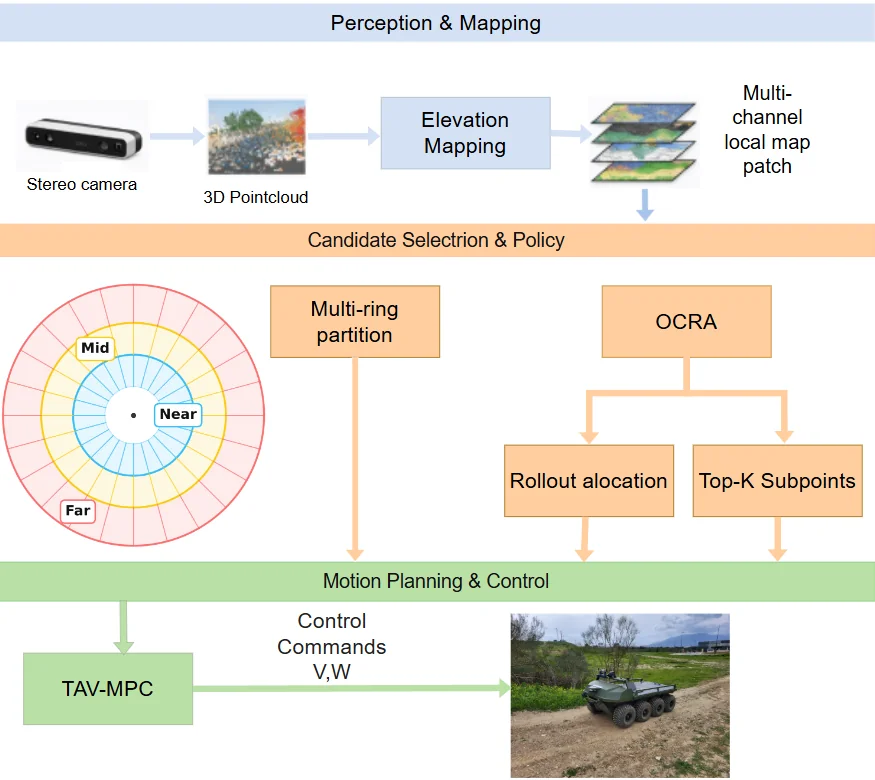
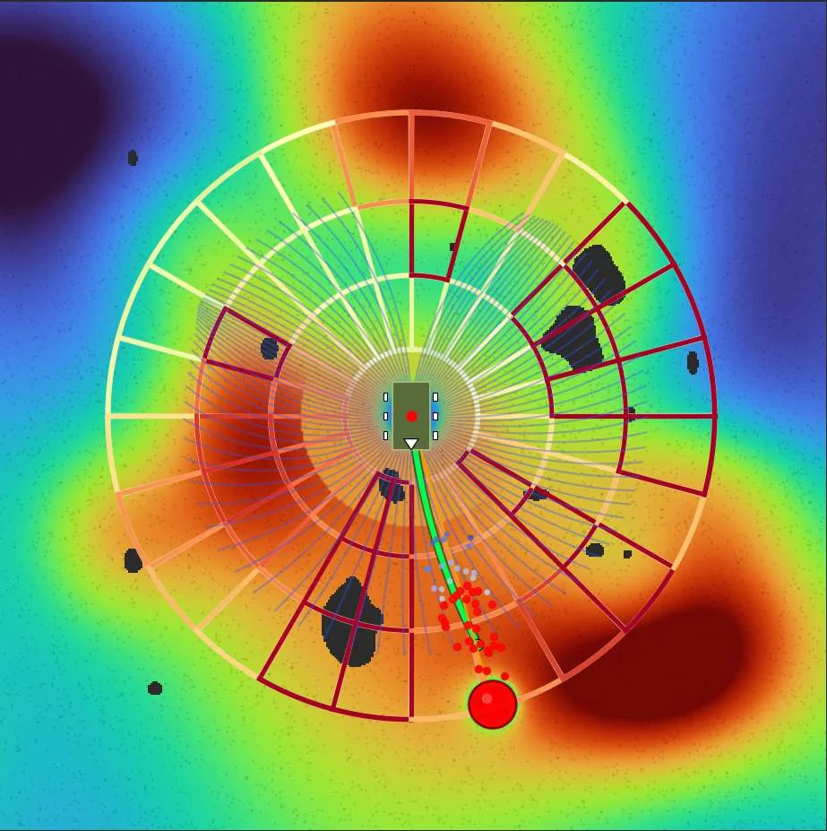
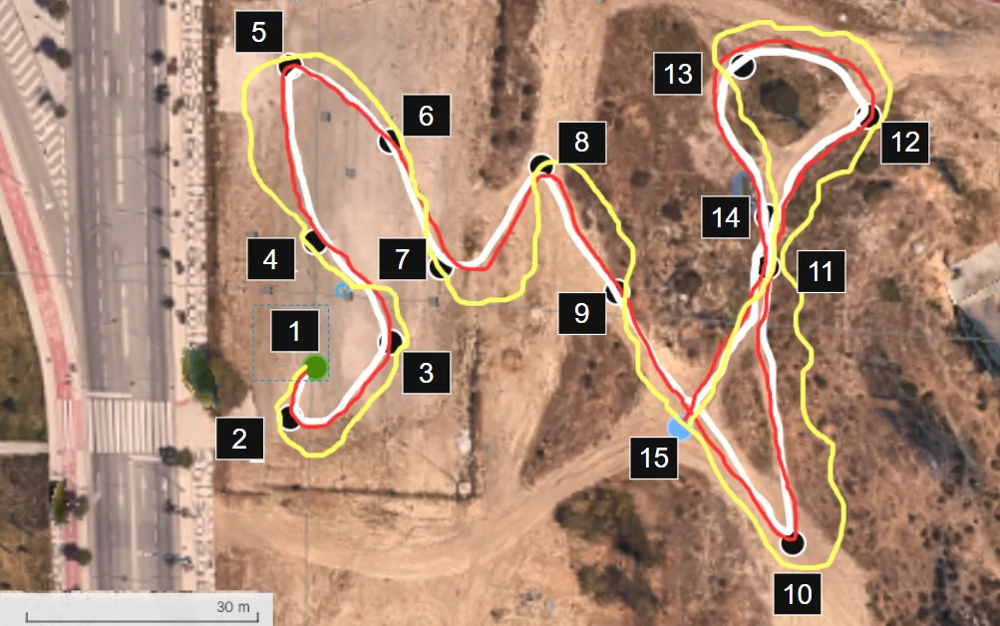

<!-- doc: 개요 | 0 -->
# 리서치 개요 (2026-09)

**travplan의 리서치는 이 개요와, 파이프라인 순서의 네 주제 문서, 두 보조 문서로 나뉜다.** 주제 문서는 인식, Planner,
Controller·안전, 시뮬레이션이고, 보조 문서는 여러 논문이 함께 쓰는 수식(배경·수식)과 전체 목록(참고문헌)이다. 각 주제 문서의 첫 탭은 그 분야의
**계보**다. 분야를 연 마일스톤에서 2026년 최신(SOTA)까지 한 표로 보여 주고, 공개 모델(HuggingFace)과 코드(GitHub) 현황을 함께 둔다.
그다음 탭들이 세부 주제별 설명이다.

각 방식은 같은 순서로 소개한다. **한 줄 요약**으로 무엇인지 말하고, **동작 방식**을 설명하고, **travplan에 주는 의미**로 마무리한다.
논문 그림에는 무엇을 보여주는지 한 줄 설명을 붙였다. 방법과 수식은 그림 뒤의 **"자세히"** 토글에 있다. ==노란 강조==는 그 절에서
가장 먼저 기억할 문장이다.

**이 문서의 탭은 둘이다.** 개요 탭은 문서 지도, 전체 연표, costmap의 한계를 다룬다. 학회 수확 탭은 IROS 2026에서 travplan의 열린 질문에 걸리는 논문을 모으고,
그중 다섯 편을 그림과 함께 자세히 읽는다.

```
 센서(카메라/LiDAR)                                                            동적 장애물(보행자)
      │                                                                              │
      ▼                                                                              ▼
 ┌──────────────────┐    ┌───────────┐    ┌──────────────────┐    ┌──────────────────────────────┐
 │ 인식 (§A)         │──▶ │ TravMap   │──▶ │ Planner (§B)      │──▶ │ Controller · 안전 (§E, §C)     │──▶ body twist
 │ 지형 지도, 가통행성 │    │ [8,H,W]   │    │ 학습 궤적 생성     │    │ MPPI 추종, 안전 필터            │
 │ 동적 장애물 인식    │    └───────────┘    └──────────────────┘    └──────────────────────────────┘
 └──────────────────┘
          시뮬레이션 (§S): 운동학 시뮬 · Isaac Sim · 보도 장면 · sim-to-real 로 위 전체를 검증
```

**문서 지도.** 문서마다 첫 탭이 개요(분야 계보, 공개 코드·모델 현황, travplan의 위치)이고, 그 뒤가 주제별 탭이다. 절 번호는 문서를 옮겨도
그대로 둔다(인식 A, Planner B, Controller E와 안전 필터 C, 보행 갤러리 G, 시뮬레이션 S, 배경 0, 강화학습 R, 딥러닝 L, 모방 I, 참고문헌 D).

| 문서 | 탭과 절 | 무엇을 보나 | travplan에서 |
|---|---|---|---|
| 인식 (§A) | 지형 지도·Occupancy(A.1–A.5), Traversability(A.10), 시각 기반 모델(A.11), 동적 장애물(A.12), 예측·World model(A.6), 보행 로봇(A.7–A.9) | 센서에서 TravMap과 동적 장애물까지 | elevation mapping(P2.1), TravNet(TP-0010), 검출·추적 PoC(TP-0011) |
| Planner (§B) | **방법** — travplan과 고전 기준선(B.1, B.10), 학습 로컬 Planner(B.2–B.4, B.4b, B.7), 생성형 궤적(B.8.0, B.8), Foundation·VLA·언어(B.6, B.6b–B.6d), 위험 인지·로컬 내비(B.9). **현황** — 자율주행 자동차(B.12.1, B.11, B.13), 로봇별 공개 스택(B.12), ETH RSL 계보(B.14), NVIDIA·DeepMind·취리히·RAI(B.16, B.16.1–B.16.4), 다른 연구실·휴머노이드 주행(B.16.5–B.16.8). **종합** — 분야별 지형(B.18), 최근 연구 비교(B.17) | 경로와 시간 인덱스 궤적 생성 | GuidancePlanner, LearnedPlanner, Planner D |
| Controller·안전 (§E, §C) | MPPI 계열(E.1, B.5), 학습 동역학·적응(E, E.2), 안전 필터(C.1–C.4) | 궤적 추종과 안전 | MPPIController(유지보수), 시간가변 비용 레이어, CVaR-BF 후보 |
| 시뮬레이션 (§S) | 물리 엔진(S.1), 보도·도시(S.2), 보행자(S.3), 센서·렌더링(S.4), 지형·바퀴(S.5), sim-to-real(S.6), travplan 권고(S.7) | 검증 환경의 네 층(L0–L3) | 운동학 시뮬(L0), Isaac Sim(L1) |
| 배경·수식 (§0) | 인식(0.1, 0.8, 0.9, 0.10, 0.14), Planner·학습(0.5, 0.6, 0.7, 0.12, 0.13), 제어·안전(0.2, 0.3, 0.4, 0.11) | 여러 논문이 공유하는 수식 | 각 토글이 "배경 0.N"으로 가리킨다 |
| 강화학습 (§R) | 개요(R.0), 문제 설정·모방(R.1–R.2), 정책 기울기(R.3–R.5), 가치 기반(R.6), 추론으로서의 제어(R.7–R.8, R.17), 모델 기반(R.9, R.18), 오프라인·탐색(R.10–R.11), LLM·생성 정책·안전(R.12–R.13), 이론·다과제(R.14–R.15), travplan에서(R.16) | 버클리 CS 185/285의 강의마다 풀어 쓴 설명과 영상(2023, 2018), 확산·flow 정책의 RL | TP-0066 후학습(AWR, 그룹 이점), TP-0128 진화 전략, MPPI(제어를 추론으로), NMPC(iLQR 계열) |
| 딥러닝 (§L) | 개요(L.0), 기초(L.1–L.3), 구조(L.4–L.8), 생성 모델(L.9–L.13), 자기지도·규모(L.14–L.18), 멀티모달·로봇(L.19–L.21), travplan에서(L.22) | 교재 Understanding Deep Learning과 MIT 6.S184·Stanford CS336을 뼈대로 한 딥러닝 개념. 장난감 문제를 실제로 풀어 그린 그림 | Planner D(flow matching), Joint Planner(DiT식 transformer), TravNet, TinyPolicy의 구조와 학습 |
| 보행 갤러리 (§G) | 사족보행(G.1–G.10), 휴머노이드(G.11–G.16), 다몸체(G.17), travplan에서(G.18) | 사족·휴머노이드 보행의 마일스톤 논문 17편을 한 편에 카드 하나로. 초록 전문 번역, 원문 그림 번역 설명, 방법·결과 표, 왜 마일스톤인가 | 스워브 plant 지연(TP-0150), 교사–학생 DAgger(TP-0075·0055), belief 지도의 sigma, Planner·Controller 경계, sim-to-real 프로토콜(TP-0043) |
| 모방 (§I) | 개요(I.0), 데이터·리타기팅(I.1–I.6), 동작 추종(I.7–I.9), 범용 추종기(I.10–I.12), 위 층(I.13), travplan에서(I.14) | 사람 동작 데이터와 라이선스, 리타기팅(로봇 쪽 고전, GMR·OmniRetarget), 동작 추종(SAMCON·DeepMimic에서 BeyondMimic까지의 계보), 범용 추종기(SONIC, SuperMimic)와 2026년 후속, 공개 코드. 장난감 문제를 풀어 그린 그림 | 학습 절차(적응 표집, 교사–학생, world model을 통한 정책 기울기), Planner·Controller 분리, Playground 휴머노이드 |
| 참고문헌 (§D) | 인식(D.1–D.3b), Planner(D.0–D.5b), Controller·안전(D.6–D.7b), 강화학습(D.14), 딥러닝(D.15), 모방(D.16), 연구 그룹(D.13), 로코모션·데이터·산업(D.8–D.12) | 전체 목록, 발표처, 코드 링크 | — |

**전체 연표.** 분야마다 흐름을 바꾼 연구를 한 표에 놓았다. 2023년 전후로 네 분야가 함께 "큰 사전학습 모델 + 생성형 출력"으로
옮겨 갔다. 인식은 시각 기반 모델로, Planner는 diffusion과 flow matching으로, Controller는 학습 world model로, 시뮬레이션은 GPU 병렬
학습과 사진 같은 렌더링으로 갔다. 각 이름의 설명은 해당 문서의 개요 탭과 본문에 있다.

| 연도 | 인식 | Planner | Controller·안전 | 시뮬레이션 |
|---|---|---|---|---|
| 1959–1997 | — | Dijkstra, A*, DWA | — | — |
| 2008–2014 | Robot-centric elevation mapping | Hybrid A*, TEB | — | — |
| 2015–2018 | Social GAN | Apollo EM planner | MPPI, 정보이론적 MPC, CBF-QP, HJ 도달 가능성, PETS, 예측 안전 필터 | Sorour 등, Domain Randomization, Dynamics Randomization |
| 2019–2020 | Lift-Splat-Shoot, RELLIS-3D, BADGR, 등속 모델, Trajectron++ | Nav2 | CBF 튜토리얼, 이산 CBF + MPC | Actuator net, ADR, Sim2Real Predictivity |
| 2021–2022 | BEVFormer, BEVFusion, MonoScene, elevation_mapping_cupy, ByteTrack, BoT-SORT | Diffuser, GNM, FAR Planner, PUTN | Robust MPPI, IKD, RMA, log-MPPI, SMPPI | Learning to Walk in Minutes, ART/ATK |
| 2023 | DINOv2, Grounding DINO, Occ3D, WVN, RT-DETR | iPlanner, ViNT, NoMaD, Diffusion Policy, MPD, UniAD, VAD, PDM-Closed, ArtPlanner | TD-MPC2, 안전 필터 통합 관점 | HuNavSim, Gazebo Harmonic |
| 2024 | Depth Anything V2, SAM 2, V-STRONG, RoadRunner, YOLOv10, D-FINE | ViPlanner, OpenVLA, π0, NaVILA, CityWalker, DiffusionDrive, NAVSIM, Hydra-MDP | MPPI-Generic | MetaUrban, Arena 4.0, X-Mobility, Navigation World Models |
| 2025 | DINOv3, Depth Anything 3, SAM 3, RF-DETR, MoFlow | Diffusion Planner, GoalFlow, NavDP, CaRL, Alpamayo, MolmoAct, VAMOS, FPO | CVaR-BF, DRA-MPPI | Isaac Lab, MuJoCo Playground, URBAN-SIM, UrbanVerse, COMPASS, Cosmos |
| 2026 | WalkOCC, ViTA, CATNAV, PIVOT, RayOcc, 4D panoptic occupancy tracking, EgoHTR | AgniNav, MILER, PC-Diffuser, JPPD, GRACE, Can VFMs Navigate?, Click-and-Traverse, TNT, DYNA-2.1 | ProxPI, Predictive Semantic Safety, HDVIO2.0, OGM-CBF, Safe Score Matching, PolyStep | Isaac Sim 6.x, Newton, SidewalkBench, NavIsaacLab |

## ROS/ROS2 costmap의 한계 — travplan이 TravMap을 쓰는 이유

**travplan은 지금도 ROS 2 위에서 돌고 Nav2 생태계를 쓴다.** 그런데 공통 표현만은 `costmap_2d`가 아니라
`TravMap[8,H,W]`다. 왜 갈라섰는지를 여기에 적는다. ==결론부터: costmap은 "여기 무언가 있나"를 답하는 자료구조이고,
보도 주행이 물어야 하는 것은 "여기를 지날 수 있나"다.==

**먼저 costmap이 무엇인지.** `nav2_costmap_2d`는 2D 격자에 레이어를 쌓는다. static(정적 지도), obstacle(센서로
mark/clear), voxel(3D로 쌓았다가 2D로 투영), inflation(장애물 주위를 로봇 반지름만큼 부풀림)이다. 각 셀은
0–255의 비용 하나를 갖는다.

### 다섯 가지 한계

**① 점유/비점유의 이분법.** 셀은 "비었다 / 찼다 / 모른다"와 inflation 비용을 갖는다. ==**"지날 수는 있지만 비싼 곳"**을
표현할 자리가 없다.== 경사 8°의 램프와 평지가 같은 값이고, 자갈과 아스팔트가 같은 값이다. 경사·거칠기를 넣으려면
직접 레이어를 만들어야 하는데, 그러면 그 레이어의 의미는 더 이상 표준이 아니다.

**② 2D 투영이 높이를 무너뜨린다.** 이것이 보도에서 가장 아프다. 세 가지가 함께 무너진다.

- **연석.** 3D 점을 2D로 투영하면 높이 10 cm 턱과 높이 2 m 벽이 같은 "장애물"이다. 반대로 투영 문턱 아래의 턱은
  아예 사라진다(Planner 문서 B.12.4의 BotBrain 사례: 10 cm 미만 턱을 놓친다).
- **오버행.** 나뭇가지나 간판 아래는 로봇이 지나갈 수 있는데 2D로는 막힌 것이 된다.
- ==**음의 장애물.**== 포트홀·배수구·내려가는 연석은 **반사가 돌아오지 않는다.** costmap에서 "반사 없음"은 장애물이
  아니라 **미관측**이고, 미관측은 보통 자유공간처럼 지나간다. travplan이 TP-0031(가림)·TP-0044(그림자 상한)·
  TP-0047(깊이 prior)·TP-0067(관측 증거로 묶기)에 들인 일이 전부 이 한 칸을 메우는 작업이다.

**③ 불확실성이 없다.** 셀은 비용 **하나**를 갖는다. "얼마나 확신하는가"를 담을 곳이 없다. 미관측은 플래그이지
분포가 아니다. 그래서 *"못 본 곳에서는 천천히"*를 표현할 수 없고, 그 결정은 전부 플래너·제어기 쪽 임시 규칙이 된다.
TravMap의 `SIGMA` 채널이 이 자리다.

**④ inflation은 고정된 기하 연산이다.** 로봇 반지름과 감쇠 계수로 정해지고, 속도·지형·불확실성에 따라 변하지 않는다.
Controller 문서 F.5의 4족 확률 제약 MPC가 **"손으로 맞춘 제약 조이기"를 이겼다**고 보고하는데, costmap의 inflation이
바로 그 손으로 맞춘 조이기의 전형이다. travplan의 TP-0069가 겨냥하는 것도 같다.

**⑤ 지면 평면을 가정한다.** 투영 기준면이 평평하다고 보므로, 경사면에서는 **지면 자체가 장애물로 마킹된다.** 실외
적용에서 흔한 실패이고, 농업 쪽 보고에서는 로봇이 밟고 지나갈 수 있는 키 큰 풀이 장애물로 찍혀 경로가 길어지거나
주행이 중단됐다([arXiv:2407.18535](https://arxiv.org/abs/2407.18535)).

### 업스트림도 같은 결론을 적어 두었다

이것은 바깥의 비판이 아니다. Nav2 저장소의 이슈
[#1278 *Redesign Environmental Representation*](https://github.com/ros-navigation/navigation2/issues/1278)에서
메인테이너가 2019년에 이렇게 썼고, 그 이슈는 지금도 **열려 있다.**

> 오늘 우리는 독립된 셀들의 2D costmap을 쓴다. 싸고 쓸모 있는 방법이지만, 당분간 우리를 2.5D 땅에 묶어 둘 것이다.
> (…) 경사를 3D로 다루면 램프나 언덕, **내려가는 계단이나 낙차**를 표현할 수 있다. (…)
> ==비었나 찼나를 따지는 대신 이제 이렇게 생각하자 — **여기를 지날 수 있나.**==

travplan의 `TravMap`은 그 제안을 실제로 구현한 형태에 가깝다. 제안된 "gradient map"이 `GRAD_X`·`GRAD_Y`·`SLOPE`이고,
"지날 수 있나"가 `COST`다.

### TravMap의 여덟 채널이 어느 한계에 답하나

| 채널 | 답하는 한계 |
|---|---|
| `ELEV` | ② 높이를 버리지 않는다 |
| `GRAD_X`, `GRAD_Y`, `SLOPE` | ①·⑤ 경사를 값으로 갖는다. 지면 평면을 가정하지 않는다 |
| `STEP` | ② 연석 높이를 벽과 구분한다(`max_step_m = 0.08`) |
| `ROUGH` | ① 자갈과 아스팔트를 구분한다 |
| `COST` | ① "지날 수 있나"를 연속값으로 |
| `SIGMA` | ③ 얼마나 확신하는지 |

### 그래도 costmap을 버리지는 않는다

==표현을 바꾼 것이지 생태계를 버린 것이 아니다.== Nav2의 행동 트리, 복구 행동, 전역 플래너(Smac), 그리고 실물
배포의 안전 장치는 그대로 값이 있다. travplan이 Nav2와 겹치는 지점과 비교 기준은 Planner 문서 B.12.4에 정리해 두었다.
실물 배달로봇 스택(AntBot)도 Nav2 위에 있다. **바뀌는 것은 "무엇을 공통 표현으로 쓰는가" 하나다.**

<!-- tab: 학회 수확 (IROS 2026) -->
## 학회 수확 — IROS 2026 (피츠버그)

**채택 논문 1,929편을 제목으로 훑어 travplan의 열린 질문에 걸리는 것만 골랐다**([논문 색인](https://2026.ieee-iros.org/program/paper-index/)).
세부는 각 주제 문서에 들어가고, 여기서는 지도와 자세히 볼 다섯 편을 둔다.

==제목에 "sidewalk"가 들어간 논문이 한 편도 없다.== 보도 배달로봇이라는 자리는 여전히 비어 있다. 가장 가까운 것은 험지(off-road)와
다리 로봇이고, 그 방법을 보도 규모로 옮기는 일은 travplan의 몫으로 남는다. 키워드별 편수는 terrain 41, traversability 9, off-road 8,
elevation map 7, occupancy 11, MPPI 9, sidewalk 0이다.

| travplan의 열린 질문 | IROS 2026에서 걸리는 논문 | 어디에 |
|---|---|---|
| 기하만으로 매기는 비용의 한계(TP-0010, TP-0022) | **TNT**(508), **Remember Your Driving Feel**(1304), **TravKAN**(2427), Implicit Neural Representation of Terrain Traversability(4937) | 인식 A.10 |
| 가림과 미관측(TP-0031, TP-0044, TP-0047) | **RayOcc**(1720), **OGM-CBF**(3618), BEACON(3266), What's Hidden Matters(1569) | 인식 A.5, Controller C |
| 고도지도 위의 샘플링 제어(Controller) | **Observation-Conditioned Rollout Allocation**(3312), PA-MPPI(68), Value Function-Guided MPPI(3764) | Controller E.1, B.5 |
| 바퀴 제어와 계획–실행 간극(TP-0034, TP-0150) | **MSC: Multi-Stage Caster-Aware Control**(3480), CHUTNI(2438) | Planner B.12.4 |
| occupancy 표현과 추적 | **Streaming Gaussian Encoding for 4D Panoptic Occupancy Tracking**(2962, Best Paper 결선), OccTrack360(1298) | 인식 A.2 |

### 왜 이 다섯 편인가

**다섯 편은 위 표의 질문에서, 파이프라인의 층이 겹치지 않게, 우리 결정과 반대쪽 근거가 되는 것을 골랐다.** 1,929편을 다 읽을 수는 없다.
그래서 2026-09-28에 제목·저자·세션으로 위 표를 먼저 만들고, 그 표에서 자세히 볼 것을 골랐다. 기준은 셋이다.

1. **열린 질문에 바로 걸린다.** 표의 줄마다 travplan의 TP가 있다. 분야가 가까워도 우리 결정을 바꿀 수 없는 논문은 표에만 남겼다.
2. **층이 겹치지 않는다.** 다섯 편이 인식의 비용 규칙, 비용의 온라인 갱신, Controller의 표본, 바퀴 제어, 지도 표현과 평가를 한 층씩 맡는다.
   한 층의 논문 다섯 편보다 빈 곳이 잘 드러난다.
3. **우리와 다른 쪽을 고른다.** 우리 쪽을 지지하는 논문은 결정을 바꾸지 않는다. 반대쪽 근거가 있어야 TP-0057 같은 결정을 다시 볼 수 있다.

| 편 | 맡는 층 | 걸린 질문 | 우리와 다른 쪽 | 원문(2026-10-26 확인) |
|---|---|---|---|---|
| TNT(508) | 인식: 비용 규칙 | 기하 cost의 보수성(TP-0022, TP-0057) | 최댓값 규칙 대신 "못 간다"를 주행 기록으로 낮춘다 | arXiv 전문, 코드 없음 |
| POLT(1304) | 인식: 비용 갱신 | TravNet 자기지도 라벨(TP-0010, TP-0022), 마찰(TP-0059) | 오프라인 학습 대신 주행 중에 갱신한다 | 초록만, 본문 미공개 |
| OCRA(3312) | Controller: 표본 | 가림과 좁은 지도(TP-0031), plant 레벨 3 멈춤(TP-0151) | 못 본 칸을 비용뿐 아니라 표본 배분에도 쓴다 | 대학 저장소의 원고, 코드 없음 |
| MSC(3480) | Controller: 바퀴 | plant 지연(TP-0149, TP-0150), 스워브 모듈(TP-0034) | 지연을 rollout에 넣는 대신 하위 학습으로 흡수한다 | arXiv 전문, 코드 없음 |
| SGE(2962)와 OccTrack360(1298) | 인식: 표현과 평가 | 미관측과 지도 평가(TP-0053) | 칸마다 관측 신뢰도를 시간에 걸쳐 쌓는다(우리 σ에는 시간이 없다) | 둘 다 arXiv 전문과 코드 |

**가림 줄은 따로 고르지 않았다.** RayOcc와 OGM-CBF는 아래 마무리에서 비교 대상으로만 든다. 같은 문제를 OCRA(못 본 칸을 표본 배분에)와
OccTrack360(못 본 칸을 평가 범위에)이 다른 층에서 다룬다. 두 논문의 원문은 아직 확인하지 않았다.

**원문을 다시 읽고 세 곳을 고쳤다.** 처음 고를 때는 제목·초록·세션만 봤다. 2026-10-26에 원문을 읽으니 아래가 처음 요약과 달랐다.

- MSC의 로봇은 비동축 스워브가 아니라 수동 캐스터를 단 차동구동 AMR이다. 캐스터의 오프셋도 구름 방향이라, 바퀴 축 방향인 AntBot과 다르다.
- TNT의 "50 %, 26.7 %, 9.2 %"는 한 코스 10회에서 TNT 없는 MPPI 대비 상대값이다.
- SGE는 Best Paper·Best Student Paper 결선 10편 중 하나다. OccTrack360의 어안 카메라는 측면 2대다.

POLT는 본문이 공개되면 다시 본다. 카드는 원문, 한 줄 요약, 동작 방식, 결과, travplan에 주는 의미 순서다. 방법과 수식은 카드 끝의 **"자세히"** 토글에 있다.

### 골라 볼 다섯 편

#### TNT — 못 갈 것처럼 보이는 바위를 주행 기록으로 다시 매긴다(508)

**원문.** Chenhui Pan·Aniket Datar(공동 1저자)·Anuj Pokhrel·Matthew Choulas·Mohammad Nazeri·Xuesu Xiao, George Mason University.
[arXiv:2409.17479](https://arxiv.org/abs/2409.17479)(2024-09, CC BY 4.0), [영상](https://www.youtube.com/watch?v=Shcalb8sGcA).
코드는 없다. 로봇 플랫폼만 `RobotiXX/Verti-Wheelers` 저장소로 공개돼 있다.

**한 줄 요약.** ==기존 추정기가 "못 간다"로 자르는 바위 지형을, 그 패치가 지난 주행에서 차를 얼마나 기울이고 명령과 실제를 얼마나 어긋나게 했는지로 다시 매긴다.==
사륜구동·독립 서스펜션·디퍼렌셜 잠금이 있는 바퀴 로봇은 차체만 한 바위도 넘는다. 갈 수 있다/없다로 자르면 그 능력을 버린다.

**동작 방식.** 1/10 크롤러 V4W를 실내 바위판(3.1 × 1.3 m, 최고 0.6 m)에서 139분 원격조종해 고도 지도 70,816장을 모았다. 지도의 패치마다 세 값을 만든다.

- **정적 roll·pitch.** 바퀴 네 접점의 높이차를 바퀴 간격으로 나눠 구한다. 학습하지 않는다.
- **속도 어긋남.** 명령 속도와 실제 속도(모캡)의 차를 평균과 분산으로 배운다.
- **자세 예측 오차.** 6-DoF 모델 TAL이 25스텝 앞을 예측한 자세와 실제 자세의 차를 같은 방식으로 배운다.

세 값을 가중합하고 진행 방위 다섯을 평균하면 패치 값이 된다. 배포 때는 고도 지도 한 장에서 14채널 지도를 한 번에 내는 재구성망만 돈다.
MPPI는 TAL로 rollout하면서 이 지도로 분명히 못 가는 곳을 먼저 걸러 표본 공간을 줄인다. A*의 비용 지도로도 쓴다.

**결과(Table I).** 바위판의 한 코스에서 방법마다 10회 달렸다.

- 성공은 TNT 9/10, TNT 없는 MPPI+TAL 6/10, 분해형 6-DoF 모델 wmvct 8/10이다.
- 성공한 시행의 평균 주행 시간은 TNT 17.6 s, MPPI+TAL 24.0 s다.
- 처음 적은 "계획 성능 50 %, 효율 26.7 %, 안정성 9.2 %"는 모두 MPPI+TAL 대비 상대값이다. 50 %는 성공 6회 → 9회, 26.7 %는 주행 시간,
  9.2 %는 roll과 pitch 크기의 평균이 준 비율이다. 9.2 %는 본문에 식이 없어 표로 계산했다.
- pitch 크기 하나만 보면 MPPI+TAL(6.9°)이 TNT(8.2°)보다 작다.
- 시뮬레이션 실험은 없다. 실외는 정성 시연뿐이다.

**travplan에 주는 의미.**

- **우리 게이트로는 아직 근거가 아니다.** 한 코스 10회 한 판이고, 9/10 대 6/10의 정확 검정 p는 0.30이다. 실패를 전복과 갇힘으로 나누지 않아
  치명 실패 수를 셀 수 없다. 치명은 p와 무관하게 늘면 안 된다는 travplan 게이트로는 판정할 수 없다.
- **값을 합치는 식이 반대다.** `GeometricTraversability`는 경사·턱·거칠기를 각 한계로 나눈 값의 최댓값을 쓴다. TNT는 가중합이고 진행 방위 다섯을 평균한다.
  한 방향에서만 위험한 칸(옆으로 들어가면 기우는 경사)은 평균에 묻힌다. 보도에서는 이 평균을 그대로 가져오지 않는다.
- **가져올 것은 라벨이다.** 명령 속도와 실제 속도의 차는 "걸려서 못 간다"를 데이터로 잡는다. TravNet의 proxy(TP-0022)는 수직 가속으로 충격을 재서
  과속방지턱을 편하다고 느꼈다(TP-0057). 속도 어긋남은 반대편인 진행 방해를 잰다. 슬립 proxy로 TravNet을 배우는 TP-0059(대기)에 넣을 후보다.
  TravNet도 가우시안 NLL로 σ를 배우므로 σ 채널은 그대로 이어진다.
- **TP-0057의 결정은 그대로 둔다.** 2026-10-03에 "잔차는 cost를 올리는 쪽만"을 기본으로 정했다. TNT는 낮추는 쪽의 근거로 읽히지만, 위의 이유로 결정을 바꾸지 못한다.
  낮추는 실험을 한다면 TNT식 라벨로 하되 치명 수를 짝 비교로 잰다.
- **수치는 옮기지 않는다.** 크롤러는 디퍼렌셜 잠금으로 0.6 m 바위판을 지난다. travplan 로봇이 넘는 턱은 0.08 m까지다.


*그림 — TNT 개요 (Fig. 1): 위는 흑백 고도 지도에서 TNT 없는 MPPI의 표본이 흰 바위 쪽으로 몰리는 장면이고, 아래는 TNT 지도(파랑 쉬움, 빨강 어려움)에서 표본이 파란 통로로 모이는 장면이다. 오른쪽은 1/10 크롤러 V4W다. 출처: [arXiv:2409.17479](https://arxiv.org/abs/2409.17479)*


*그림 — TNT 라벨 만들기 (Fig. 2): 패치 p에서 roll·pitch 2장, 속도 어긋남의 평균·분산 4장, 자세 예측 오차의 평균·분산 8장을 만들고 w1–w3로 더한다. 재구성망이 고도 지도 한 장에서 이 지도를 바로 낸다. 출처: [arXiv:2409.17479](https://arxiv.org/abs/2409.17479)*


*그림 — TNT 실물 시험 (Fig. 5): 왼쪽은 Table I을 잰 실내 바위판이고, 오른쪽은 자갈·바위가 섞인 실외 정성 시연이다. 출처: [arXiv:2409.17479](https://arxiv.org/abs/2409.17479)*

<details markdown="1">
<summary>자세히: TNT의 방법과 수식</summary>

**정적 roll·pitch.** 바퀴 $i$ 아래 칸의 높이를 $h_i$, 두 바퀴 사이 거리를 $d_{i,j}$라 하면 아래와 같다.

$$\text{roll},\ \text{pitch} = \tfrac12 \Big\lVert \sum_{(i,j)\in\mathcal I} \arctan\frac{h_i-h_j}{d_{i,j}} \Big\rVert$$

바퀴 번호는 앞왼쪽 1, 뒤왼쪽 2, 뒤오른쪽 3, 앞오른쪽 4다. roll은 $\mathcal I=\{(1,4),(2,3)\}$, pitch는 $\{(1,2),(4,3)\}$이다.
이 식은 정적 기울기만 준다. 바퀴 반경과 턱 높이로 정해지는 "오를 수 있나"는 이 식에 없고, 아래의 속도 어긋남이 데이터로 잡는다.

**속도 어긋남과 자세 예측 오차.** $\Delta\mathbf v=\mathbf v_{\text{cmd}}-\mathbf v_{\text{actual}}$이고 $\mathbf v=(v,\omega)$다. 같은 패치라도 차의 상태에 따라 값이 달라서 분포로 배운다.
7층 CNN과 FC 3층이 패치 $p$에서 $(\mu^{\Delta\mathbf v},\sigma^{\Delta\mathbf v})$를 내고, 손실은 가우시안 NLL이다.

$$\mathcal L=\sum_i \tfrac12\Big(\log\sigma^2(p_i)+\frac{(\mu(p_i)-\Delta\mathbf v_i)^2}{\sigma^2(p_i)}\Big)$$

자세 쪽 $\Delta\mathbf q=\mathbf q_{\text{pred}}-\mathbf q_{\text{actual}}$는 TAL의 25스텝 예측과 실제의 차다. 성분은 x, y, roll, pitch다. yaw는 x·y와 겹치고 z는 정보가 적어 뺐다.
정답 속도와 자세는 OptiTrack에서 왔다. 모캡은 학습 데이터를 모을 때만 쓴다.

**패치 값과 재구성.**

$$\text{Tr}(p)=\mathbf w_1[\text{roll},\text{pitch}]^\top+\mathbf w_2[\mu^{\Delta\mathbf v},\sigma^{\Delta\mathbf v}]^\top+\mathbf w_3[\mu^{\Delta\mathbf q},\sigma^{\Delta\mathbf q}]^\top$$

가중치 값은 보고하지 않았다. 칸마다 진행 방위 $\Psi=\{-\pi/2,-\pi/4,0,\pi/4,\pi/2\}$로 패치를 잘라 평균한 값이 지도 값이다.
재구성망(잔차 연결이 있는 4층 CNN 인코더와 conv-transpose 3층)은 고도 지도에서 14채널 320 × 260 지도를 낸다(roll·pitch 2, 속도 4, 자세 8).
최종 지도는 14채널의 가중합이고, 가중치는 상황에 따라 바꿀 수 있다고 쓴다. 입력 고도 지도는 Azure Kinect 깊이에 elevation_mapping_cupy를 돌린 것이다.
칸 크기와 패치 크기는 적혀 있지 않다.

**Planner와의 연결.** MPPI가 TAL로 SE(3) rollout할 때 이 지도로 표본 분포를 치우치게 하고, 못 가는 곳을 먼저 걸러, 더 짧은 horizon으로 계획한다고 쓴다.
비용 항으로 넣는지 표본 분포를 바꾸는지는 식이 없다. A*에서는 지도를 평균 합성곱으로 31 × 25로 줄여 traversability 비용과 거리를 함께 최소화하고, DWA나 PID가 경로를 따른다.

**Table I 전체**(평균 ± 표준편차, 방법마다 10회). V4W는 길이 0.52 m, 폭 0.25 m다(플랫폼 논문 arXiv:2303.00998).

| 지표 | TNT | MPPI+TAL | wmvct |
|---|---|---|---|
| 성공 | 9/10 | 6/10 | 8/10 |
| 주행 시간 | 17.6 ± 2.64 s | 24.0 ± 9.88 s | 21.1 ± 24.90 s |
| roll 크기 | 6.6 ± 7.0° | 9.4 ± 24.6° | 8.3 ± 11.9° |
| pitch 크기 | 8.2 ± 7.4° | 6.9 ± 10.9° | 8.8 ± 10.7° |
| Δroll | 0.51 ± 1.03° | 0.63 ± 6.07° | 0.97 ± 1.6° |
| Δpitch | 0.53 ± 0.68° | 0.080 ± 1.3° | 0.57 ± 1.08° |
| Δthrottle | 0.042 ± 0.15 | 0.065 ± 0.34 | 0.053 ± 0.31 |
| Δsteering | 0.071 ± 0.24 | 0.153 ± 0.38 | 0.087 ± 0.23 |

MPPI+TAL의 Δpitch 0.080°는 PDF에도 같다. 본문은 "TNT가 Δ 네 지표 모두 가장 낮다"고 써서 0.80의 오타로 보인다. wmvct와는 성공 9/10 대 8/10이다(정확 검정 p 1.0).
TNT의 실패 1회는 분석하지 않았다. 저자가 밝힌 한계는 순수 기하만 쓴다는 것이다. 잔디·멀치·진흙·자갈은 기하로 바위와 비슷해 보여도 traversability가 다르다.

**travplan에 주는 것.** TravMap은 σ를 cost와 다른 채널로 둔다. TNT처럼 불확실성을 cost에 더해 버리면 Controller가 "모르는 곳"과 "비싼 곳"을 가를 수 없다.
속도 어긋남을 라벨로 쓸 때도 평균은 cost 쪽, 분산은 σ 쪽으로 나눠 넣는다.

</details>

#### Remember Your Driving Feel(POLT) — 바퀴가 느낀 것으로 주행 중에 배운다(1304)

**원문.** *Remember Your Driving Feel: Proprioception Based Online Learning for UGV Traversability across Complex Terrains*.
Zikang Xie·Binhan Du·Kexin Fei·Jian Li·Zhenping Sun·Shucheng Li·Xiaohui Li·Dewen Hu, 중국 국방과기대(NUDT).
**2026-10-26 현재 본문이 공개되지 않았다.** arXiv·Google Scholar·OpenAlex·GitHub에서 찾지 못했다. 아래는 IROS 프로그램에 실린 초록만으로 쓴 것이다.

**한 줄 요약.** ==빙판과 물 고인 길은 평평해도 미끄럽고, 풀 덤불은 장애물처럼 보여도 지나갈 수 있다.== 기하와 고정된 의미 라벨로는 지형의 역학적 성질을
담지 못한다는 것이 저자의 진단이다. POLT는 주행 중의 고유 감각(proprioception)으로 traversability를 배우고 예측한다.

**동작 방식(초록 기준).** 두 부분으로 된다.

- **T-PINN**(Temporal-aware Physics-Informed Neural Network)이 실시간 고유 감각 신호에서 traversability를 배운다.
- **동적 메모리**가 오프라인 물리 prior와 온라인 경험을 합쳐 지식을 쌓고 빨리 적응한다. 제목의 "Remember"가 이 부분이다.

초록은 외부 감각 기반 기준선과 온라인 학습 기반 기준선을 모두 이겼다고 쓴다. 시험 노면은 빙판, 물 고인 길, 풀 덤불이다.
어떤 신호(IMU 진동, 바퀴 슬립, 토크)를 쓰는지, 아직 밟지 않은 칸으로 어떻게 넓히는지, 수치가 얼마인지는 본문이 나와야 안다.

**travplan에 주는 의미.**

- **TravNet과 같은 계열이다.** 둘 다 로봇이 지나간 칸에 자기 감각으로 라벨을 붙인다(TravNet은 TP-0010 설계, TP-0022 실험).
  다른 점은 갱신 시점이다. TravNet은 모은 라벨로 오프라인 학습하고, POLT는 주행 중에 갱신한다.
- **"prior + 경험"은 TravNet 구조의 온라인판이다.** TravNet은 기하 cost를 사전지식으로 두고 그 위에 잔차를 얹는다. POLT의 "오프라인 물리 prior + 온라인 경험"이 같은 짜임이다.
- **빙판은 travplan의 빈칸이다.** 기하 cost는 평평한 빙판을 0으로 본다. TravMap에는 마찰을 담는 채널이 없다.
  TP-0059(Isaac 마찰 패치 + 슬립 proxy)가 이 빈칸을 시뮬레이션에서 먼저 재 보려는 항목이다.
- **온라인 갱신은 안전 문제를 함께 가져온다.** 주행 중에 cost를 낮추면 TP-0057의 "올리는 쪽만" 원칙과 부딪힌다. 본문이 나오면 메모리가 cost를 낮추는 쪽으로도 움직이는지부터 본다.


*그림 — 같은 그룹의 앞선 연구, 온라인 프로토타입 갱신 (arXiv:2504.12109 Fig. 4): POLT 본문이 없어 공저자 둘(Zhenping Sun, Xiaohui Li)이 겹치는 NUDT의 2025년 연구를 싣는다. BEV 특징 지도에서 지나간 칸의 특징을 온라인 군집으로 묶어 프로토타입을 갱신하고, 특징 지도와의 유사도로 traversability 지도를 낸다. 고유 감각을 쓰는 POLT와는 입력이 다르다. 출처: [arXiv:2504.12109](https://arxiv.org/abs/2504.12109)*

<details markdown="1">
<summary>자세히: 본문이 나오면 확인할 것과 같은 그룹의 앞선 연구</summary>

**본문에서 확인할 것.**

1. 고유 감각 신호의 종류와 라벨을 만드는 식. 초록이 바퀴 슬립을 실패 예로 들어 슬립 계열일 가능성이 크지만 확인되지 않았다.
2. "Physics-Informed"가 손실에 넣은 물리 관계인지, 망 구조에 넣은 것인지.
3. 메모리가 무엇을 기억하고 언제 지우는지. 같은 노면이 바뀌면(마른 길이 젖으면) 옛 기억이 틀린 prior가 된다.
4. 외부 감각과의 융합. 키워드에 Sensor Fusion이 있다. 밟지 않은 칸을 예측하려면 외부 감각이 있어야 한다.
5. 실패 유형. 빙판에서 미끄러진 것을 치명으로 세는지.

**같은 그룹의 앞선 연구**(arXiv:2504.12109, 2025-04). Yafeng Bu·Zhenping Sun·Xiaohui Li 등의
*Self-Supervised Traversability Learning with Online Prototype Adaptation for Off-Road Autonomous Driving*이다.

- 카메라 색을 입힌 LiDAR 점군을 오도메트리로 쌓아 BEV를 만든다.
- 차가 지나간 궤적과 장애물 검출을 BEV에 투영해 자기지도 라벨을 만들고, ResNet 인코더–디코더를 학습한다.
- 주행 중에는 지나간 칸의 특징을 온라인 군집으로 묶어 프로토타입을 갱신하고, 특징 지도와의 유사도로 traversability를 낸다.
- 실차에서 10 Hz로 돌았고 5.5 km를 자율주행했다.

POLT가 비교한 "온라인 학습 기반 기준선"이 이 연구인지는 본문이 나와야 안다.

**travplan에 주는 것.** 프로토타입 갱신은 망 가중치를 고정한 채 판정 기준만 주행 중에 바꾼다. 무엇이 바뀌었는지 검사하기 쉬워서,
TravNet에 온라인 갱신을 넣는다면 이쪽부터 시험한다. 바뀐 기준이 cost를 낮추는 쪽이면 TP-0057의 원칙대로 막는다.

</details>

#### Observation-Conditioned Rollout Allocation(OCRA) — 잘 보이는 방향에 rollout을 더 준다(3312)

**원문.** *Observation-Conditioned Rollout Allocation for Sampling Model Predictive Control on Myopic Egocentric Elevation Maps*.
Luis Miguel Diaz-Pichardo·Anthony Mandow·Ricardo Vázquez-Martín, 말라가 대학 IMECH.UMA. arXiv에는 없고 대학 저장소
[RIUMA](https://hdl.handle.net/10630/48147)에 IROS 원고 PDF가 있다(CC BY-NC-ND 4.0). [영상](https://youtu.be/4zNUPtkI_Qs). 코드는 없다.

**한 줄 요약.** 로봇 중심 고도 지도가 좁고 못 본 칸이 많으면 여러 진행 방향이 다 그럴듯해 보인다. 그러면 균일하게 뿌린 rollout이 모호한 방향에 낭비되고,
진행 방향이 흔들린다(yaw dithering). ==OCRA는 rollout 총수는 그대로 두고, 학습한 정책이 지도를 보고 진행 방향 후보 사이에 예산만 옮긴다.==
안전 판정은 끝까지 MPC가 쥔다.

**동작 방식.**

- **입력.** 로봇 중심 21 × 21 m 패치(0.15 m 칸)의 여섯 채널이다. 고도, 경사, 턱 높이, 거칠기, 관측 근거가 약할수록 커지는 정보 위험,
  관측 근거를 문턱으로 자른 유효 마스크다.
- **세 고리.** 주변을 가까이(0–4 m), 중간(4–8 m), 멀리(8–10 m)로 나눈다. SAC로 학습한 CNN 정책이 고리마다 진행 방향 점수를 내고,
  갈 만한 칸(subpoint)을 고른다. 가까운 고리는 위험한 방향을 거르고, 중간 고리는 통로를 고르고, 먼 고리는 지도 끝의 약한 의도만 준다.
- **배분.** 진행 방향 seed 24개의 점수를 softmax로 바꿔 rollout 192개를 나눈다. 모든 seed가 최소 몫을 받으므로 탐색이 끊기지 않는다.
  점수가 모두 같으면 균일 샘플링으로 돌아간다.
- **선택.** MPC(TAV-MPC)는 유효하지 않거나 못 본 칸에 들어가는 rollout을 버리고, 남은 것 중 비용이 가장 낮은 하나의 첫 제어를 낸다.
  저자는 MPPI식이라고 부르지만, 지수 가중 평균이 아니라 최솟값 선택이다.


*그림 — OCRA 구조 (Fig. 1): 스테레오 깊이로 만든 고도 지도에서 다채널 패치를 잘라, 세 고리 구획과 OCRA(rollout 배분, 상위 K개 subpoint)를 거쳐 TAV-MPC가 속도 명령 (v, ω)를 낸다. 출처: Diaz-Pichardo 등, IROS 2026 원고([RIUMA](https://hdl.handle.net/10630/48147), CC BY-NC-ND 4.0, 형식만 WebP로 바꿨다)*


*그림 — 한 제어 주기 (Fig. 2 위, 코스 A의 13→14 구간): 검은 칸은 못 봤거나 범위 밖인 칸, 빨간 점은 OCRA의 subpoint, 회색은 뿌린 rollout, 초록은 고른 rollout이다. 못 본 칸에 들어가는 rollout은 검사에서 버려져 실행 후보가 되지 못한다. 출처: 같은 원고(CC BY-NC-ND 4.0)*

**결과.** 8륜 skid-steer UGV(2.53 × 1.54 m, 스테레오 깊이, ROS 2)로 쟀다. 시험장을 점군으로 다시 만든 Unity 지형의 두 코스(코스마다 10회)와 실제 코스 하나다.
같은 MPC에서 배분만 균일로 바꾼 판과 비교한다. 칸마다 앞이 OCRA, 뒤가 균일 배분이다.

| 코스 | 완주 시간(분) | 주행 거리(m) | 위반(100 m당) | 계산 시간 평균 / p95(ms) |
|---|---|---|---|---|
| A(시뮬) | 8.10 / 9.47 | 245.0 / 293.0 | 0.82 / 1.02 | 13.2 / 16.2 대 14.5 / 18.7 |
| B(시뮬) | 13.08 / 14.57 | 394.0 / 448.5 | 0.76 / 1.11 | A와 같게 적혀 있다 |
| C(실제) | 5.49 / 5.56 | 166.2 / 171.1 | 1.8 / 3.5 | 12.7 / 15.4 대 13.5 / 17.2 |

- 위반은 충돌이나 운용자 안전 정지가 일어난 횟수다.
- OCRA의 몫은 시뮬 주행 거리 12–16 % 감소, 위반 밀도 20–49 % 감소다. 실제 코스는 짧아서 적은 사건 수로도 위반 밀도가 크게 바뀐다고 저자가 적었다.
- 목표 쪽으로 표본을 치우친 Biased-MPPI(같은 지도)는 코스 A에서 18.3분, 451.3 m, 위반 17.73이었다. 코스 B는 10회 모두 완주하지 못했고,
  9회는 첫 오르막 뒤에 아래층으로 떨어졌다. 이 큰 차이는 배분보다 못 본 칸을 버리는 검사에서 온 몫이 크다.
- 표에는 평균만 있고 분산이 없다.


*그림 — 코스 A 궤적 (Fig. 4 위, Unity): 흰색이 OCRA, 빨강이 균일 배분, 노랑이 Biased-MPPI다. 8번 뒤 관측 근거가 약해지는 구간에서 빨강이 흔들리고, 노랑은 크게 돌아간다. 출처: 같은 원고(CC BY-NC-ND 4.0)*

**travplan에 주는 의미.**

- **설정이 같다.** travplan Controller도 로봇 중심 belief TravMap 위에서 MPPI를 돌리고, 가림(TP-0031)으로 못 본 칸이 생긴다.
  우리는 못 본 칸을 비용으로만 다룬다(미관측 cost 0.5, `--unknown-near 1.5`, 그림자 상한). OCRA는 같은 정보를 "어디에 표본을 더 쓸지"에도 쓴다.
- **넣는 자리는 표본기다.** 비용 항(`CostTerm`)이 아니다. `mppi.py`를 고치지 않는다는 규칙이 있으므로, `mppi_plant_lag`(`control/mppi/plant_aware.py`)처럼
  별도 Controller 구현체로 둔다.
- **MPPI 평균과 섞으면 위험하다.** 두 통로로 나뉜 표본을 지수 가중 평균하면 두 통로의 제어가 섞일 수 있다. OCRA가 최솟값 선택을 쓰는 것도
  이 때문으로 읽힌다(저자 설명은 아니다). seed별로 따로 평균한 뒤 하나를 고르는 판이 필요하다.
- **짝 비교를 짜기 쉽다.** 점수가 같으면 균일 샘플링이므로, 같은 MPPI에서 배분만 바꾼 두 팔이 된다. 혼돈 조건에서는 seed 10 × 오프셋 3의 짝 비교로 잰다.
- **먼저 쓸 곳.** TP-0151은 plant 레벨 3 멈춤의 원인 후보로 표본 탐색을 올렸고, 경사로는 설계 한계로 정리했다.
  경사로를 뺀 시간 초과(random_mix 20, bumps_potholes 11)에서 배분이 멈춤을 줄이는지 볼 수 있다.

<details markdown="1">
<summary>자세히: OCRA의 방법과 수식</summary>

**관측.** 관측은 지도 텐서와 목표 인코딩의 쌍 $o_t=(\mathcal L_t, g_t)$다. 지도 텐서는 $\mathcal L_t=[\mathcal E_t,\mathcal S_t,\mathcal Q_t,\mathcal R_t,H_t,M_t]$로,
차례로 고도, 경사, 턱 높이, 거칠기, 정보 위험, 유효 마스크다. $M_t$는 관측 근거를 문턱으로 자른 0/1 마스크이고, 못 봤거나 범위 밖인 칸은 0이다.
$H_t$와 관측 근거의 식은 논문에 없다.

**subpoint.** 유효 칸 집합 $\mathcal V$ 위의 masked softmax에서 상위 $K_p$개 칸을 고른다.

$$P(i,j)=\frac{\exp(-\beta J(i,j))}{\sum_{(u,v)\in\mathcal V}\exp(-\beta J(u,v))}$$

**seed 가중치.** seed $i$의 방향 $\theta_i$에 대해 아래와 같다.

$$w_{t,i}=g_{near}\big(s_{near}(\theta_i)\big)\,\big(\epsilon+s_{mid}(\theta_i)\big)^p\,e^{\alpha_{far}(s_{far}(\theta_i)-0.5)}\Big(1+\alpha_b\max_j e^{-\Delta\theta(\theta_i,\theta^{pref}_j)^2/2\sigma_b^2}\Big)$$

$g_{near}$는 위험하거나 근거가 약한 방향을 거르는 문이다. 마지막 괄호는 subpoint 방향 $\theta^{pref}_j=\operatorname{atan2}(y_j,x_j)$ 가까이의 seed를 키운다.

**배분.** $\pi(i\mid o_t)=\operatorname{softmax}_i(\log w_{t,i})$로 두고 아래처럼 나눈다.

$$n_{t,i}=N_{min}+\big\lfloor (N-KN_{min})\,\pi(i\mid o_t)\big\rfloor$$

내림으로 남은 rollout은 소수부가 큰 seed에 준다. 그래서 $\sum_i n_{t,i}=N$이 늘 성립한다. 실험값은 $N=192$, $K=24$이고, seed는 $[0,2\pi)$의 균일 섹터다.

**seed별 표본.** 선속도는 $v\sim\mathcal N(v_i^{prior},\sigma_v^2)$다. 각속도는 OU 과정 $\omega_{t+1}=\omega_t+\beta(\omega_i^{prior}-\omega_t)+\sigma_\omega\xi_t$로 시간 상관을 준다.
prior 값을 어떻게 정하는지는 적혀 있지 않다. 기호 $\beta$를 subpoint의 온도와 OU 계수에 겹쳐 쓴다.

**비용.** $J(\tau)=\sum_t\big(w_g\ell_g+w_u\ell_u+w_\Delta\ell_\Delta+w_{terr}\ell_{terr}\big)+w_T\ell_T$이고, 지형 항은 아래와 같다.

$$\ell_{terr}=w_s\rho_s(\mathcal S)+w_{st}\rho_{st}(\mathcal Q)+w_r\rho_r(\mathcal R)+w_hH_t+w_m(1-M_t)$$

못 본 칸은 비용($w_m(1-M_t)$, $w_hH_t$)과 검사 둘 다로 다룬다. footprint와 구간 캡슐 검사를 통과하지 못하거나 $M_t=0$ 칸에 들어가는 rollout은 버린다.
학습한 배분도 이 검사를 건너뛰지 못한다. 지도나 TF가 무효하면 보수적인 대체 동작을 쓴다.

**설정.** 10 Hz, horizon 4 s(Δt 0.15 s), 속도 약 0.5 m/s 제한이다. 그래서 rollout은 약 2 m까지만 가고, 중간·먼 고리(4–10 m)는 배분에만 쓰인다.
SAC는 replay $10^5$, batch 256, γ 0.98이고, Unity의 무작위 지형과 경유점 경로로 학습했다. 평가 코스와 학습 경로는 겹치지 않는다.
seed 가중치의 계수, 비용 가중치, 보상, 계산 장비는 논문에 없다. 코스 A와 B의 계산 시간이 방법별로 똑같이 적혀 있어, 한 값을 옮겨 적은 것으로 보인다.

**저자가 밝힌 한계.** 실험은 예비 결과다. 미끄러지면 지도 정렬을 지키기 위해 오도메트리와 TF가 일관돼야 한다. 식생이 스테레오 깊이를 오염시킨다.
드물거나 잡음 많은 인식은 더 보수적인 행동(정지)으로 이어진다. Biased-MPPI가 계산은 더 빠르다.

**travplan에 주는 것.** 배분 식은 MPPI의 표본 수를 그대로 둔 채 쓸 수 있다. Planner D는 궤적 후보 16개를 만들고 비학습 선택기로 하나를 고른다(`flow_planner.py`).
하나만 넘기는 대신 상위 후보 몇 개를 넘기고 후보마다 MPPI 표본을 나눠 주면, seed 자리에 Planner D 후보가 들어간 같은 식이 된다. 아직 시험하지 않았다.

</details>

#### MSC — 수동 캐스터가 어긋나는 순간을 아는 두 층 제어(3480)

**원문.** *MSC: Multi-Stage Caster-aware Control Framework with Uncertainty-Aware NMPC and RL-based Execution Layer*.
Jinho Park·Jeongtae Lee·Jeonghyeok Lim(공동 1저자)·Keun Ha Choi·Kyung-Soo Kim, KAIST 기계공학과.
[arXiv:2610.16199](https://arxiv.org/abs/2610.16199)(2026-10-12, CC BY 4.0). 코드와 영상은 없다.

**처음 요약을 고친다.** 2026-09-28에는 제목만 보고 비동축 스워브와 같은 문제라고 적었다. 원문의 로봇은 차동구동 AMR이고, 캐스터는 자유롭게 도는 수동 캐스터 둘이다.
조향을 구동하지 않는다. "Multi-stage"는 상위 NMPC와 하위 RL 실행 층의 두 층을 가리킨다.

**한 줄 요약.** 저속 선회, 제자리 회전, 전후진 전환에서 수동 캐스터가 진행 방향과 어긋나면 옆으로 긁는 힘과 선회 저항 토크가 생긴다. 그러면 로봇이 명령대로 움직이지 않거나 멈춘다.
==MSC는 하위 RL이 캐스터 상태와 그 불확실성을 예측하고, 상위 NMPC가 그 불확실성으로 비용 가중치를 바꿔 계획과 실행의 간극을 줄인다.==

**동작 방식.**

- **상위 CU-MPC.** iLQR로 63스텝 × 0.05 s를 풀어 속도 기준 $(v,\omega)$를 낸다. 상태에 캐스터 각과 각속도의 추정을 넣는다.
  "미끄럼 없이 이 속도를 내려면 캐스터가 있어야 할 방향"과 추정 방향의 차를 비용 항으로 둔다.
- **하위 실행 층.** GRU가 관측 이력 16개에서 잠재 상태를 만든다. 세 헤드가 현재 캐스터 상태, 8스텝 앞 캐스터 상태의 평균·분산, 좌우 구동 바퀴의 목표 각속도를 낸다.
  행동은 PPO로, 추정은 시뮬의 정답으로, 예측은 가우시안 NLL로 배운다. Isaac Sim에서 바퀴 마찰, 캐스터 선회 마찰·감쇠, 구동 감쇠를 무작위로 바꿔 학습한다.
- **불확실성의 쓰임.** 튜브나 확률 제약이 아니다. 예측 분산이 크면 캐스터 정렬 항의 가중치를 낮추고 입력 평활 항의 가중치를 키운다.
  상위는 직전 주기의 예측을 써서 두 층이 서로를 기다리지 않는다.

**결과.** 시뮬 세 경로(M·S·C)와 실기 한 경로(C)에서 두 기준선과 비교했다. B1은 기존 캐스터 인지 MPC + 기구학 추정기 + PI이고,
B2는 같은 상위 층 + concurrent-learning 실행 층이다.

- **캐스터 각 추정 오차가 가장 크게 줄었다.** 시뮬에서 B1의 0.29–0.39 rad이 0.03–0.07 rad이 됐다. 실기에서는 0.345 rad이 0.10 rad이 됐다.
- **실기 경로 오차**는 0.199 m(B1)가 0.116 m가 됐다. B2(0.117 m)와는 거의 같다.
- **대가가 있다.** 시뮬 평균 토크가 B1의 1.5–2배이고, 실기 평균 전류는 1.2배다.
- 상위 층만의 효과를 가르는 분해 실험은 없다. 반복 횟수와 분산도 적혀 있지 않다.

**travplan에 주는 의미.**

- **오프셋의 방향이 다르다.** MSC의 캐스터는 접지점이 구름 방향으로 떨어진 트레일링 캐스터다(시뮬레이션 문서 S.5.3b의 (i)).
  AntBot의 오프셋 55.5 mm는 바퀴 축 방향이라(같은 절의 (ii)) 옆 방향 구속은 동축 스워브와 같고, 조향하면 타이어가 끌린다.
  그래서 MSC의 캐스터 식(선행 연구 Arrizabalaga 등, [arXiv:2110.05604](https://arxiv.org/abs/2110.05604))은 그대로 가져오지 않는다.
- **문제의 꼴은 같다.** 둘 다 접지점이 조향축에서 떨어져 있어, 조향이 곧 접지면의 긁힘이 된다. MSC는 그 긁힘을 비용의 정렬 항으로 다룬다.
  AntBot 제어기는 스크럽 보상 스위치로 다루고, 시뮬 설정에서는 꺼져 있다. 켜면 1초 드리프트가 12배 준다(S.5.3b 실측).
  캐스터 정상 각의 두 해(π 차이) 가운데 하나를 고르는 문제는 역기구학의 모듈 반전(TP-0034)과 닮았다.
- **실패의 뿌리가 같다.** B1이 진 이유는 기구학 추정기의 위상 지연이다. MPPI rollout이 plant 지연을 몰라 치명이 55건으로 늘었던 일(TP-0149)과 같은 종류다.
  답은 다르다. MSC는 하위 학습과 상위의 가중치 조정으로 흡수하고, `mppi_plant_lag`(TP-0150)는 rollout에 지연을 직접 넣는다. 두 방식을 겨룬 결과는 없다.
- **가중치 식은 옮길 수 있다.** 불확실하면 정렬 항을 낮추고 평활 항을 키우는 식은 MPPI `CostTerm`으로 쓸 수 있다. 불확실성에는 잔차 GP(`control/acados_mpc/gp.py`)의 분산을 쓸 수 있다.
  다만 NMPC 갈래의 GP 분산 튜브는 측정되는 효과가 없었다(STATE.md). 이 판도 같은 짝 비교로 잰다.


*그림 — MSC가 푸는 문제 (Fig. 1): 위는 리프트형 차동구동 AMR과 수동 캐스터다. 회전 명령을 주면 진행 방향과 캐스터 방향이 어긋나 반력과 반토크가 생긴다. 아래는 실기 궤적(빨강)과 기준(검정)이다. 출처: [arXiv:2610.16199](https://arxiv.org/abs/2610.16199)*


*그림 — 제자리 저속 회전 (Fig. 4): (a) 캐스터 각의 정답(파랑), 기구학 추정(초록), 학습 추정(빨강), 예측 ±1σ(띠)다. 18.5–19.9 s에는 선회 저항 토크로 캐스터가 멈췄다가 갑자기 돈다. 그 순간은 두 추정기 모두 놓친다. (b) 예측 분산이 커지자 정렬 가중치가 내려가고 평활 가중치가 올라간다. 출처: [arXiv:2610.16199](https://arxiv.org/abs/2610.16199)*


*그림 — MSC 구조 (Fig. 2): 상위 CU-MPC(iLQR)가 선속도·각속도 기준을 내고, 하위의 GRU가 관측 이력에서 캐스터 상태 추정과 예측 분포를 낸다. Actor가 바퀴 목표 각속도를 내고 PI 제어기가 토크로 바꾼다. 점선은 시뮬에서만 쓰는 정답과 critic이다. 출처: [arXiv:2610.16199](https://arxiv.org/abs/2610.16199)*

<details markdown="1">
<summary>자세히: MSC의 방법과 수식</summary>

**선행 연구의 캐스터 기구학**(Arrizabalaga 등). 트레일을 $l_{tr}$, 캐스터 힌지 위치를 $(\Delta x_{cw},\Delta y_{cw})$, 캐스터 선회각을 $\varphi$라 하자. 접촉점의 속도는 아래와 같다.

$${}^b\mathbf v_C=\begin{bmatrix}v-\omega\Delta y_{cw}+\dot\varphi\sin\varphi\,l_{tr}\\ \omega\Delta x_{cw}-\dot\varphi\cos\varphi\,l_{tr}\end{bmatrix}$$

수동 캐스터는 옆미끄럼이 없으므로 선회각이 아래 식을 따라 끌려간다.

$$\dot\varphi=-\frac{1}{l_{tr}}\big[(v-\omega\Delta y_{cw})\sin\varphi-\omega\Delta x_{cw}\cos\varphi\big]$$

정상 상태 각은 $\varphi_{ss}=\operatorname{atan}\frac{\omega\Delta x_{cw}}{v-\omega\Delta y_{cw}}$이고, 해가 π만큼 떨어진 둘이다. MSC는 이 확장 상태와 비용의 기본형을 따른다고 쓰고,
동역학 식과 트레일 값은 적지 않았다.

**비용.** $J_t=\sum_{k=0}^{N-1}(\ell_{trk}+\ell_{ctrl}+\ell_{cw})+\ell_f$이고, 상태·입력·충돌 회피 제약이 붙는다. $\ell_{cw}$가 이상 정렬과 추정 캐스터 상태의 차다.

**불확실성으로 가중치 바꾸기.** 예측 분산으로 위험값 $\rho_{t+k|t}=\sigma^2_{\varphi,t+k|t}+\eta\,\sigma^2_{\dot\gamma,t+k|t}$를 만들고, $k=1,\dots,\min(N,H_p)$에서 아래처럼 둔다.

$$w_{cw}(t+k)=w^0_{cw}\big[g_{\min}+(1-g_{\min})e^{-\beta\rho_{t+k|t}}\big],\qquad w_{ctrl}(t+k)=w^0_{ctrl}(1+\alpha\rho_{t+k|t})$$

값은 $g_{\min}=0.15$, $\beta=1.0$, $\alpha=1.4$다. 예측 길이 $H_p=8$이라 63스텝 가운데 앞 8스텝만 바뀐다. 나머지 스텝의 처리는 적혀 있지 않다.

**실행 층.** 관측은 $\mathbf o_t=[\hat{\dot\varphi}_L,\hat{\dot\varphi}_R,v,\omega,u_{L,t-1},u_{R,t-1},v^{ref},\omega^{ref}]$이고, 이력 16개를 stride 2로 뽑는다.
GRU 잠재 상태는 48차원이다. 예측 헤드는 $p(\mathbf x^{cw}_{t+k}\mid\mathbf z_t)=\mathcal N(\boldsymbol\mu_{t+k},\operatorname{diag}\boldsymbol\sigma^2_{t+k})$를 낸다. 손실은 아래와 같다.

$$\mathcal L=\lVert\hat{\mathbf x}^{cw}_t-\mathbf x^{cw}_t\rVert^2+\lambda_r\lVert\mathbf z_t\rVert_1+\lambda_\pi\mathcal L_\pi+\lambda_V\mathcal L_V+\lambda_{pred}\mathcal L_{NLL}$$

무작위화 범위는 바퀴 마찰 0.2–0.9, 캐스터 선회 마찰과 감쇠 각각 0–0.1, 구동 관절 감쇠 10–40이다. 보상 함수, 병렬 환경 수, 학습 스텝, 실행 층의 주기는 적혀 있지 않다.

**실험 장비.** Lattepanda Sigma, IMU MTi-630R, 2D LiDAR, ROS 2 Humble·Nav2다. 캐스터 선회축에 엔코더를 달아 정답으로 쓴다.
캐스터 트레일, 질량, 하중은 적혀 있지 않다.

**본문의 어긋남.** 가중치 식은 구름 속도 $\dot\gamma$의 분산을 쓰는데, 예측 헤드가 내는 것은 선회각속도 $\dot\varphi$다.
시뮬 M 경로에서는 경로 오차가 B2(0.080 m)가 MSC(0.094 m)보다 낮아, "세 경로 모두에서 줄었다"는 본문과 다르다.

**travplan에 주는 것.** 구동 조향 모듈은 조향각을 직접 잰다. 그래서 MSC가 푸는 추정 문제는 travplan에 없고, 남는 것은 조향 속도 한계와 지연이다.
plant 모델(`robot/plant.py`)은 조향 속도 한계 5 rad/s와 오프셋 55.5 mm로 실현 twist를 계산한다. 두 오프셋의 식은 시뮬레이션 문서 S.5.3b에 있다.
MSC의 교훈은 실행 층의 지연을 Controller가 알아야 한다는 것이고, travplan은 이미 그 결론(TP-0150)에 와 있다.

</details>

#### Streaming Gaussian Encoding(SGE)과 OccTrack360 — 가려진 곳을 기억하는 점유 추적, 못 본 칸을 빼고 매기는 규약(2962, 1298)

**원문.**

- **SGE.** *Streaming Gaussian Encoding for 4D Panoptic Occupancy Tracking*. Maximilian Luz(Freiburg)·Thomas Nürnberg(Bosch Research)·Yakov Miron(Bosch Research, Haifa)·Abhinav Valada(Freiburg).
  [arXiv:2606.30754](https://arxiv.org/abs/2606.30754)(2026-06), [프로젝트](https://sge.cs.uni-freiburg.de). 코드는 `robot-learning-freiburg/LaGS` 저장소의 `sge/v1.0` 태그다(AGPL-3.0, 가중치는 CC BY-NC-SA 4.0).
  IROS 2026 Best Paper·Best Student Paper 결선 10편 중 하나다.
- **OccTrack360.** *OccTrack360: 4D Panoptic Occupancy Tracking from Surround-View Fisheye Cameras*. Yongzhi Lin·Kai Luo(공동 1저자)·Kailun Yang(교신) 등, 후난 대학.
  [arXiv:2603.08521](https://arxiv.org/abs/2603.08521)(v3 2026-07). 코드는 `YouthZest-Lin/OccTrack360`(MIT)이고, 데이터는 HuggingFace `YouthZestLin/OccTrack360`(약 413 GB, 라이선스 표기 없음)이다.

**한 줄 요약.** 4D panoptic occupancy 추적은 카메라 영상으로 주변 3D 칸마다 클래스와 개체 번호를 매기고, 그 번호를 시간에 걸쳐 유지하는 문제다.
==SGE는 장면을 가우시안 8,192개의 상태로 들고 가며 "얼마나 잘 봤나"를 쌓아, 지금 가려진 정적 구조를 잃지 않는다.==
OccTrack360은 어안 카메라용 벤치마크를 내고, 학습과 평가를 관측 가능한 칸으로 한정하는 규약을 다시 세운다.

**동작 방식 — SGE.**

- 기존 방법(TrackOcc, LaGS)은 개체 query만 프레임 사이로 넘기고, 기하를 담는 3D 특징 볼륨은 매 프레임 새로 만든다. 그래서 가림이 생기면 형상이 흔들린다.
- SGE는 고정 개수의 latent 가우시안을 상태로 둔다. 자차 운동만큼 위치를 옮기고, 현재 영상으로 다시 다듬는다.
- 가우시안마다 신뢰도를 쌓는다. 시야 안에 있고, 가깝고, 불투명할수록 크게 쌓인다. 한 번도 보지 못한 곳의 가우시안은 가지치기되고, 예전에 잘 봤다가 지금 가려진 구조는 남는다.
  동적 클래스는 매 프레임 신뢰도에 0.9를 곱해 깎는다.
- 불투명도는 LiDAR 깊이로 학습한다. 그래서 불투명도가 가시성의 대리값이 되고, 가리는 차 뒤에 "그림자"가 생긴다. 입력은 카메라뿐이고 LiDAR는 이 감독에만 쓴다.


*그림 — SGE의 장면 상태 (Fig. 1): latent 가우시안을 PCA 색의 타원체로 그렸다. 어두운 곳은 불투명도가 낮은 곳(가시성 대리값)이라 가리는 차 뒤에 그림자가 생긴다. 한 번도 못 본 곳(왼쪽 위)은 신뢰도 거르기로 비어 있다. 궤적의 굵기가 신뢰도이고, 검은 차가 자차다. 출처: [arXiv:2606.30754](https://arxiv.org/abs/2606.30754)*

**동작 방식 — OccTrack360.**

- KITTI-360의 측면 어안 2대(전방 핀홀 2대 포함)로 만든 실세계 4D 점유 추적 벤치마크다. 시퀀스는 174–2234프레임이고, 건물·기둥 같은 정적 요소에도 개체 번호를 준다.
- 라벨은 시간에 걸쳐 쌓아 가려진 부분까지 채운다. 그 위에 가림 마스크와 어안 시야 마스크를 AND로 씌워, 관측 가능한 칸만 학습 손실과 평가에 넣는다.
- 가림 마스크의 새 점은 광선을 점유 칸이 아니라 공간 경계의 모든 칸으로 쏘는 것이다. 위쪽처럼 아무것도 맞지 않는 방향의 빈 공간도 "관측했다"로 들어간다.
- 기준선 FoSOcc는 TrackOcc에 어안 구면 투영(FEL)과 개체 중심 감독(CFM)을 더했다.

**결과.**

- SGE는 Occ3D-nuScenes에서 STQ 34.4로 LaGS-2s(32.3)보다 높다. mIoU는 43.5 대 40.7, IoU는 71.7 대 67.3이다.
  Waymo에서는 STQ 21.9 대 21.2로 폭이 작다. 저자는 앞으로 달리는 장면이 많아 가림이 적다고 설명한다. 속도는 LaGS보다 약 2 % 느리다.
- OccTrack360에서 FoSOcc는 OccSTQ 15.82로 TrackOcc(14.84)보다 높다. 어안 영상만 넣으면 펴지 않은 영상의 TrackOcc는 1.67로 무너지고, FoSOcc는 14.38을 지킨다.
  평가는 시퀀스 하나(Seq06)뿐이다.

**travplan에 주는 의미.**

- **직접 쓰지는 않는다.** 둘 다 복셀의 의미와 개체를 다루고, travplan은 2.5D 지형 비용을 다룬다.
- **σ에 시간이 없다는 것이 드러난다.** travplan의 σ는 관측 여부나 높이 오차 민감도(TP-0054)로 정하고, 마지막으로 본 뒤 지난 시간은 넣지 않는다.
  SGE는 신뢰도를 관측으로 쌓고 움직이는 것은 매 프레임 깎는다. 보행자가 지나간 칸처럼 오래된 관측을 얼마나 믿을지 정할 때 이 식이 출발점이 된다.
- **무엇을 관측으로 치느냐가 학습을 바꾼다.** OccTrack360의 Fig. 5는 감독에서 빠진 방향의 칸에 모델이 엉뚱한 점유를 그리는 것을 보여 준다. 마스크 밖의 예측은 학습되지 않은 값이다.
  travplan은 못 본 칸의 σ를 1로 두어 Controller가 그 값을 믿지 않게 한다. TravNet도 같다.
- **평가 규약은 우리가 한 걸음 더 간다.** 두 논문은 관측 가능한 칸만 채점하고, 위험 클래스의 재현율 같은 안전 지표가 없다.
  travplan의 지도 평가(TP-0053, `eval/map_quality.py`)도 cost 오차는 관측 칸에서만 잰다. 그러나 치명 재현율은 못 본 치명 칸도 놓친 것으로 센다.
  못 본 칸을 평가에서 빼면 지도가 좋아 보이고, 그 칸이 위험했다는 사실은 폐루프의 치명 실패로만 드러난다.


*그림 — LaGS의 예측 (Fig. 3, Occ3D-nuScenes): 갈라지는 옆길이 가려지자 길의 범위와 교통섬을 잃는다. 출처: [arXiv:2606.30754](https://arxiv.org/abs/2606.30754)*


*그림 — SGE의 예측 (Fig. 3, 같은 장면): 가려진 뒤에도 옆길과 교통섬의 형상 대부분을 지킨다. 출처: [arXiv:2606.30754](https://arxiv.org/abs/2606.30754)*


*그림 — OccTrack360 라벨 만들기 (Fig. 3): 카메라 내·외부 파라미터, 의미 점유, 3D 박스에서 4D 라벨을 만들고(전방 라벨링, 후방 완성), 시야 마스크와 가림 마스크를 AND로 묶어 걸러 학습·추론용 "보이는 4D 점유"를 얻는다. 출처: [arXiv:2603.08521](https://arxiv.org/abs/2603.08521)*


*그림 — 가림 마스크의 한계 (Fig. 5, Occ3D-Waymo): 왼쪽이 정답, 오른쪽이 마스크 없이 본 예측이다. 학습 때 감독에서 빠진 위쪽 방향에 점유 칸이 떠 있다. 출처: [arXiv:2603.08521](https://arxiv.org/abs/2603.08521)*

<details markdown="1">
<summary>자세히: SGE와 OccTrack360의 방법과 수식</summary>

**SGE의 상태.** latent query $q_k$와 참조 위치 $p_k$를 $K=8192$개 들고 간다(새 query는 최소 2,048개). 각 query는 중심 $\mu_k=p_k+\delta_k$, 공분산, 불투명도 $\alpha_k$,
임베딩, 클래스 logit을 가진 가우시안으로 풀린다. 자차 운동 $T$만큼 $p_k^{(t)}=T\mu_k^{(t-1)}$로 옮기고, 특징은 이동량과 회전각으로 만든 FiLM으로 고친다.

**신뢰도.** 관측 점수와 누적은 아래와 같다($\lambda=0.8$, $\lambda_{dist}=20$ m).

$$o_k=\alpha_k\,d_k\,\mathbf 1_{FoV}(\mu_k),\quad d_k=\frac{1}{1+\lVert\mu_k\rVert/\lambda_{dist}},\qquad \rho_k^{(t)}=\rho_k^{(t-1)}+\lambda\,o_k^{(t)}\big(1-\rho_k^{(t-1)}\big)$$

동적 클래스로 예측된 가우시안은 매 프레임 $\rho$에 0.9를 곱한다. 자차 운동 보상은 물체의 움직임을 맞추지 못하기 때문이다.
$\rho$나 $\alpha$가 0.01 이상이고 관심 영역 안인 query를 남긴다. 넘치면 $\rho$와 $\alpha$의 순위 중 큰 쪽에 비례해 뽑는다. 빈 자리는 현재 프레임 특징의 크기에 비례한 위치로 새로 채운다.
분해 실험에서 신뢰도 없이 불투명도만으로 가지치면 성능이 떨어졌다. 가장 큰 기여는 자차 운동 보상이었다(STQ1 35.8 → 37.9).

**깊이 감독.** 가우시안을 영상에 alpha 합성해 깊이를 그리고, 희소 LiDAR 깊이와 L1로 맞춘다. $\Omega$는 LiDAR가 맞은 픽셀이다.

$$\mathcal L_{depth}=\frac{1}{|\Omega|}\sum_{u\in\Omega}\big|\hat D(u)-D(u)\big|$$

그래서 가려진 곳의 불투명도가 낮아진다. 출력 격자는 ±40 m, 0.4 m 칸이다. 학습은 8프레임 시퀀스로 하고, 앞 프레임은 손실 없이 상태만 채운다(warmup).

**SGE의 평가 범위.** 학습 손실은 Occ3D의 카메라 마스크 안에서만 계산하고, 지표도 기본 설정으로 카메라에 보인 칸만 채점한다(코드 `sge/v1.0` 설정).
그래서 핵심 장점인 "가려진 정적 구조 유지"는 지금 가려진 칸이 채점에서 빠져, 주로 정성 그림으로 보인다.

**OccTrack360 라벨.** 범위는 ±25.6 m, 높이 −2.0–4.4 m, 0.2 m 칸, 2 Hz, 18 클래스다. 실험은 GPU 메모리 때문에 ±12.8 m로 줄였다.

1. KITTI-360의 개체 박스를 SSCBench 의미 칸에 입혀 개체 번호를 붙인다.
2. SSCBench 라벨은 전방만 있어서, 과거 프레임의 전방 칸을 자차 자세로 누적해 후방을 채운다. 외부 파라미터의 z 오차 때문에 yaw와 XY 이동만 쓴다. 그래서 실제 높이 변화는 무시된다(저자 언급).
3. 어안 시야 마스크는 MEI 통합 투영 모델로 만든다. 최대 반경은 $a_{max}=\sqrt{1/(\xi^2-1)}$이고, 왜곡과 영상 경계로 자른 뒤 구면으로 올려 칸 공간 전체로 넓힌다. 가림 마스크와 AND로 묶는다.

**지표.** STQ $=\sqrt{\text{SQ}\cdot\text{AQ}}$다. SQ는 의미 분할 품질(mIoU), AQ는 개체 연관 품질이다.

**travplan에 주는 것.** SGE의 누적 식은 칸마다 값 하나로 쓸 수 있다. belief TravMap의 칸에 관측 신뢰도를 두고, 볼 때마다 $\lambda o(1-\rho)$만큼 올리고,
보행자가 있었던 칸은 깎는다. 그 값을 σ에 넣으면 오래된 관측과 방금 본 관측을 가를 수 있다. 아직 시험하지 않았다.

</details>

### 다섯 편을 합쳐 보면

==험지 연구는 "보수적으로 막는 것"에서 "실제로 넘을 수 있는지 데이터로 가르는 것"으로 옮겨 가고 있다.== TNT와 POLT가 그 방향이다.
다만 원문을 읽어 보면 근거는 아직 약하다. TNT는 한 코스 10회이고, POLT는 본문이 없다. travplan은 보수적인 최댓값 규칙을 쓴다.
안전 쪽으로는 옳지만, 0.07 m 턱을 막는 오탐(TP-0048, TP-0067)의 뿌리이기도 하다. 두 흐름을 어떻게 화해시킬지가 TP-0057의 결정 사항이었다.
2026-10-03에 기본을 "올리는 쪽만"으로 두고, 낮추는 쪽은 치명이 늘지 않는지로 판정하는 선택 실험으로 남겼다. 다섯 편을 읽은 뒤에도 이 결정은 그대로다.

**두 번째 흐름은 못 본 칸을 다루는 법이다.** OCRA는 표본 배분에, SGE는 시간에 걸친 신뢰도에, OccTrack360은 평가 범위에 쓴다. travplan은 못 본 칸을 지금 cost와 σ로만 다룬다.
가림 줄의 RayOcc와 OGM-CBF는 인식과 제어에서 "못 본 것을 어떻게 들고 갈 것인가"를 다룬다. travplan의 그림자 상한·깊이 prior와 비교할 값이 있다.

**세 번째는 계획과 실행의 간극이다.** MSC와 travplan은 같은 원인(실행 층의 지연)을 다른 방법으로 메운다. MSC는 학습으로 흡수하고, travplan은 rollout에 지연을 넣는다.

**다음에 해 볼 것**(제안이다. 아직 TP로 열지 않았다).

| 순서 | 시험 | 가져올 것 | 판정 |
|---|---|---|---|
| 1 | plant 레벨 3 멈춤에서 표본 배분 | OCRA | 경사로를 뺀 시간 초과가 짝 비교로 줄고, 치명이 늘지 않는다 |
| 2 | TravNet 라벨에 속도 어긋남을 더한다 | TNT | TP-0059와 함께. 기하 cost보다 나빠지지 않는다 |
| 3 | belief 칸의 관측 신뢰도를 σ에 넣는다 | SGE | 보행자 조건의 짝 비교, 치명이 늘지 않는다 |
| 4 | 불확실성으로 가중치를 바꾸는 `CostTerm` | MSC | 잔차 GP 분산으로, plant 조건의 짝 비교 |
